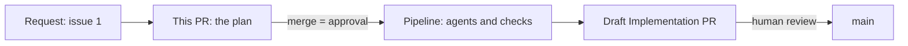

# Pull request description

Every pull request the modernization workflows write uses this body. Keep prose short and start with the content. No preamble, no closing remarks.

Adapted from the `pr` and `show-me` skills (the visual guidance comes from Dex Horthy's `show-me`) and the `unslop` writing rules.

## Body shape

```markdown
## Summary

<one or two sentences, then one to three small visuals>

## Evidence

- **Before:** <what the repository or the baseline run shows now>
  **After:** <what must be true, or is true, after this change>

## Merge Danger

**Door:** <one-way or two-way, and for what>

<one or two sentences>

**Blast Radius:** <one word>

<one or two sentences>
```

Fill every value from files you read or results you were given. Never copy an example value without checking it.

## Summary

Pick the smallest view that makes the point. Use at most three.

- Flow between pull requests or stages: a Mermaid `flowchart LR`. Quote every label. Write "issue 12", not "#12", because Mermaid reads `#` as an entity.
- What changes and the surrounding shape already exists: a `diff` block.
- Who runs in what order: an indented text tree, with `in parallel` notes.

Plan pull request, example for issue 1:

````markdown
Plan for issue 1: upgrade Asset Manager from Java 8 and Spring Boot 2.7 to Java 21 and Spring Boot 3.5. This pull request adds one Markdown file and changes no application code. Merging it approves the plan and starts the pipeline.



What the plan proposes to change later, not in this pull request:

```diff
 asset-manager/
-  java.version                  8
+  java.version                  21
-  spring-boot-starter-parent    2.7.18
+  spring-boot-starter-parent    3.5.x
-  javax.* imports (5 files)
+  jakarta.* imports             javax.imageio stays, it ships with the JDK
```

```text
pipeline (starts on merge)
  baseline tests, JDK 8         in parallel
  compat-analyst                in parallel
  dependency-analyst            in parallel
  build-upgrader
    code-fixer
  verify build and versions     in parallel
  conformance-reviewer
```
````

Implementation pull request: show the changed paths as a diff-style tree with a few words per path (at most 12 lines, taken from `git diff --stat`), then the stage results as a text tree.

## Evidence

Show a before and after with real values.

- Plan pull request. Before: the versions and test classes you read, with file paths. After: the checks the Implementation pull request must pass, taken from the plan's Validation section. The planner does not run tests, so say that.
- Implementation pull request. Before: the baseline test totals from the tracker comment. After: the final totals, plus the verdict of each check. If the final totals are worse than the baseline, say so first.

## Merge Danger

- Door. Two-way means a revert undoes it. One-way means it cannot be undone, such as spent Copilot requests or a deleted branch. A change can be both. Say which part is which.
- Blast Radius. One word, then the real consequence in a sentence. Consider what breaks for people who build or deploy from the branch.

Plan pull request: two-way for code, one-way for spend. The pipeline never writes to `main`. Reverting the merge removes the plan file but not the Copilot requests the pipeline already used. Blast radius is `Contained`.

Implementation pull request: two-way. Merging replaces the Java 8 code on `main` with Java 21 code, and a revert restores it. Anyone building `main` then needs JDK 21. Pick the blast radius word from what the diff shows.

## Writing rules

- Use plain words. "Use", not "utilize". "Because", not "due to the fact that".
- No em dashes, no en dashes. Use a period or a comma.
- No emojis, no decorative bold. Bold only the template labels.
- Sentence case headings, except the three template headings.
- Active voice. Name who acts: "the pipeline pushes to the branch".
- No filler such as "ensuring", "leveraging", "robust", "seamless". No closing summary.
- Say what the change does, with a number or a path. Cut any sentence that could appear unchanged in another project.
