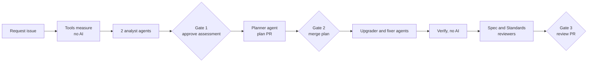

# Beat 4 - Multi-agent Java modernization with gh-aw

This folder holds everything the demo needs. All prerequisites for running it live in this repository (your fork of `java-migration-copilot-samples`). The application being modernized is [`asset-manager/`](../../asset-manager).

## What the demo does

The order follows GitHub Copilot app modernization: **assess, plan, execute, validate**. A human approves each step before the next one starts.

1. A human files a **Modernization Request** issue that starts with `/modernize`.
2. **Assess.** Standard Java tools measure the facts (tests on JDK 8, `mvn dependency:tree`, `versions-maven-plugin`, `jdeps`, `jdeprscan`, SpotBugs, an OpenRewrite dry run, OSV.dev advisories). Two read-only agents turn the facts into ranked findings with stable IDs. The pipeline posts one **Assessment Report** on the issue and **stops**.
3. **Gate 1.** A human approves the Assessment Report in the Actions run.
4. **Plan.** A planner agent writes `plan.md` into a plan pull request that already holds the approved assessment and its evidence. A deterministic check confirms every finding ID is assigned to a step. The pipeline adds a measured AI cost estimate.
5. **Gate 2.** A human merges the plan pull request.
6. **Execute and validate.** Agents upgrade `asset-manager` from Java 8 / Spring Boot 2.7 to Java 21 / Spring Boot 3.5 on a branch. Plain Actions jobs build and test on JDK 21, publish a JUnit check, and re-run SpotBugs and the advisory scan. Two reviewer agents check the result in parallel: one against the plan (Spec), one against the coding rules (Standards).
7. **Gate 3.** A human reviews the draft **Implementation Pull Request**.

**Where the code lives.** The original Java 8 code stays on `main`. Only Markdown and evidence files reach `main` (when the plan is merged). The modernized code lives on the branch `modernize/issue-<N>` and in the Implementation Pull Request. Do not merge it during the demo.

The pipeline copies the order of GitHub Copilot app modernization with our own gh-aw agents and standard Java tools. It does not run that product and is not a supported product feature.



## What is automated and what is manual

| Item | Who does it | How |
|---|---|---|
| Install gh-aw `v0.89.21` or newer, GitHub CLI, Git | You, once | See Prerequisites |
| Create the fine-grained token (PAT) | **You (manual)** | Step 2. GitHub does not allow a script to create it |
| Enable Issues and Actions, allow Actions to create pull requests | Script | `setup.ps1` |
| Store `COPILOT_GITHUB_TOKEN` as a secret | Script | `setup.ps1` asks you to paste the token; it is never printed |
| Create labels and the `assessment-review` approval environment, with you as required reviewer | Script | `setup.ps1` |
| Compile the seven agent workflows (`.lock.yml`) | Script | `setup.ps1` runs `gh aw compile` |
| Commit and push the demo files to your fork | Script | `setup.ps1`, after you confirm. Never commits `.github/modernize/` |
| Create the Modernization Request issue | Script | `new-request.ps1` |
| Tool evidence, analysis, report, plan, upgrade, tests, reviews, draft PR, cost report | **Agents and Actions** | Automatic |
| **Approve the Assessment Report** | **You (gate 1)** | Actions run > Review deployments |
| **Approve the plan (merge the plan PR)** | **You (gate 2)** | `gh pr merge` or the GitHub UI |
| **Review the Implementation Pull Request** | **You (gate 3)** | GitHub UI |

## Prerequisites

Run on your Windows machine. You do not need Visual Studio Code, a JDK, or Maven for the pipeline itself; it all runs in GitHub Actions.

```powershell
git --version
gh --version
gh auth status
gh aw version        # must be v0.89.21 or newer
```

You also need a GitHub account with an active Copilot license, and your fork of `Azure-Samples/java-migration-copilot-samples` cloned locally. If `gh aw` is missing or too old, follow "SAML fallback for gh-aw" in the demo kit `plan.md`.

## Step 1 - Open the fork

```powershell
Set-Location C:\Temp\GHDemo\JavaModernization\java-migration-copilot-samples
git branch --show-current     # main
git remote -v                 # origin = your fork, upstream = Azure-Samples
```

Every command below runs from this folder.
## Step 2 - Create the token (manual, about 2 minutes)

The agents call Copilot with a token you own.

1. Open this gh-aw link. It pre-fills the token name and the **Copilot Requests** permission, so you do not have to find it in the dropdown:

   <https://github.com/settings/personal-access-tokens/new?name=COPILOT_GITHUB_TOKEN&description=GitHub+Agentic+Workflows+-+Copilot+engine+authentication&user_copilot_requests=read>

2. **Resource owner**: your **personal user account**, not an organization. The Copilot Requests permission is not offered for organization-owned tokens. The account needs an active Copilot license.
3. **Repository access**: **Only select repositories**, then select `java-migration-copilot-samples` (your fork).
4. Open **Permissions** and select the **Account** tab (not **Repositories**). Confirm **Copilot Requests** is listed with access **Read**.

   If it is not listed: with the **Account** tab active, select **Add permissions**, search for `Copilot`, and tick **Copilot Requests**. On the **Repositories** tab the search only shows repository permissions such as "Copilot agent settings", which is the wrong one.
5. Choose a short expiration and select **Generate token**.
6. Copy it. It must start with `github_pat_`. A classic `ghp_` token does not work.

Do not give this token repository permissions. Actions uses its own token to write to the repository.

## Step 3 - Run the setup script

Preview first. This changes nothing on GitHub:

```powershell
.\demo\beat4\setup.ps1 -CheckOnly
```

Then run it for real. It asks for the token and for confirmation before it commits and pushes:

```powershell
.\demo\beat4\setup.ps1
```

The compile step takes about a minute. The script ends with a table. Every row must be `OK` or `FIXED`. A `MANUAL` row tells you exactly what to do.


## Step 4 - Pre-run the demo

The status board is one comment on the request issue, titled **Modernization status**. It has one row per stage across both workflows and links to every run. Keep the issue open in a browser tab.

### 4.1 Create the request

```powershell
.\demo\beat4\new-request.ps1
```

The issue body starts with `/modernize`. That starts [modernize-assessment.yml](../../.github/workflows/modernize-assessment.yml). Only the repository owner, members and collaborators can start it.

### 4.2 Watch the assessment

```powershell
gh run list --workflow modernize-assessment.yml --limit 3
gh run watch
```

```text
modernize-assessment
  prepare                                  status board on the issue
  assessment-facts                         tools only, no AI (about 5 minutes)
    mvnw test on JDK 8                     baseline, test by test
    mvnw dependency:tree                   resolved dependencies per module
    versions-maven-plugin                  newer versions on Maven Central
    jdeps, jdeprscan (JDK 21)              JDK internal and removed API use
    SpotBugs (JDK 21)                      static analysis baseline
    OpenRewrite dry run (JDK 21)           preview diff, nothing applied
    OSV.dev                                known advisories in the current tree
  modernize-compat-analyst                 in parallel, read-only agent
  modernize-dependency-analyst             in parallel, read-only agent
  assessment-report                        one report with finding IDs
  assessment-approval                      GATE 1, waits for you
  open-plan-pr -> modernize-planner -> plan-ready
```

Open the `assessment-facts` job: every tool is its own step with its own log. The run summary page shows the measured evidence.

### 4.3 Review and approve the Assessment Report (gate 1)

About 10 to 15 minutes after the request, the comment **Assessment report for issue N** appears on the issue and the run shows **Waiting**. Nothing in the repository has changed. Read, top to bottom:

1. **At a glance**: the gate flow, the key numbers (Java and Spring Boot now and target, classes and lines, baseline tests, javax imports, jdeps hits, advisories, OpenRewrite preview size, findings by rank, estimated AI cost), a module map and two pie charts.
2. **Decisions for the reviewer**: checkboxes, for example the target Spring Boot version, the `web` module without tests, and the test that already fails on JDK 8.
3. **Findings**: one row per finding with a stable ID (`C-..` source, `D-..` dependencies), rank (Blocker, Change, Watch, No change), a permalink to the exact line, the proposed change, the owning agent and a confidence.
4. **Dependency decisions**: artifact, current, decision, target.
5. **Evidence measured by tools (no AI)**: build facts, code inventory, the JDK 8 tests case by case, every javax import, direct dependencies, newer versions, jdeps and jdeprscan, OSV.dev advisories grouped by artifact, the SpotBugs baseline, and the OpenRewrite preview diff.
6. **After you approve**: the next steps, the estimated AI cost of the plan and execution, and the actual cost of the two analysts.

Then open the run, select **Review deployments**, tick `assessment-review` and **Approve and deploy**. **Reject** stops here with no change. The report records who approved.

### 4.4 Review and approve the plan (gate 2)

After approval the run opens a draft pull request `[modernization-plan] Plan Asset Manager Java modernization for #<N>` on branch `modernize/plan-<N>`, and `modernize-planner` writes the plan into it. `plan-ready` then checks the plan without AI, fills in the cost section, posts a **Plan validation** comment, and marks the pull request ready for review. If validation fails, the pull request stays a draft with the `needs-attention` label.

**Files changed** shows, under `docs/modernization/requests/<N>/`:

| File | What it is |
|---|---|
| `assessment.md` | The approved report, exactly as approved |
| `findings.json` | The same findings as data. The validator and the reviewers read it |
| `evidence/` | `facts.json`, `rewrite.patch`, `osv.json`, `dependency-tree-*.txt`, `jdeps-*.txt` |
| `cost-estimate.md` | Estimated AI credits of the execution stage |
| `plan.md` | The plan: Run Parameters, steps with owned finding IDs and diffs, a Finding Coverage table, Validation, Risks and Rollback, Cost Estimate, Approval Checklist |

Merging the pull request is the approval. Use **Squash and merge**, or:

```powershell
$planPr = gh pr list --repo lenvolk/java-migration-copilot-samples --search "[modernization-plan] in:title" --state open --json number --jq '.[0].number'
gh pr merge $planPr --repo lenvolk/java-migration-copilot-samples --squash --delete-branch
```

### 4.5 Watch the execution

```powershell
gh run list --workflow modernize-pipeline.yml --limit 3
gh run watch
```

```text
prepare -> modernize-build-upgrader -> modernize-code-fixer              sequential, one branch
        -> [ verify-build | verify-static ]                              parallel, no AI
        -> [ modernize-conformance-reviewer | modernize-standards-reviewer ]   parallel, read-only
        -> finalize                                                      cost report; ready only if both reviews say PASS
```

Commits name the finding IDs they address, for example `build(D-01,D-02): ...` and `fix(C-03): ...`. A change that no finding predicted is committed as `fix(unplanned): ...` with its reason.

### 4.6 Review the result (gate 3)

Open the Implementation Pull Request (`[modernization] Upgrade Asset Manager ...`). Show:

- **Verification on JDK 21** comment: before and after for Java, Spring Boot, tests (case by case), javax imports, known advisories, SpotBugs patterns (new and fixed), and the packaged jars. No AI.
- **Spec review** comment and the pull request description from `modernize-conformance-reviewer`: one row per finding ID with Met, Not met or Cannot verify and the commit that shows it.
- **Standards review** from `modernize-standards-reviewer`: inline comments on changed lines, hard violations, judgement calls. Adapted from the `code-review` skill's two-axis review.
- **AI cost of the execution stage** comment: actual credits per agent and model next to the estimate shown in the plan.
- The diff and the commit list.

```powershell
git fetch origin
git diff --stat main...origin/modernize/issue-<N>
git log --oneline main..origin/modernize/issue-<N>
```

**Do not merge it.** `main` keeps the original Java 8 code.

## Models and AI cost

Each agent workflow selects its model under `engine.model`. All use the Copilot engine and the same token.

| Workflow | Stage | Model ID | Why |
|---|---|---|---|
| `modernize-compat-analyst` | Assess | `gpt-5.4-mini` | Bounded, read-only source analysis from tool evidence |
| `modernize-dependency-analyst` | Assess | `claude-haiku-4.5` | Dependency decisions from the measured tree |
| `modernize-planner` | Plan | `claude-sonnet-4.6` | Reasoning and readable plan writing |
| `modernize-build-upgrader` | Execute | `gpt-5-mini` | Narrow, plan-guided POM edits |
| `modernize-code-fixer` | Execute | `gpt-5.3-codex` | Java edits and the compile, test, fix loop |
| `modernize-conformance-reviewer` | Review (Spec) | `gpt-5.4` | Traceability of the diff to the plan |
| `modernize-standards-reviewer` | Review (Standards) | `claude-sonnet-5.5` | Rule and smell review of the diff |

Estimate per full run (`python .github/scripts/modernize_cost.py estimate`), from token counts measured on a real run of this pipeline and the [GitHub Copilot price list](https://docs.github.com/en/copilot/reference/copilot-billing/models-and-pricing). 1 AI credit = $0.01:

| Stage | Agents | Estimated AI credits | USD |
|---|---|---|---|
| Assess | 2 analysts + threat detection | about 20 (12 to 39) | about $0.20 |
| Plan | planner + threat detection | about 50 (30 to 100) | about $0.50 |
| Execute | 4 agents + threat detection | about 86 (52 to 194) | about $0.86 |
| **Total** | 7 agents | **about 156 (95 to 332)** | **about $1.56** |

The report, the plan and the Implementation pull request show the same estimate and the **actual** credits that gh-aw recorded for each agent. Every gh-aw agent comment also ends with its own credit count. Tools and checks use GitHub Actions minutes and no AI credits. These are demo choices, not benchmarks; model access depends on the token owner and policy. Rehearse a full run before presenting. After changing a model, run `gh aw compile`; the estimate follows the model automatically.

## Timeline (estimates; record your own during the pre-run)

| Stage | Typical time |
|---|---|
| Tool evidence (`assessment-facts`) | 4 to 7 minutes |
| Analysts and report | 5 to 10 minutes |
| Gate 1 | as long as you take |
| Planner and plan validation | 5 to 10 minutes |
| Gate 2 | as long as you take |
| `modernize-build-upgrader`, `modernize-code-fixer` | 15 to 40 minutes |
| Verification and reviews | 10 to 20 minutes |

## Recovery

Each stage is its own job or workflow, so a failure stops that run at that stage and keeps earlier work.

1. Open the failed run in **Actions** and read the failed job.
2. Select **Re-run failed jobs**. Only the failed stage and the stages after it run again.
3. To restart the assessment for an existing request: delete the branch `modernize/plan-<N>` if it exists, then comment `/modernize` on the issue, or run `gh workflow run modernize-assessment.yml -f issue_number=<N>`.
4. To run one agent alone, dispatch it directly. Example for `modernize-code-fixer`:

   ```powershell
   gh workflow run modernize-code-fixer.lock.yml `
     -f issue_number=<N> -f pr_number=<PR> `
     -f branch=modernize/issue-<N> `
     -f plan_path=docs/modernization/requests/<N>/plan.md
   ```

5. If the execution did not start after the plan merge, dispatch it with the plan path:

   ```powershell
   gh workflow run modernize-pipeline.yml -f plan_path=docs/modernization/requests/<N>/plan.md
   ```

## Reset

Closes all open issues and PRs, deletes every branch except `main`, and deletes all workflow runs. Merged plans and assessments on `main` stay; each lives in its own `docs/modernization/requests/<N>/` folder.

```powershell
cd C:\Temp\GHDemo\JavaModernization\java-migration-copilot-samples
.\demo\beat4\reset.ps1          # preview, changes nothing
.\demo\beat4\reset.ps1 -Full    # reset; type the repo name to confirm
```

Keep your pre-run until after the customer meeting.

## Troubleshooting

| Symptom | Fix |
|---|---|
| `setup.ps1` reports `Issues - MANUAL` or `Actions - MANUAL` | Enable them in the fork's Settings, then re-run. Forks start with both off |
| `gh` asks "Select a repo" (Multiple remotes detected) | Choose `lenvolk/java-migration-copilot-samples` (your fork), never `Azure-Samples/...`. `gh secret` always needs `--repo` |
| `/modernize` does nothing | The issue body or comment must start with `/modernize`, and you must be the owner, a member or a collaborator. Confirm Actions is enabled |
| Run fails on the Copilot token | Use a fine-grained `github_pat_` token owned by your user account with **Account permissions: Copilot Requests: Read**. Re-run `gh secret set COPILOT_GITHUB_TOKEN --repo lenvolk/java-migration-copilot-samples` |
| `prepare` fails with `Branch modernize/plan-<N> already exists` | Close the old plan pull request and delete the branch, or run `reset.ps1 -Full` |
| The OpenRewrite step is yellow | The dry run is `continue-on-error`. The report then says the preview is unavailable; everything else continues |
| The OSV.dev step is yellow | OSV.dev was unreachable. The report says "n/a" for advisories |
| The run shows **Waiting** at `assessment-approval` | Expected. It is gate 1. Open the run, select **Review deployments** and approve |
| No **Review deployments** button | You are not a required reviewer of `assessment-review`, or the environment is missing. Run `.\demo\beat4\setup.ps1`. Environments with reviewers need a public repository or a paid plan |
| `assessment-report` fails with `No comment from modernize-...-analyst` | An analyst did not post its comment. Re-run the failed jobs |
| Report warns "posted no structured findings block" | The analyst's JSON block was missing or invalid. Its comment is shown as text; re-run the analyst for structured findings |
| Plan pull request stays a draft with `needs-attention` | Read the **Plan validation** comment: a finding ID is missing, invented, or a section is missing. Re-run `modernize-planner` from the run, then `plan-ready` |
| Execution did not start after the merge | The plan PR title must start with `[modernization-plan]` and contain `docs/modernization/requests/<N>/plan.md`. Otherwise dispatch it (see Recovery) |
| `Branch modernize/issue-<N> already exists` | Run `reset.ps1 -Full`, then create a new request |
| `verify-build` fails on tests | Read the **Verification on JDK 21** comment, case by case. Re-run `modernize-code-fixer` |
| Agent cannot download Maven dependencies | The workflow allows the `java` network ecosystem. Check the agent log for a blocked domain and add it under `network.allowed` in that agent's workflow `.md`, then recompile |
| An agent's comment shows another agent's content, or `safe_outputs` fails with `No handler loaded for type` | Artifact name collision. Each worker needs a unique `stage` input (already set). If you add a worker, give it its own default |
| `gh extension upgrade aw` fails with SAML | Ignore it if `gh aw version` is v0.89.21 or newer |

## Files in this repository

| Path | Purpose |
|---|---|
| `demo/beat4/setup.ps1` | One-time setup and checks. Also pins the `gh` default repository to your fork |
| `demo/beat4/new-request.ps1` | Creates the Modernization Request issue |
| `demo/beat4/reset.ps1` | Previews or fully resets the fork (keeps `main`) |
| `demo/beat4/modernization-request.md` | Issue body used by `new-request.ps1` |
| `.github/workflows/modernize-assessment.yml` | Assess and plan: tool evidence, analysts, report, gate 1, plan pull request, plan validation |
| `.github/workflows/modernize-pipeline.yml` | Execute and validate: upgrade, verification, two-axis review, cost report |
| `.github/workflows/modernize-*.md` | Seven agent workflows, each named like its agent |
| `.github/agents/modernize-*.agent.md` | Six agent role definitions (the planner's role is in its workflow) |
| `.github/skills/java-modernization/` | Plan format, checked by the plan validator |
| `.github/skills/java-upgrade-rules/` | Shared rules for the upgrade agents |
| `.github/skills/modernization-review/` | Two-axis Spec and Standards review, adapted from the `code-review` skill |
| `.github/skills/pr-description/` | Pull request and comment style, with Mermaid visuals |
| `.github/scripts/modernize_facts.py` | Tool evidence: summarize, OSV.dev, before and after verification |
| `.github/scripts/modernize_assessment.py` | Assessment report, approval record, plan validation |
| `.github/scripts/modernize_cost.py` | AI credit estimate and actuals |
| `.github/scripts/modernize_tracker.py` | Status board on the request issue |
| `*.lock.yml` | Generated by `gh aw compile`. Never edit by hand |