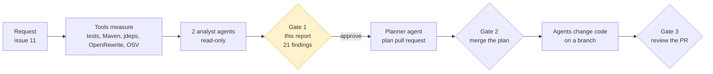
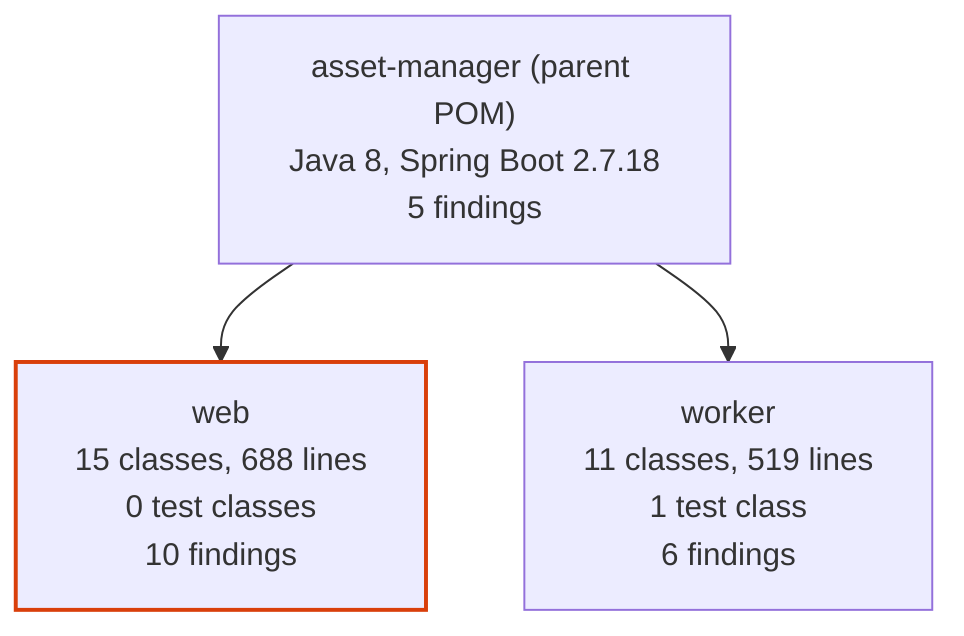
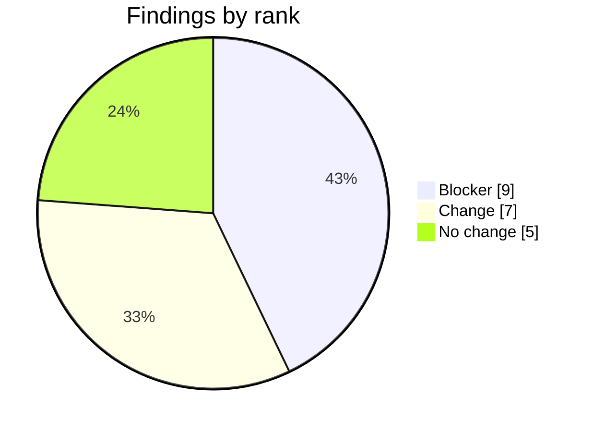
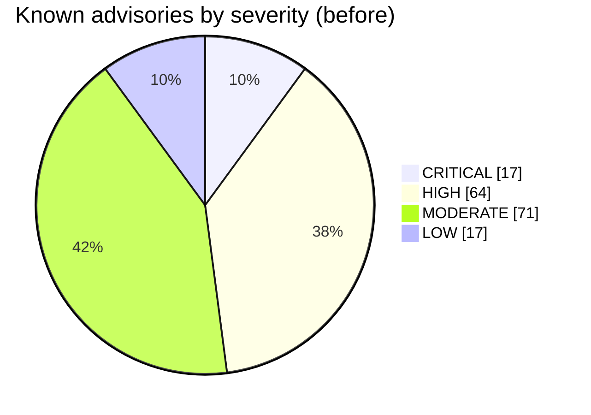

# Assessment report for issue 11

Status: approved by @lenvolk on 2026-10-19T22:38:20Z (gate 1). Assessed commit `28f26dbd476c`. The approval is recorded in the [assessment run](https://github.com/lenvolk/java-migration-copilot-samples/actions/runs/39320515024). This file is the approved record; do not edit it.

No file in the repository changed before this approval. The plan in this folder was written from this report.

## At a glance



| Measure | Now | Target or result | Source |
|---|---|---|---|
| Java | 8 | 21 | `asset-manager/pom.xml` |
| Spring Boot | 2.7.18 | 3.5.16 (latest 3.5.x) | Maven Central |
| Maven Wrapper | 3.9.9 | 3.9.16 or keep | `asset-manager/.mvn/wrapper/maven-wrapper.properties` |
| Code | 26 classes, 1207 lines | | source scan |
| Tests on JDK 8 | 4 run, 0 failed, 1 error | no worse after upgrade | `mvnw test` |
| `javax` imports to migrate | 9 in 5 files | 0 | source scan |
| JDK internal API use | 7 dependencies | resolved by newer versions | `jdeps` |
| Known vulnerabilities | 169 advisories | re-scanned after upgrade | OSV.dev |
| Static analysis | 9 bug patterns | no new ones after upgrade | SpotBugs |
| Preview of the change | 7 files | reference only | OpenRewrite dry run |
| Findings | 9 blocker, 7 change, 5 no change | each one owned by a plan step | analyst agents |
| Estimated AI cost of plan and execution | 135.7 credits | $1.36 | measured profile |







## Decisions for the reviewer

Check these before you approve. Each one becomes a constraint in the plan.

- [ ] Should the web module declare jakarta.servlet-api directly? Recommended: Do not add it unless the final dependency tree demonstrates a real need.. spring-boot-starter-web already brings the Servlet API for normal Spring MVC compilation. (modernize-compat-analyst)
- [ ] How should the existing ResponseInputStream test error be handled? Recommended: First validate it with the Boot 3.5 Mockito 5 test stack, then change the test only if it remains failing.. The JDK 8 baseline already has one error and the target test stack may enable inline final-class mocking. (modernize-compat-analyst)
- [ ] Should transitive logging versions be allowed to follow the Boot 3.5 BOM? Recommended: Yes; verify that logback-classic is upgraded from 1.2.12 before running on JDK 21.. The measured dependency scan found removed sun.reflect.Reflection usage in the current logging artifact. (modernize-compat-analyst)
- [ ] PostgreSQL 42.3.8 has a critical SQL injection vulnerability (CVE-2024-1597). Should we upgrade to 42.7.14 (latest)? Recommended: Upgrade PostgreSQL to 42.7.14 for critical security fix and latest stable version.. CVE-2024-1597 (CRITICAL) allows SQL injection via line comment generation; 42.7.14 is on Maven Central and compatible with Spring Boot 3.5.16. (modernize-dependency-analyst)
- [ ] AWS SDK S3 v2.25.13 can be updated to v2.56.0. Should we upgrade to the latest v2 series? Recommended: Upgrade to 2.56.0 to align with latest v2 series before Spring Boot 3.5 BOM adoption.. AWS SDK v2.56.0 is available and provides many stability and performance improvements; Spring Boot 3.5.16 BOM likely manages a recent v2 version. (modernize-dependency-analyst)
- [ ] Logback 1.2.12 uses sun.reflect.Reflection, removed in JDK 21, and has HIGH severity CVE-2023-6378. How should we handle this? Recommended: Spring Boot 3.5.16 BOM manages Logback 1.4.x+ which removes this internal API use; upgrade happens via parent version change.. Logback 1.2.x reaches end of life; Spring Boot 3.5.16 migrated to 1.4.x+ which uses Java 9+ compatible reflection APIs. (modernize-dependency-analyst)
- [ ] The `web` module has no tests, so the pipeline cannot prove its behavior is unchanged. Accept this, or ask for tests in a separate request.
- [ ] `S3FileProcessingServiceTest.downloadOriginalCopiesFileFromS3` already fails on JDK 8 (org.mockito.exceptions.base.MockitoException: Cannot mock/spy class software.amazon.awssdk.core.ResponseInputStream). The code fixer must fix it if the upgrade allows, or explain why not.
- [ ] Target Spring Boot 3.5.16. Newer major versions (4.x) are out of the approved scope.

## Findings

Each finding has a stable ID. The plan assigns every ID to a step, commits reference the IDs they address, and the review checks each one.

| ID | Rank | Module | Where | Finding | Proposed change | Owner | Confidence |
|---|---|---|---|---|---|---|---|
| C-01 | Blocker | web | [WebMvcConfig.java:8](https://github.com/lenvolk/java-migration-copilot-samples/blob/28f26dbd476cb2f049caeb7a25e67638f8e3c30d/asset-manager/web/src/main/java/com/microsoft/migration/assets/config/WebMvcConfig.java#L8) | WebMvcConfigurerAdapter and HandlerInterceptorAdapter are removed in Spring Framework 6, and lines 11-12 import javax.servlet.http.HttpServletRequest and HttpServletResponse. | Implement WebMvcConfigurer and HandlerInterceptor and use jakarta.servlet.http.HttpServletRequest and jakarta.servlet.http.HttpServletResponse. | `modernize-code-fixer` | High |
| C-02 | Blocker | web | [ImageMetadata.java:3](https://github.com/lenvolk/java-migration-copilot-samples/blob/28f26dbd476cb2f049caeb7a25e67638f8e3c30d/asset-manager/web/src/main/java/com/microsoft/migration/assets/model/ImageMetadata.java#L3) | The entity imports javax.persistence.* while the target Spring Boot 3.5 stack uses Jakarta Persistence. | Replace the wildcard import with jakarta.persistence.*. | `modernize-code-fixer` | High |
| C-03 | Blocker | web | [LocalFileStorageService.java:14](https://github.com/lenvolk/java-migration-copilot-samples/blob/28f26dbd476cb2f049caeb7a25e67638f8e3c30d/asset-manager/web/src/main/java/com/microsoft/migration/assets/service/LocalFileStorageService.java#L14) | PostConstruct is imported from javax.annotation. | Use jakarta.annotation.PostConstruct. | `modernize-code-fixer` | High |
| C-04 | Blocker | worker | [ImageMetadata.java:3](https://github.com/lenvolk/java-migration-copilot-samples/blob/28f26dbd476cb2f049caeb7a25e67638f8e3c30d/asset-manager/worker/src/main/java/com/microsoft/migration/assets/worker/model/ImageMetadata.java#L3) | Entity, Id, PrePersist, and PreUpdate all come from javax.persistence. | Replace all four imports with their jakarta.persistence equivalents. | `modernize-code-fixer` | High |
| C-05 | Blocker | worker | [LocalFileProcessingService.java:6](https://github.com/lenvolk/java-migration-copilot-samples/blob/28f26dbd476cb2f049caeb7a25e67638f8e3c30d/asset-manager/worker/src/main/java/com/microsoft/migration/assets/worker/service/LocalFileProcessingService.java#L6) | PostConstruct is imported from javax.annotation. | Use jakarta.annotation.PostConstruct. | `modernize-code-fixer` | High |
| C-06 | Blocker | parent | [pom.xml:8](https://github.com/lenvolk/java-migration-copilot-samples/blob/28f26dbd476cb2f049caeb7a25e67638f8e3c30d/asset-manager/pom.xml#L8) | The parent selects Spring Boot 2.7.18 and Java 8; the current resolved logback-classic 1.2.12 also references removed sun.reflect.Reflection on JDK 21. | Move the parent to Spring Boot 3.5.x with java.version 21 and verify the BOM upgrades logging and other JDK-sensitive transitive artifacts. | `modernize-build-upgrader` | High |
| D-01 | Blocker | parent | [pom.xml:8](https://github.com/lenvolk/java-migration-copilot-samples/blob/28f26dbd476cb2f049caeb7a25e67638f8e3c30d/asset-manager/pom.xml#L8) | Parent POM version and Spring Boot BOM for both modules. | Update parent version to 3.5.16 and Java version to 21. | `modernize-build-upgrader` | High |
| D-02 | Blocker | parent | [pom.xml:19](https://github.com/lenvolk/java-migration-copilot-samples/blob/28f26dbd476cb2f049caeb7a25e67638f8e3c30d/asset-manager/pom.xml#L19) | Target Java version for compilation and runtime. | Update <java.version> to 21. | `modernize-build-upgrader` | High |
| D-04 | Blocker | web | [pom.xml:40](https://github.com/lenvolk/java-migration-copilot-samples/blob/28f26dbd476cb2f049caeb7a25e67638f8e3c30d/asset-manager/web/pom.xml#L40) | PostgreSQL driver has critical CVE-2024-1597 (SQL injection via line comment) and CVE-2026-42198 (PBKDF2 DoS); 42.7.14 is latest and compatible. | Upgrade postgresql runtime dependency to 42.7.14 in both modules. | `modernize-build-upgrader` | High |
| C-07 | Change | parent | [pom.xml:19](https://github.com/lenvolk/java-migration-copilot-samples/blob/28f26dbd476cb2f049caeb7a25e67638f8e3c30d/asset-manager/pom.xml#L19) | The requested target requires Java 21 compilation rather than the current Java 8 release. | Set java.version to 21 and validate both module compile and package goals with the Maven Wrapper. | `modernize-build-upgrader` | High |
| C-08 | Change | web | [pom.xml:19](https://github.com/lenvolk/java-migration-copilot-samples/blob/28f26dbd476cb2f049caeb7a25e67638f8e3c30d/asset-manager/web/pom.xml#L19) | The preview adds a direct jakarta.servlet-api dependency even though spring-boot-starter-web supplies the Servlet API transitively. | Omit the extra dependency unless the final compile dependency graph proves it is required. | `modernize-build-upgrader` | High |
| C-09 | Change | worker | [S3FileProcessingServiceTest.java:43](https://github.com/lenvolk/java-migration-copilot-samples/blob/28f26dbd476cb2f049caeb7a25e67638f8e3c30d/asset-manager/worker/src/test/java/com/microsoft/migration/assets/worker/service/S3FileProcessingServiceTest.java#L43) | The JDK 8 baseline has one error because Mockito cannot mock final ResponseInputStream; Boot 3.5's Mockito 5 inline mock maker may make this pass, but it must be verified. | Run the test on the upgraded stack and retain the test if inline mocking fixes it; otherwise replace the final-class mock with a testable response stream. | `modernize-code-fixer` | High |
| D-03 | Change | web | [pom.xml:11](https://github.com/lenvolk/java-migration-copilot-samples/blob/28f26dbd476cb2f049caeb7a25e67638f8e3c30d/asset-manager/web/pom.xml#L11) | AWS SDK S3 client in web module has property override; many bug fixes and performance improvements available. | Update aws-sdk.version property to 2.56.0 in both web and worker pom.xml files. | `modernize-build-upgrader` | High |
| D-05 | Change | web | [pom.xml:25](https://github.com/lenvolk/java-migration-copilot-samples/blob/28f26dbd476cb2f049caeb7a25e67638f8e3c30d/asset-manager/web/pom.xml#L25) | Lombok has many fixes and improvements; 1.18.48 is latest stable in v1.18 series before v1.19 preview. | Upgrade lombok to 1.18.48 (handles internal Java compiler APIs gracefully on JDK 21 with warnings suppressed). | `modernize-build-upgrader` | High |
| D-07 | Change | worker | [pom.xml:22](https://github.com/lenvolk/java-migration-copilot-samples/blob/28f26dbd476cb2f049caeb7a25e67638f8e3c30d/asset-manager/worker/pom.xml#L22) | Jackson databind is not managed by Spring Boot 2.7 BOM; upgrade to latest stable which is compatible with JDK 21. | Upgrade jackson-databind to 2.17.1 (latest Java 8+ compatible version, well-tested with Spring Boot 3.5). | `modernize-build-upgrader` | Medium |
| D-08 | Change | parent | [maven-wrapper.properties:15](https://github.com/lenvolk/java-migration-copilot-samples/blob/28f26dbd476cb2f049caeb7a25e67638f8e3c30d/asset-manager/.mvn/wrapper/maven-wrapper.properties#L15) | Maven Wrapper is at 3.9.9; latest 3.9.16 available with improved JDK 21 compatibility and bug fixes. | Update Maven Wrapper distributionUrl to apache-maven-3.9.16-bin.zip. | `modernize-build-upgrader` | High |
| C-10 | No change | worker | [AbstractFileProcessingService.java:11](https://github.com/lenvolk/java-migration-copilot-samples/blob/28f26dbd476cb2f049caeb7a25e67638f8e3c30d/asset-manager/worker/src/main/java/com/microsoft/migration/assets/worker/service/AbstractFileProcessingService.java#L11) | javax.imageio.ImageIO is a JDK package and is not part of the Jakarta EE namespace migration. | Keep javax.imageio unchanged. | `modernize-code-fixer` | High |
| C-11 | No change | web | [application.properties:10](https://github.com/lenvolk/java-migration-copilot-samples/blob/28f26dbd476cb2f049caeb7a25e67638f8e3c30d/asset-manager/web/src/main/resources/application.properties#L10) | The measured keys are supported Boot 3 keys: multipart, RabbitMQ, datasource, and JPA settings require no namespace rename; no spring.mvc trailing-slash setting is present. | Keep the existing keys and validate application startup and upload limits after the BOM upgrade. | `modernize-code-fixer` | High |
| C-12 | No change | worker | [ImageMetadata.java:12](https://github.com/lenvolk/java-migration-copilot-samples/blob/28f26dbd476cb2f049caeb7a25e67638f8e3c30d/asset-manager/worker/src/main/java/com/microsoft/migration/assets/worker/model/ImageMetadata.java#L12) | The entity uses String @Id and lifecycle callbacks but no @GeneratedValue or @Lob; no Hibernate 6 ID-generation or LOB rewrite is indicated by this mapping. | Keep the mapping and verify schema/update behavior in integration validation. | `modernize-code-fixer` | High |
| C-13 | No change | web | [list.html:6](https://github.com/lenvolk/java-migration-copilot-samples/blob/28f26dbd476cb2f049caeb7a25e67638f8e3c30d/asset-manager/web/src/main/resources/templates/list.html#L6) | Templates use #lists, #numbers, and #temporals and do not use removed #request or #session utility objects. | Keep the expressions and include a rendering smoke test because the web module has no baseline tests. | `modernize-code-fixer` | High |
| D-06 | No change | web | [pom.xml:33](https://github.com/lenvolk/java-migration-copilot-samples/blob/28f26dbd476cb2f049caeb7a25e67638f8e3c30d/asset-manager/web/pom.xml#L33) | Spring Boot starter test and all other starters managed by parent BOM upgrade. | Remove any explicit version; BOM-managed via parent 3.5.16. | `modernize-build-upgrader` | High |

### Dependency decisions

| ID | Artifact | Current | Decision | Target | Why |
|---|---|---|---|---|---|
| D-01 | `org.springframework.boot:spring-boot-starter-parent` | 2.7.18 | Explicit upgrade | 3.5.16 | Parent POM version and Spring Boot BOM for both modules. |
| D-02 | `java.version` | 8 | Explicit upgrade | 21 | Target Java version for compilation and runtime. |
| D-03 | `software.amazon.awssdk:s3` | 2.25.13 | Explicit upgrade | 2.56.0 | AWS SDK S3 client in web module has property override; many bug fixes and performance improvements available. |
| D-04 | `org.postgresql:postgresql` | 42.3.8 | Explicit upgrade | 42.7.14 | PostgreSQL driver has critical CVE-2024-1597 (SQL injection via line comment) and CVE-2026-42198 (PBKDF2 DoS); 42.7.14 is latest and compatible. |
| D-05 | `org.projectlombok:lombok` | 1.18.30 | Explicit upgrade | 1.18.48 | Lombok has many fixes and improvements; 1.18.48 is latest stable in v1.18 series before v1.19 preview. |
| D-06 | `org.springframework.boot:spring-boot-starter-test` | 2.7.18 | BOM-managed | 3.5.16 | Spring Boot starter test and all other starters managed by parent BOM upgrade. |
| D-07 | `com.fasterxml.jackson.core:jackson-databind` | 2.13.5 | Explicit upgrade | 2.17.1 | Jackson databind is not managed by Spring Boot 2.7 BOM; upgrade to latest stable which is compatible with JDK 21. |
| D-08 | `Maven Wrapper` | 3.9.9 | Explicit upgrade | 3.9.16 | Maven Wrapper is at 3.9.9; latest 3.9.16 available with improved JDK 21 compatibility and bug fixes. |

## Analyst summaries

<details>
<summary>Source compatibility, from <code>modernize-compat-analyst</code></summary>

Assessment found 6 Blocker, 3 Change, 0 Watch, and 4 No change findings across 12 files.

| file | finding | rank | proposed change |
|---|---|---|---|
| asset-manager/web/src/main/java/com/microsoft/migration/assets/config/WebMvcConfig.java:8-12,17,49 | Uses removed MVC adapter classes and javax Servlet types. | Blocker | Implement WebMvcConfigurer and HandlerInterceptor with jakarta.servlet imports. |
| asset-manager/web/src/main/java/com/microsoft/migration/assets/model/ImageMetadata.java:3 | Entity still imports javax.persistence. | Blocker | Replace with jakarta.persistence. |
| asset-manager/worker/src/main/java/com/microsoft/migration/assets/worker/model/ImageMetadata.java:3-6 | Entity still imports javax.persistence. | Blocker | Replace the four imports with jakarta.persistence. |
| asset-manager/web/src/main/java/com/microsoft/migration/assets/service/LocalFileStorageService.java:14 | PostConstruct remains in javax.annotation. | Blocker | Use jakarta.annotation.PostConstruct. |
| asset-manager/worker/src/main/java/com/microsoft/migration/assets/worker/service/LocalFileProcessingService.java:6 | PostConstruct remains in javax.annotation. | Blocker | Use jakarta.annotation.PostConstruct. |
| asset-manager/pom.xml:8,19 | Boot 2.7 and Java 8 baseline cannot provide the target platform. | Change | Set the approved Boot 3.5.x parent and Java 21 release. |
| asset-manager/worker/src/test/java/com/microsoft/migration/assets/worker/service/S3FileProcessingServiceTest.java:43 | Baseline error mocks final ResponseInputStream; the target Boot test stack's Mockito 5 inline mock maker should change this result. | Change | Re-run the test on the upgraded stack and retain the mock or use a real response stream if it still fails. |
| asset-manager/web/pom.xml:19-22 | OpenRewrite adds a direct servlet API that spring-boot-starter-web already supplies. | Change | Avoid the redundant direct dependency unless dependency resolution proves it is needed. |
| asset-manager/worker/src/main/java/com/microsoft/migration/assets/worker/service/AbstractFileProcessingService.java:11 | javax.imageio is a JDK package, not an EE namespace migration. | No change | Keep javax.imageio unchanged. |
| asset-manager/web/src/main/resources/templates/list.html:6,18 and view.html:38-44 | Thymeleaf uses supported #lists, #numbers, and #temporals utilities; no removed #request or #session object is present. | No change | Keep the templates and verify rendering after the upgrade. |

Where I differ from the OpenRewrite preview:
- The namespace and Spring MVC edits in the preview are directionally correct, but the explicit jakarta.servlet-api dependency in web/pom.xml is redundant with spring-boot-starter-web and should not be accepted without a resolution reason.
- The preview does not cover the existing Mockito baseline error at S3FileProcessingServiceTest.java:43 or the JDK 21 risk from the resolved logback-classic 1.2.12 dependency using removed sun.reflect.Reflection; the Boot 3.5 BOM must bring a JDK-21-compatible logging stack.
- The preview does not identify the non-preview compatibility checks below; source inspection found no required Hibernate, Spring property-key, AMQP, validation, trailing-slash, or Thymeleaf expression rewrite.

[Original comment](https://github.com/lenvolk/java-migration-copilot-samples/issues/11#issuecomment-6276902816)

</details>

<details>
<summary>Dependencies and build tooling, from <code>modernize-dependency-analyst</code></summary>

## Dependency & Build-Tooling Analysis

Upgrade to Spring Boot 3.5.16 and Java 21; 8 dependency decisions with security, internal API, and version management changes.

### Key Decisions

| Artifact | Current | Decision | Target | Reason |
|----------|---------|----------|--------|--------|
| org.springframework.boot:spring-boot-starter-parent | 2.7.18 | Explicit upgrade | 3.5.16 | Spring Boot parent POM and BOM for both modules |
| java.version | 8 | Explicit upgrade | 21 | Target Java version for compilation and runtime |
| software.amazon.awssdk:s3 | 2.25.13 | Explicit upgrade | 2.56.0 | AWS SDK v2 latest stable with bug fixes |
| org.postgresql:postgresql | 42.3.8 | Explicit upgrade | 42.7.14 | **Critical CVE-2024-1597 (SQL injection) + HIGH CVE-2026-42198** |
| org.projectlombok:lombok | 1.18.30 | Explicit upgrade | 1.18.48 | Fixes + JDK 21 internal API compatibility |
| com.fasterxml.jackson.core:jackson-databind | 2.13.5 | Explicit upgrade | 2.17.1 | Latest stable for JDK 21 + Spring Boot 3.5 compatibility |
| Spring Boot starters (test, web, amqp, jpa, etc.) | 2.7.18 | BOM-managed | 3.5.16 | Managed by parent BOM upgrade, no explicit change needed |
| Maven Wrapper | 3.9.9 | Explicit upgrade | 3.9.16 | Latest 3.9.x with improved JDK 21 support |

### Vulnerability Status

**Before upgrade:** 17 CRITICAL, 64 HIGH, 71 MODERATE, 17 LOW vulnerabilities.

**Highest impact fixes by Spring Boot 3.5.16 BOM:**
- **Logback 1.2.12 → 1.4.x+**: Removes use of `sun.reflect.Reflection` (removed in JDK 21), fixes CVE-2023-6378 (HIGH), CVE-2025-11226 (MODERATE), CVE-2024-12801 (LOW)
- **Thymeleaf 3.0.15 → 3.1.x+**: Fixes CVE-2026-41901 (CRITICAL) + CVE-2026-47884 (CRITICAL) - sandboxed expression vulnerabilities
- **Jackson 2.13.5 → Spring Boot managed 2.15+**: Removes several deprecations and improves security
- **SnakeYAML 1.30 → 1.32+**: Fixes CVE-2022-25857, CVE-2022-1471 (RCE deserialization) and multiple DoS issues
- Spring Framework 5.3.31 → 6.1.x+: Multiple path traversal and XSS fixes
- Spring Data Commons 2.7.18 → 3.5.x+: Fixes 3 HIGH/MODERATE DoS vulnerabilities
- Spring retry 1.3.4 → 2.0.13+: Cache exhaustion DoS fix

**Not fixed by Spring Boot 3.5.16 BOM (requires explicit action):**
- CVE-2024-1597 (CRITICAL PostgreSQL SQL injection) – manually upgrade to 42.7.14
- CVE-2026-42198 (HIGH PostgreSQL PBKDF2 DoS) – manually upgrade to 42.7.14
- AssertJ XXE via `isXmlEqualTo()` (HIGH, test scope) – Spring Boot BOM doesn't manage AssertJ, evaluate if test-only impact is acceptable

### JDK 21 Internal API Changes

The following artifacts use internal JDK APIs that require monitoring with JDK 21:

| Artifact | Internal API | Status | Upgrade Path |
|----------|--------------|--------|--------------|
| logback-classic-1.2.12 | `sun.reflect.Reflection` | **Removed in JDK 21** | Spring Boot 3.5.16 BOM → logback 1.4.x+ (no internal API use) |
| aspectjweaver-1.9.7 | `sun.misc.Unsafe` | jdk.unsupported module | Spring AOP handles this; Unsafe access suppressed at runtime |
| lombok-1.18.30 | `sun.misc.Unsafe`, `com.sun.tools.javac.*` | jdk.unsupported + jdk.compiler modules | Upgrade to 1.18.48; internal API use suppressed with `--add-opens` or warnings |
| netty-common-4.1.101 | `sun.misc.Unsafe` | jdk.unsupported module | Spring Boot 3.5.16 BOM → netty 4.1.x with JDK 21 compatibility |
| netty-handler-4.1.101 | `sun.security.x509.*` APIs | java.base internal | Spring Boot 3.5.16 manages netty with OpenJDK 9+ compatible paths |
| objenesis-3.2 | `sun.misc.Unsafe` | jdk.unsupported module | No upgrade needed; widely used in test mocking, warnings are informational |
| spring-core-5.3.31 | `sun.misc.Unsafe` | jdk.unsupported module | Spring Boot 3.5.16 BOM → spring 6.1.x (Unsafe use removed/suppressed) |

**Summary:** Logback is the only artifact using a **removed** API; Spring Boot 3.5.16 BOM fix is sufficient. Other artifacts using internal APIs from `jdk.unsupported` module remain functional with `--add-opens` at runtime or via module configuration if needed.

### Implementation Plan

[Original comment](https://github.com/lenvolk/java-migration-copilot-samples/issues/11#issuecomment-6276919756)

</details>


## Evidence measured by tools (no AI)

Measured on commit `28f26dbd476c` at 2026-10-19T20:39:19Z. No AI produced any number in this section.

### Build

| Item | Value | Source |
|---|---|---|
| Java release | 8 | [pom.xml:19](https://github.com/lenvolk/java-migration-copilot-samples/blob/28f26dbd476cb2f049caeb7a25e67638f8e3c30d/asset-manager/pom.xml#L19) |
| Spring Boot parent | 2.7.18 | [pom.xml:8](https://github.com/lenvolk/java-migration-copilot-samples/blob/28f26dbd476cb2f049caeb7a25e67638f8e3c30d/asset-manager/pom.xml#L8) |
| Maven Wrapper | 3.9.9 | `asset-manager/.mvn/wrapper/maven-wrapper.properties` |
| Modules | web, worker | `asset-manager/pom.xml` |
| Latest Spring Boot 3.5.x on Maven Central | 3.5.16 | maven-metadata.xml |
| Latest Maven 3.9.x on Maven Central | 3.9.16 | maven-metadata.xml |

### Code inventory

| Module | Main classes | Main LOC | Test classes | Test LOC | Controllers | Services | Repositories | Entities | Listeners | Templates |
|---|---:|---:|---:|---:|---:|---:|---:|---:|---:|---:|
| web | 15 | 688 | 0 | 0 | 2 | 2 | 1 | 1 | 1 | 4 |
| worker | 11 | 519 | 1 | 80 | 0 | 2 | 1 | 1 | 1 | 0 |

### Baseline tests on JDK 8

`./mvnw test` on `main`: 4 tests, 0 failures, 1 error, 0 skipped. The upgrade must be no worse than this.

| Module | Test | Result | Message |
|---|---|---|---|
| worker | `S3FileProcessingServiceTest.testExtractOriginalKey` | passed |  |
| worker | `S3FileProcessingServiceTest.uploadThumbnailPutsFileToS3` | passed |  |
| worker | `S3FileProcessingServiceTest.downloadOriginalCopiesFileFromS3` | error | org.mockito.exceptions.base.MockitoException: Cannot mock/spy class software.amazon.awssdk.core.ResponseInputStream |
| worker | `S3FileProcessingServiceTest.getStorageTypeReturnsS3` | passed |  |

Modules with no tests: web. Their behavior is not covered by the baseline.

### javax imports

9 imports in 5 files move to `jakarta.*`. 1 import stays because the package ships with the JDK.

| File | Line | Import | Action |
|---|---:|---|---|
| [WebMvcConfig.java:11](https://github.com/lenvolk/java-migration-copilot-samples/blob/28f26dbd476cb2f049caeb7a25e67638f8e3c30d/asset-manager/web/src/main/java/com/microsoft/migration/assets/config/WebMvcConfig.java#L11) | 11 | `javax.servlet.http.HttpServletRequest` | move to jakarta |
| [WebMvcConfig.java:12](https://github.com/lenvolk/java-migration-copilot-samples/blob/28f26dbd476cb2f049caeb7a25e67638f8e3c30d/asset-manager/web/src/main/java/com/microsoft/migration/assets/config/WebMvcConfig.java#L12) | 12 | `javax.servlet.http.HttpServletResponse` | move to jakarta |
| [ImageMetadata.java:3](https://github.com/lenvolk/java-migration-copilot-samples/blob/28f26dbd476cb2f049caeb7a25e67638f8e3c30d/asset-manager/web/src/main/java/com/microsoft/migration/assets/model/ImageMetadata.java#L3) | 3 | `javax.persistence.*` | move to jakarta |
| [LocalFileStorageService.java:14](https://github.com/lenvolk/java-migration-copilot-samples/blob/28f26dbd476cb2f049caeb7a25e67638f8e3c30d/asset-manager/web/src/main/java/com/microsoft/migration/assets/service/LocalFileStorageService.java#L14) | 14 | `javax.annotation.PostConstruct` | move to jakarta |
| [ImageMetadata.java:3](https://github.com/lenvolk/java-migration-copilot-samples/blob/28f26dbd476cb2f049caeb7a25e67638f8e3c30d/asset-manager/worker/src/main/java/com/microsoft/migration/assets/worker/model/ImageMetadata.java#L3) | 3 | `javax.persistence.Entity` | move to jakarta |
| [ImageMetadata.java:4](https://github.com/lenvolk/java-migration-copilot-samples/blob/28f26dbd476cb2f049caeb7a25e67638f8e3c30d/asset-manager/worker/src/main/java/com/microsoft/migration/assets/worker/model/ImageMetadata.java#L4) | 4 | `javax.persistence.Id` | move to jakarta |
| [ImageMetadata.java:5](https://github.com/lenvolk/java-migration-copilot-samples/blob/28f26dbd476cb2f049caeb7a25e67638f8e3c30d/asset-manager/worker/src/main/java/com/microsoft/migration/assets/worker/model/ImageMetadata.java#L5) | 5 | `javax.persistence.PrePersist` | move to jakarta |
| [ImageMetadata.java:6](https://github.com/lenvolk/java-migration-copilot-samples/blob/28f26dbd476cb2f049caeb7a25e67638f8e3c30d/asset-manager/worker/src/main/java/com/microsoft/migration/assets/worker/model/ImageMetadata.java#L6) | 6 | `javax.persistence.PreUpdate` | move to jakarta |
| [AbstractFileProcessingService.java:11](https://github.com/lenvolk/java-migration-copilot-samples/blob/28f26dbd476cb2f049caeb7a25e67638f8e3c30d/asset-manager/worker/src/main/java/com/microsoft/migration/assets/worker/service/AbstractFileProcessingService.java#L11) | 11 | `javax.imageio.ImageIO` | keep, JDK package |
| [LocalFileProcessingService.java:6](https://github.com/lenvolk/java-migration-copilot-samples/blob/28f26dbd476cb2f049caeb7a25e67638f8e3c30d/asset-manager/worker/src/main/java/com/microsoft/migration/assets/worker/service/LocalFileProcessingService.java#L6) | 6 | `javax.annotation.PostConstruct` | move to jakarta |

### Direct dependencies

`web`: 10 direct, 141 resolved in total.

| Artifact | Resolved version | Scope |
|---|---|---|
| `org.springframework.boot:spring-boot-starter-thymeleaf` | 2.7.18 | compile |
| `org.springframework.boot:spring-boot-starter-web` | 2.7.18 | compile |
| `org.springframework.boot:spring-boot-starter-amqp` | 2.7.18 | compile |
| `software.amazon.awssdk:s3` | 2.25.13 | compile |
| `org.springframework.boot:spring-boot-devtools` | 2.7.18 | runtime |
| `org.springframework.boot:spring-boot-configuration-processor` | 2.7.18 | compile |
| `org.projectlombok:lombok` | 1.18.30 | compile |
| `org.springframework.boot:spring-boot-starter-test` | 2.7.18 | test |
| `org.springframework.boot:spring-boot-starter-data-jpa` | 2.7.18 | compile |
| `org.postgresql:postgresql` | 42.3.8 | runtime |

`worker`: 8 direct, 122 resolved in total.

| Artifact | Resolved version | Scope |
|---|---|---|
| `org.springframework.boot:spring-boot-starter` | 2.7.18 | compile |
| `org.springframework.boot:spring-boot-starter-amqp` | 2.7.18 | compile |
| `software.amazon.awssdk:s3` | 2.25.13 | compile |
| `org.projectlombok:lombok` | 1.18.30 | compile |
| `org.springframework.boot:spring-boot-starter-test` | 2.7.18 | test |
| `com.fasterxml.jackson.core:jackson-databind` | 2.13.5 | compile |
| `org.springframework.boot:spring-boot-starter-data-jpa` | 2.7.18 | compile |
| `org.postgresql:postgresql` | 42.3.8 | runtime |

Newer versions on Maven Central (versions-maven-plugin; pre-releases hidden):

| Module | Artifact | Current | Newest stable |
|---|---|---|---|
| web | `org.postgresql:postgresql` | 42.3.8 | 42.7.14 |
| web | `org.projectlombok:lombok` | 1.18.30 | 1.18.48 |
| web | `org.springframework.boot:spring-boot-configuration-processor` | 2.7.18 | 4.1.1 |
| web | `org.springframework.boot:spring-boot-devtools` | 2.7.18 | 4.1.1 |
| web | `org.springframework.boot:spring-boot-starter-amqp` | 2.7.18 | 4.1.1 |
| web | `org.springframework.boot:spring-boot-starter-data-jpa` | 2.7.18 | 4.1.1 |
| web | `org.springframework.boot:spring-boot-starter-test` | 2.7.18 | 4.1.1 |
| web | `org.springframework.boot:spring-boot-starter-thymeleaf` | 2.7.18 | 4.1.1 |
| web | `org.springframework.boot:spring-boot-starter-web` | 2.7.18 | 4.1.1 |
| web | `software.amazon.awssdk:s3` | 2.25.13 | 2.56.0 |
| web | `org.springframework.boot:spring-boot-maven-plugin` | 2.7.18 | 4.1.1 |
| worker | `com.fasterxml.jackson.core:jackson-databind` | 2.13.5 | 2.22.4 |
| worker | `org.postgresql:postgresql` | 42.3.8 | 42.7.14 |
| worker | `org.projectlombok:lombok` | 1.18.30 | 1.18.48 |
| worker | `org.springframework.boot:spring-boot-starter` | 2.7.18 | 4.1.1 |
| worker | `org.springframework.boot:spring-boot-starter-amqp` | 2.7.18 | 4.1.1 |
| worker | `org.springframework.boot:spring-boot-starter-data-jpa` | 2.7.18 | 4.1.1 |
| worker | `org.springframework.boot:spring-boot-starter-test` | 2.7.18 | 4.1.1 |
| worker | `software.amazon.awssdk:s3` | 2.25.13 | 2.56.0 |
| worker | `org.springframework.boot:spring-boot-maven-plugin` | 2.7.18 | 4.1.1 |

### Java 21 readiness (jdeps, jdeprscan)

`jdeps --jdk-internals --multi-release 21` on the compiled classes and their runtime classpath:

| Artifact | Modules | JDK API used | Kind |
|---|---|---|---|
| `logback-classic-1.2.12.jar` | web, worker | `sun.reflect.Reflection` | removed in JDK 21 |
| `aspectjweaver-1.9.7.jar` | web, worker | `sun.misc.Unsafe` | JDK internal API (jdk.unsupported) |
| `lombok-1.18.30.jar` | web, worker | `com.sun.tools.javac.processing.JavacFiler`, `com.sun.tools.javac.processing.JavacProcessingEnvironment`, `com.sun.tools.javac.util.Context`, `com.sun.tools.javac.util.Options` | JDK internal API (jdk.compiler), JDK internal API (jdk.unsupported) |
| `netty-common-4.1.101.Final.jar` | web, worker | `sun.misc.Unsafe` | JDK internal API (jdk.unsupported) |
| `netty-handler-4.1.101.Final.jar` | web, worker | `sun.security.x509.AlgorithmId`, `sun.security.x509.CertificateAlgorithmId`, `sun.security.x509.CertificateSerialNumber`, `sun.security.x509.CertificateSubjectName` | JDK internal API (java.base) |
| `objenesis-3.2.jar` | web, worker | `sun.misc.Unsafe` | JDK internal API (jdk.unsupported) |
| `spring-core-5.3.31.jar` | web, worker | `sun.misc.Unsafe` | JDK internal API (jdk.unsupported) |

`jdeprscan --release 21 --for-removal` found no application code that uses APIs marked for removal.

### Known vulnerabilities in the current dependency tree (OSV.dev)

169 advisories affect 31 of the 141 resolved artifacts (17 critical, 64 high, 71 moderate, 17 low). Most arrive transitively through the Spring Boot 2.7 BOM, so the BOM upgrade is expected to clear many of them. The pipeline repeats this scan after the upgrade.

| Artifact | Version | Scope | Advisories | Highest | Version that fixes all | 
|---|---|---|---:|---|---|
| `org.apache.tomcat.embed:tomcat-embed-core` | 9.0.83 | compile | 36 | CRITICAL | 9.0.121 |
| `org.springframework:spring-webmvc` | 5.3.31 | compile | 16 | CRITICAL | 7.0.9 |
| `io.netty:netty-handler` | 4.1.101.Final | runtime | 6 | CRITICAL | 4.1.137.Final |
| `org.springframework:spring-web` | 5.3.31 | compile | 6 | CRITICAL | 6.1.14 |
| `org.thymeleaf:thymeleaf` | 3.0.15.RELEASE | compile | 3 | CRITICAL | 3.1.5.RELEASE |
| `org.thymeleaf:thymeleaf-spring5` | 3.0.15.RELEASE | compile | 3 | CRITICAL | 3.1.5.RELEASE |
| `org.postgresql:postgresql` | 42.3.8 | runtime | 2 | CRITICAL | 42.7.11 |
| `io.netty:netty-codec-http` | 4.1.101.Final | runtime | 19 | HIGH | 4.1.137.Final |
| `com.fasterxml.jackson.core:jackson-databind` | 2.13.5 | compile | 11 | HIGH | 2.18.11 |
| `com.rabbitmq:amqp-client` | 5.14.3 | compile | 11 | HIGH | 5.36.1 |
| `ch.qos.logback:logback-core` | 1.2.12 | compile | 8 | HIGH | 1.5.34 |
| `io.netty:netty-codec-http2` | 4.1.101.Final | runtime | 8 | HIGH | 4.1.136.Final |
| `org.yaml:snakeyaml` | 1.30 | compile | 7 | HIGH | 2.0 |
| `org.springframework:spring-expression` | 5.3.31 | compile | 5 | HIGH | 6.2.19 |
| `com.fasterxml.jackson.core:jackson-core` | 2.13.5 | compile | 3 | HIGH | 2.18.11 |

<details>
<summary>16 more artifacts</summary>

| Artifact | Version | Scope | Advisories | Highest | Version that fixes all | 
|---|---|---|---:|---|---|
| `io.netty:netty-codec` | 4.1.101.Final | runtime | 3 | HIGH | 4.1.136.Final |
| `org.springframework.data:spring-data-commons` | 2.7.18 | compile | 3 | HIGH | 3.5.12 |
| `org.springframework.boot:spring-boot` | 2.7.18 | compile | 2 | HIGH | 3.5.14 |
| `org.springframework:spring-core` | 5.3.31 | compile | 2 | HIGH | 6.2.19 |
| `ch.qos.logback:logback-classic` | 1.2.12 | compile | 1 | HIGH | 1.2.13 |
| `org.assertj:assertj-core` | 3.22.0 | test | 1 | HIGH | 3.27.7 |
| `org.springframework.boot:spring-boot-devtools` | 2.7.18 | runtime | 1 | HIGH | 3.5.14 |
| `io.netty:netty-common` | 4.1.101.Final | runtime | 2 | MODERATE | 4.1.118.Final |
| `org.springframework.amqp:spring-amqp` | 2.4.17 | compile | 2 | MODERATE | 3.2.11 |
| `org.springframework:spring-context` | 5.3.31 | compile | 2 | MODERATE | 6.1.20 |
| `com.jayway.jsonpath:json-path` | 2.7.0 | test | 1 | MODERATE | 2.9.0 |
| `org.apache.logging.log4j:log4j-api` | 2.17.2 | compile | 1 | MODERATE | 2.25.5 |
| `org.apache.tomcat.embed:tomcat-embed-websocket` | 9.0.83 | compile | 1 | MODERATE | 9.0.86 |
| `org.springframework.boot:spring-boot-autoconfigure` | 2.7.18 | compile | 1 | MODERATE | 3.5.15 |
| `org.springframework.retry:spring-retry` | 1.3.4 | compile | 1 | MODERATE | 2.0.13 |
| `org.xmlunit:xmlunit-core` | 2.9.1 | test | 1 | LOW | 2.10.0 |

</details>

### Static analysis baseline (SpotBugs)

SpotBugs 4.10.5.0 (spotbugs-maven-plugin) on the JDK 8 build: 9 bug patterns (1 bad practice, 5 malicious code, 3 style). These exist before any change. The pipeline runs SpotBugs again after the upgrade and reports what is new and what is fixed.

| Module | Where | Bug pattern | Category | Priority |
|---|---|---|---|---|
| web | [LocalFileStorageService.java:60](https://github.com/lenvolk/java-migration-copilot-samples/blob/28f26dbd476cb2f049caeb7a25e67638f8e3c30d/asset-manager/web/src/main/java/com/microsoft/migration/assets/service/LocalFileStorageService.java#L60) | `NP_NULL_ON_SOME_PATH_FROM_RETURN_VALUE` | STYLE | Medium |
| web | [LocalFileStorageService.java:89](https://github.com/lenvolk/java-migration-copilot-samples/blob/28f26dbd476cb2f049caeb7a25e67638f8e3c30d/asset-manager/web/src/main/java/com/microsoft/migration/assets/service/LocalFileStorageService.java#L89) | `NP_NULL_ON_SOME_PATH_FROM_RETURN_VALUE` | STYLE | Medium |
| worker | [LocalFileProcessingService.java:48](https://github.com/lenvolk/java-migration-copilot-samples/blob/28f26dbd476cb2f049caeb7a25e67638f8e3c30d/asset-manager/worker/src/main/java/com/microsoft/migration/assets/worker/service/LocalFileProcessingService.java#L48) | `NP_NULL_ON_SOME_PATH_FROM_RETURN_VALUE` | STYLE | Medium |
| web | [AwsS3Service.java:126](https://github.com/lenvolk/java-migration-copilot-samples/blob/28f26dbd476cb2f049caeb7a25e67638f8e3c30d/asset-manager/web/src/main/java/com/microsoft/migration/assets/service/AwsS3Service.java#L126) | `DE_MIGHT_IGNORE` | BAD_PRACTICE | Medium |
| web | [S3Controller.java:24](https://github.com/lenvolk/java-migration-copilot-samples/blob/28f26dbd476cb2f049caeb7a25e67638f8e3c30d/asset-manager/web/src/main/java/com/microsoft/migration/assets/controller/S3Controller.java#L24) | `EI_EXPOSE_REP2` | MALICIOUS_CODE | Medium |
| web | [AwsS3Service.java:27](https://github.com/lenvolk/java-migration-copilot-samples/blob/28f26dbd476cb2f049caeb7a25e67638f8e3c30d/asset-manager/web/src/main/java/com/microsoft/migration/assets/service/AwsS3Service.java#L27) | `EI_EXPOSE_REP2` | MALICIOUS_CODE | Medium |
| web | [AwsS3Service.java:27](https://github.com/lenvolk/java-migration-copilot-samples/blob/28f26dbd476cb2f049caeb7a25e67638f8e3c30d/asset-manager/web/src/main/java/com/microsoft/migration/assets/service/AwsS3Service.java#L27) | `EI_EXPOSE_REP2` | MALICIOUS_CODE | Medium |
| web | [LocalFileStorageService.java:38](https://github.com/lenvolk/java-migration-copilot-samples/blob/28f26dbd476cb2f049caeb7a25e67638f8e3c30d/asset-manager/web/src/main/java/com/microsoft/migration/assets/service/LocalFileStorageService.java#L38) | `EI_EXPOSE_REP2` | MALICIOUS_CODE | Medium |
| worker | [S3FileProcessingService.java:21](https://github.com/lenvolk/java-migration-copilot-samples/blob/28f26dbd476cb2f049caeb7a25e67638f8e3c30d/asset-manager/worker/src/main/java/com/microsoft/migration/assets/worker/service/S3FileProcessingService.java#L21) | `EI_EXPOSE_REP2` | MALICIOUS_CODE | Medium |

### Preview of the change (OpenRewrite dry run)

Recipes: `org.openrewrite.java.spring.boot3.UpgradeSpringBoot_3_5`, `org.openrewrite.java.migrate.UpgradeToJava21`. Dry run only: nothing was applied. The agents use this as a reference, not as the final change. OpenRewrite estimates 2h 15m of manual work saved.

| File | Lines added | Lines removed |
|---|---:|---:|
| `asset-manager/pom.xml` | 2 | 2 |
| `asset-manager/web/pom.xml` | 4 | 0 |
| `asset-manager/web/src/main/java/com/microsoft/migration/assets/model/ImageMetadata.java` | 1 | 1 |
| `asset-manager/web/src/main/java/com/microsoft/migration/assets/config/WebMvcConfig.java` | 6 | 6 |
| `asset-manager/web/src/main/java/com/microsoft/migration/assets/service/LocalFileStorageService.java` | 5 | 3 |
| `asset-manager/worker/src/main/java/com/microsoft/migration/assets/worker/model/ImageMetadata.java` | 4 | 4 |
| `asset-manager/worker/src/main/java/com/microsoft/migration/assets/worker/service/LocalFileProcessingService.java` | 2 | 3 |

<details>
<summary>Full preview diff</summary>

```diff
diff --git a/asset-manager/pom.xml b/asset-manager/pom.xml
index 33450fb..2c88ead 100644
--- a/asset-manager/pom.xml
+++ b/asset-manager/pom.xml
@@ -6,7 +6,7 @@ org.openrewrite.config.CompositeRecipe
     <parent>
         <groupId>org.springframework.boot</groupId>
         <artifactId>spring-boot-starter-parent</artifactId>
-        <version>2.7.18</version>
+        <version>3.5.16</version>
         <relativePath/> <!-- lookup parent from repository -->
     </parent>
     
@@ -16,7 +16,7 @@
     <packaging>pom</packaging>
     
     <properties>
-        <java.version>8</java.version>
+        <java.version>21</java.version>
     </properties>
 
     <modules>

diff --git a/asset-manager/web/pom.xml b/asset-manager/web/pom.xml
index 59fcccd..b9295b7 100644
--- a/asset-manager/web/pom.xml
+++ b/asset-manager/web/pom.xml
@@ -19,6 +19,10 @@ org.openrewrite.config.CompositeRecipe
 
     <dependencies>
         <dependency>
+            <groupId>jakarta.servlet</groupId>
+            <artifactId>jakarta.servlet-api</artifactId>
+        </dependency>
+        <dependency>
             <groupId>org.springframework.boot</groupId>
             <artifactId>spring-boot-starter-thymeleaf</artifactId>
         </dependency>

diff --git a/asset-manager/web/src/main/java/com/microsoft/migration/assets/model/ImageMetadata.java b/asset-manager/web/src/main/java/com/microsoft/migration/assets/model/ImageMetadata.java
index 97ae548..f6fe5be 100644
--- a/asset-manager/web/src/main/java/com/microsoft/migration/assets/model/ImageMetadata.java
+++ b/asset-manager/web/src/main/java/com/microsoft/migration/assets/model/ImageMetadata.java
@@ -1,6 +1,6 @@ org.openrewrite.config.CompositeRecipe
 package com.microsoft.migration.assets.model;
 
-import javax.persistence.*;
+import jakarta.persistence.*;
 import lombok.Data;
 import lombok.NoArgsConstructor;
 

diff --git a/asset-manager/web/src/main/java/com/microsoft/migration/assets/config/WebMvcConfig.java b/asset-manager/web/src/main/java/com/microsoft/migration/assets/config/WebMvcConfig.java
index af668e1..d12ee46 100644
--- a/asset-manager/web/src/main/java/com/microsoft/migration/assets/config/WebMvcConfig.java
+++ b/asset-manager/web/src/main/java/com/microsoft/migration/assets/config/WebMvcConfig.java
@@ -3,18 +3,18 @@ org.openrewrite.config.CompositeRecipe
 import com.microsoft.migration.assets.constants.StorageConstants;
 import org.springframework.context.annotation.Configuration;
 import org.springframework.http.CacheControl;
+import org.springframework.web.servlet.HandlerInterceptor;
 import org.springframework.web.servlet.config.annotation.InterceptorRegistry;
 import org.springframework.web.servlet.config.annotation.ResourceHandlerRegistry;
-import org.springframework.web.servlet.config.annotation.WebMvcConfigurerAdapter;
-import org.springframework.web.servlet.handler.HandlerInterceptorAdapter;
+import org.springframework.web.servlet.config.annotation.WebMvcConfigurer;
 
-import javax.servlet.http.HttpServletRequest;
-import javax.servlet.http.HttpServletResponse;
+import jakarta.servlet.http.HttpServletRequest;
+import jakarta.servlet.http.HttpServletResponse;
 import java.util.concurrent.TimeUnit;
 
 @Configuration
 @SuppressWarnings("deprecation")
-public class WebMvcConfig extends WebMvcConfigurerAdapter {
+public class WebMvcConfig implements WebMvcConfigurer {
 
     /**
      * Resource handlers with caching for static content.
@@ -46,7 +46,7 @@
      * Custom interceptor using HandlerInterceptorAdapter.
      * This interceptor logs file operations for monitoring and debugging purposes.
      */
-    private static class FileOperationLoggingInterceptor extends HandlerInterceptorAdapter {
+    private static class FileOperationLoggingInterceptor implements HandlerInterceptor {
         
         @Override
         public boolean preHandle(HttpServletRequest request, HttpServletResponse response, Object handler) {

diff --git a/asset-manager/web/src/main/java/com/microsoft/migration/assets/service/LocalFileStorageService.java b/asset-manager/web/src/main/java/com/microsoft/migration/assets/service/LocalFileStorageService.java
index 9b33232..69b57ff 100644
--- a/asset-manager/web/src/main/java/com/microsoft/migration/assets/service/LocalFileStorageService.java
+++ b/asset-manager/web/src/main/java/com/microsoft/migration/assets/service/LocalFileStorageService.java
@@ -11,9 +11,11 @@ org.openrewrite.config.CompositeRecipe
 import org.springframework.util.StringUtils;
 import org.springframework.web.multipart.MultipartFile;
 
-import javax.annotation.PostConstruct;
+import jakarta.annotation.PostConstruct;
 import java.io.*;
-import java.nio.file.*;
+import java.nio.file.Files;
+import java.nio.file.Path;
+import java.nio.file.StandardCopyOption;
 import java.nio.file.attribute.BasicFileAttributes;
 import java.util.ArrayList;
 import java.util.List;
@@ -40,7 +42,7 @@
     
     @PostConstruct
     public void init() throws IOException {
-        rootLocation = Paths.get(storageDirectory).toAbsolutePath().normalize();
+        rootLocation = Path.of(storageDirectory).toAbsolutePath().normalize();
         logger.info("Local storage directory: {}", rootLocation);
         
         // Create directory if it doesn't exist

diff --git a/asset-manager/worker/src/main/java/com/microsoft/migration/assets/worker/model/ImageMetadata.java b/asset-manager/worker/src/main/java/com/microsoft/migration/assets/worker/model/ImageMetadata.java
index f21a51d..74f192a 100644
--- a/asset-manager/worker/src/main/java/com/microsoft/migration/assets/worker/model/ImageMetadata.java
+++ b/asset-manager/worker/src/main/java/com/microsoft/migration/assets/worker/model/ImageMetadata.java
@@ -1,9 +1,9 @@ org.openrewrite.config.CompositeRecipe
 package com.microsoft.migration.assets.worker.model;
 
-import javax.persistence.Entity;
-import javax.persistence.Id;
-import javax.persistence.PrePersist;
-import javax.persistence.PreUpdate;
+import jakarta.persistence.Entity;
+import jakarta.persistence.Id;
+import jakarta.persistence.PrePersist;
+import jakarta.persistence.PreUpdate;
 import lombok.Data;
 import lombok.NoArgsConstructor;
 

diff --git a/asset-manager/worker/src/main/java/com/microsoft/migration/assets/worker/service/LocalFileProcessingService.java b/asset-manager/worker/src/main/java/com/microsoft/migration/assets/worker/service/LocalFileProcessingService.java
index 1a06e40..97f8c5c 100644
--- a/asset-manager/worker/src/main/java/com/microsoft/migration/assets/worker/service/LocalFileProcessingService.java
+++ b/asset-manager/worker/src/main/java/com/microsoft/migration/assets/worker/service/LocalFileProcessingService.java
@@ -3,10 +3,9 @@ org.openrewrite.config.CompositeRecipe
 import org.springframework.beans.factory.annotation.Value;
 import org.springframework.context.annotation.Profile;
 import org.springframework.stereotype.Service;
-import javax.annotation.PostConstruct;
+import jakarta.annotation.PostConstruct;
 import java.nio.file.Files;
 import java.nio.file.Path;
-import java.nio.file.Paths;
 import java.nio.file.StandardCopyOption;
 import org.slf4j.Logger;
 import org.slf4j.LoggerFactory;
@@ -24,7 +23,7 @@
     
     @PostConstruct
     public void init() throws Exception {
-        rootLocation = Paths.get(storageDirectory).toAbsolutePath().normalize();
+        rootLocation = Path.of(storageDirectory).toAbsolutePath().normalize();
         logger.info("Local storage directory: {}", rootLocation);
         
         if (!Files.exists(rootLocation)) {
```

</details>


## After you approve

| Step | Who | Changes | Human gate |
|---|---|---|---|
| Plan | `modernize-planner` agent | Opens a pull request with `plan.md`, this report and the evidence. No code. | Gate 2: merge the plan |
| Build upgrade | `modernize-build-upgrader` agent | POM files and Maven Wrapper only | |
| Code fixes | `modernize-code-fixer` agent | Java sources and tests, in a build and test loop | |
| Verify | Actions jobs, no AI | JDK 21 build and tests against this baseline, version and namespace checks, OSV re-scan | |
| Review | `modernize-conformance-reviewer` (spec) and `modernize-standards-reviewer` (standards), in parallel | Comments only | |
| Result | Draft Implementation pull request | Branch `modernize/issue-11`, never `main` | Gate 3: review the PR |

### Estimated AI cost of the next stages

| Stage | Agent | Model | Requests | Input | Output | Cache read | Cache write | AI credits (range) | USD (range) |
|---|---|---|---:|---:|---:|---:|---:|---|---|
| Plan | `modernize-planner` | `claude-sonnet-4.6` | ~9 | 7.8K | 6.9K | 318.7K | 73.1K | 49.6 (29.8 to 99.2) | $0.50 ($0.30 to $0.99) |
| Execution | `modernize-build-upgrader` | `gpt-5-mini` | ~10 | 6.8K | 2.4K | 302.0K | 41.5K | 2.4 (1.5 to 4.9) | $0.02 ($0.01 to $0.05) |
| Execution | `modernize-code-fixer` | `gpt-5.3-codex` | ~17 | 7.5K | 5.8K | 577.5K | 32.2K | 25.2 (15.1 to 75.5) | $0.25 ($0.15 to $0.76) |
| Execution | `modernize-conformance-reviewer` | `gpt-5.4` | ~8 | 7.2K | 6.2K | 254.3K | 59.7K | 32.3 (19.4 to 64.7) | $0.32 ($0.19 to $0.65) |
| Execution | `modernize-standards-reviewer` | `claude-sonnet-5.5` | ~7 | 6.7K | 5.7K | 234.7K | 55.1K | 23.2 (13.9 to 46.3) | $0.23 ($0.14 to $0.46) |
| All | threat detection after each agent (5 runs) | `claude-haiku-5.5` | ~10 | | | | | 3.0 | $0.03 |
| **Total** | | | | | | | | **135.7 (82.6 to 293.6)** | **$1.36 ($0.83 to $2.94)** |

Estimate from token counts measured on a real run of this pipeline, scaled for this version's prompts. Prices: [GitHub Copilot models and pricing](https://docs.github.com/en/copilot/reference/copilot-billing/models-and-pricing), read 2026-10-19. 1 AI credit = $0.01. Credits count against the Copilot plan of the `COPILOT_GITHUB_TOKEN` owner; usage beyond the plan's included credits is billed. Deterministic jobs (tests, Maven, OpenRewrite, OSV) use GitHub Actions minutes and no AI credits.

### AI cost so far (this assessment run)

| Agent | Model used | Requests | Input | Output | Cache read | Cache write | AI credits | USD |
|---|---|---:|---:|---:|---:|---:|---:|---:|
| `modernize-compat-analyst` | `gpt-5.6-luna` | 13 | 347.4K | 7.0K | 276.6K | 0.0K | 2.8 | $0.03 |
| `modernize-dependency-analyst` | `claude-haiku-4.5` | 30 | 6.0K | 10.3K | 1.01M | 54.6K | 22.7 | $0.23 |
| threat detection (2 runs) | `claude-haiku-4.5, gpt-5.6-luna` | 7 | | | | | 6.9 | $0.07 |
| **Total** | | | | | | | **32.4** | **$0.32** |

Recorded by gh-aw for every model request (`token_usage.jsonl` in the `*-usage` artifacts of this run). 1 AI credit = $0.01.
