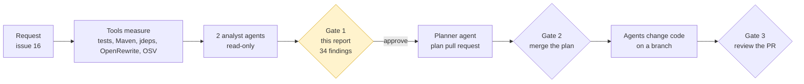
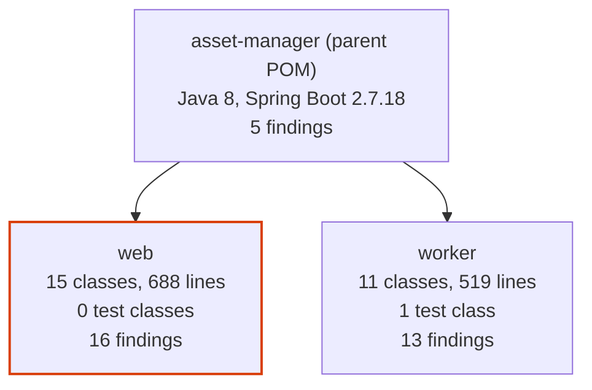
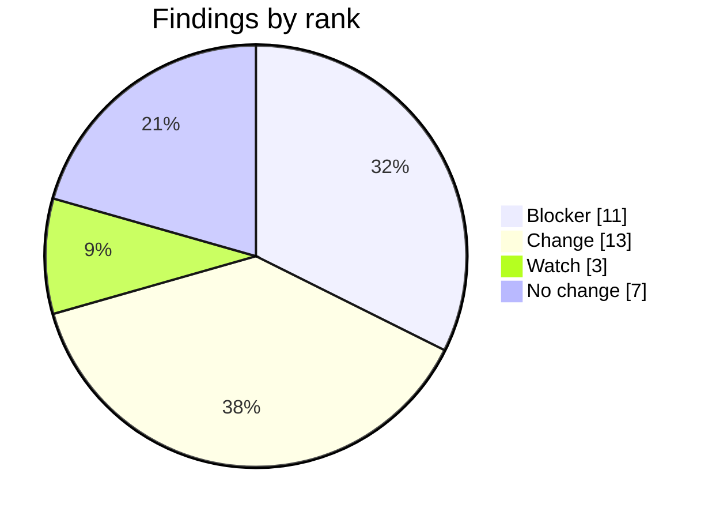
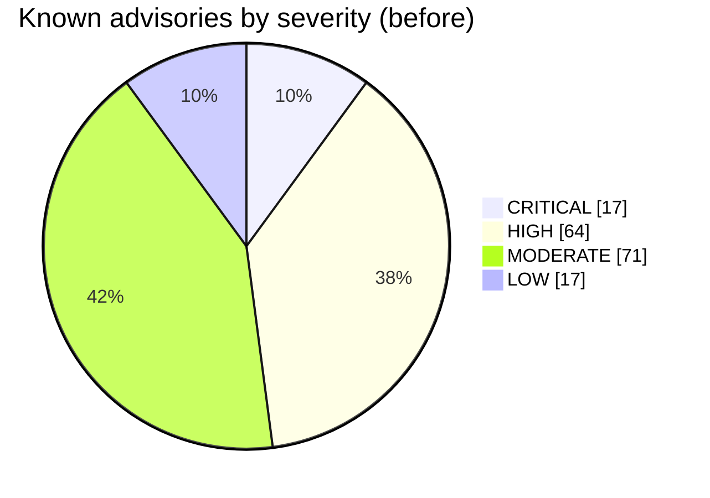
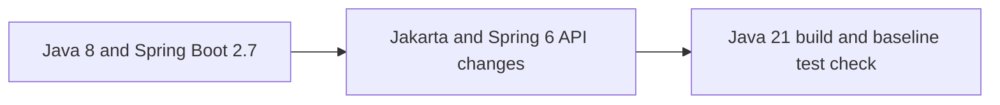
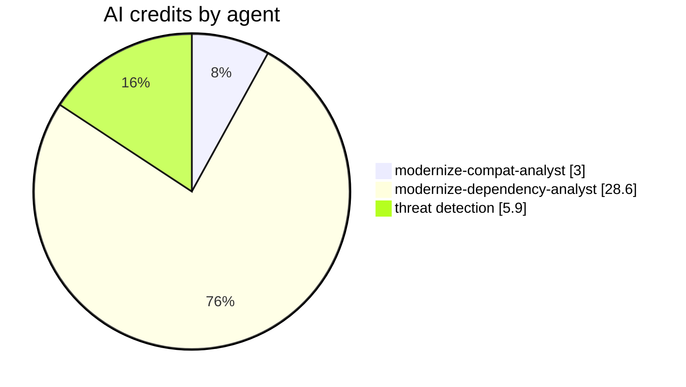

# Assessment report for issue 16

Status: approved by @lenvolk on 2026-10-19T23:07:03Z (gate 1). Assessed commit `953286b19440`. The approval is recorded in the [assessment run](https://github.com/lenvolk/java-migration-copilot-samples/actions/runs/39338189682). This file is the approved record; do not edit it.

No file in the repository changed before this approval. The plan in this folder was written from this report.

## At a glance



| Measure | Now | Target or result | Source |
|---|---|---|---|
| Java | 8 | 21 | `asset-manager/pom.xml` |
| Spring Boot | 2.7.18 | 3.5.16 (latest 3.5.x) | Maven Central |
| Maven Wrapper | 3.9.9 | 3.9.16 or keep | `asset-manager/.mvn/wrapper/maven-wrapper.properties` |
| Code | 26 classes, 1207 lines | | source scan |
| Tests on JDK 8 | 4 run, 0 failed, 1 error | no worse after upgrade | `mvnw test` |
| `javax` imports to migrate | 9 in 5 files | 0 | source scan |
| JDK internal API use | 7 dependencies | resolved by newer versions | `jdeps` |
| Known vulnerabilities | 169 advisories | re-scanned after upgrade | OSV.dev |
| Static analysis | 9 bug patterns | no new ones after upgrade | SpotBugs |
| Preview of the change | 7 files | reference only | OpenRewrite dry run |
| Findings | 11 blocker, 13 change, 3 watch, 7 no change | each one owned by a plan step | analyst agents |
| Estimated AI cost of plan and execution | 110.7 credits | $1.11 | measured profile |

What the requested upgrade changes. Nothing is changed yet:

```diff
 asset-manager/
-  java.version                  8
+  java.version                  21
-  spring-boot-starter-parent    2.7.18
+  spring-boot-starter-parent    3.5.16
-  javax.* imports               9 in 5 files
+  jakarta.* imports
   javax.imageio    stays, it ships with the JDK
```

Files the OpenRewrite preview touches:

```text
asset-manager/
├── asset-manager/pom.xml                                                                    +2 -2
├── asset-manager/web/pom.xml                                                                +4 -0
├── asset-manager/web/src/main/java/com/microsoft/migration/assets/model/ImageMetadata.java  +1 -1
├── asset-manager/web/src/main/java/com/microsoft/migration/assets/config/WebMvcConfig.java  +6 -6
├── asset-manager/web/src/main/java/com/microsoft/migration/assets/service/LocalFileStorageService.java +5 -3
├── asset-manager/worker/src/main/java/com/microsoft/migration/assets/worker/model/ImageMetadata.java +4 -4
└── asset-manager/worker/src/main/java/com/microsoft/migration/assets/worker/service/LocalFileProcessingService.java +2 -3
```







## Decisions for the reviewer

Check these before you approve. Each one becomes a constraint in the plan.

- [ ] Should the implementation add an explicit jakarta.servlet-api dependency to the web module? Recommended: Do not add it unless compilation proves the starter does not expose the required servlet types.. spring-boot-starter-web already brings the servlet API transitively and the source only needs the Jakarta namespace. (modernize-compat-analyst)
- [ ] Should the implementation keep the OpenRewrite Paths.get to Path.of replacements? Recommended: Allow either equivalent form, with Path.of preferred only as a Java 21 cleanup.. The replacement is source-compatible but is not required by the Java 8 to 21 migration. (modernize-compat-analyst)
- [ ] Does the existing ResponseInputStream Mockito error clear on the Boot 3.5 test stack? Recommended: Run the baseline test on JDK 21 and change the test only if it still errors.. The baseline has one pre-existing Mockito error and Mockito 5 changes the default mock maker, but this must be verified. (modernize-compat-analyst)
- [ ] Should we update PostgreSQL immediately from 42.3.8 to fix CVE-2024-1597 (CRITICAL SQL Injection)? Recommended: Yes. CVE-2024-1597 is a CRITICAL SQL injection in PostgreSQL JDBC. Upgrade to 42.7.2+ which is also managed by Spring Boot 3.5 BOM.. Active security vulnerability affecting SQL query generation in Line comment handling. (modernize-dependency-analyst)
- [ ] Should we allow the Spring Boot 3.5 BOM to manage AWS SDK S3 or keep the explicit 2.25.13 pin? Recommended: Keep the explicit property-driven version (2.25.13) or upgrade to latest within 2.x (2.57.0). Spring Boot 3.5 BOM does not manage SDK versions.. AWS SDK v2 is not included in Spring Boot BOM. The explicit dependency management property in web/pom.xml and worker/pom.xml is necessary and valid. (modernize-dependency-analyst)
- [ ] How should we handle Thymeleaf's CRITICAL vulnerabilities (CVE-2026-40477, CVE-2026-40478, CVE-2026-41901)? Recommended: Upgrade to 3.1.5.RELEASE for thymeleaf and 3.1.5.RELEASE for thymeleaf-spring5. Spring Boot 3.5 manages these versions.. Three CRITICAL expression sandbox bypasses require immediate patching; Spring Boot 3.5 BOM provides 3.1.5.RELEASE which fixes all three. (modernize-dependency-analyst)
- [ ] The `web` module has no tests, so the pipeline cannot prove its behavior is unchanged. Accept this, or ask for tests in a separate request.
- [ ] `S3FileProcessingServiceTest.downloadOriginalCopiesFileFromS3` already fails on JDK 8 (org.mockito.exceptions.base.MockitoException: Cannot mock/spy class software.amazon.awssdk.core.ResponseInputStream). The code fixer must fix it if the upgrade allows, or explain why not.
- [ ] Target Spring Boot 3.5.16. Newer major versions (4.x) are out of the approved scope.

## Findings

Each finding has a stable ID. The plan assigns every ID to a step, commits reference the IDs they address, and the review checks each one.

| ID | Rank | Module | Where | Finding | Proposed change | Owner | Confidence |
|---|---|---|---|---|---|---|---|
| C-03 | Blocker | web | [WebMvcConfig.java:7](https://github.com/lenvolk/java-migration-copilot-samples/blob/953286b19440528ee2d624169df02d2e93f1833f/asset-manager/web/src/main/java/com/microsoft/migration/assets/config/WebMvcConfig.java#L7) | WebMvcConfigurerAdapter and HandlerInterceptorAdapter were removed from Spring Framework 6, and lines 11-12 import javax.servlet types. | Implement WebMvcConfigurer and HandlerInterceptor, and change both servlet imports to jakarta.servlet.http. | `modernize-code-fixer` | High |
| D-01 | Blocker | parent | [pom.xml:8](https://github.com/lenvolk/java-migration-copilot-samples/blob/953286b19440528ee2d624169df02d2e93f1833f/asset-manager/pom.xml#L8) | Parent POM sets the Spring Boot BOM for both modules. Spring Boot 3.5.16 is the latest 3.5.x release. | Set parent version to 3.5.16. | `modernize-build-upgrader` | High |
| D-02 | Blocker | parent | [pom.xml:19](https://github.com/lenvolk/java-migration-copilot-samples/blob/953286b19440528ee2d624169df02d2e93f1833f/asset-manager/pom.xml#L19) | Java source and target must move from 8 to 21 for JDK 21 support. | Set java.version property to 21. | `modernize-build-upgrader` | High |
| D-03 | Blocker | web | [pom.xml:22](https://github.com/lenvolk/java-migration-copilot-samples/blob/953286b19440528ee2d624169df02d2e93f1833f/asset-manager/web/pom.xml#L22) | Thymeleaf 3.0.15.RELEASE has 3x CRITICAL vulnerabilities (CVE-2026-40477, CVE-2026-40478, CVE-2026-41901) fixed in 3.1.5.RELEASE. | Remove explicit version; let BOM manage it. | `modernize-build-upgrader` | High |
| D-04 | Blocker | web | [pom.xml:26](https://github.com/lenvolk/java-migration-copilot-samples/blob/953286b19440528ee2d624169df02d2e93f1833f/asset-manager/web/pom.xml#L26) | Spring Boot 3.5 BOM manages this. Includes Tomcat 10.1.x (fixes 36 CVEs). | Remove explicit version. | `modernize-build-upgrader` | High |
| D-07 | Blocker | web | [pom.xml:38](https://github.com/lenvolk/java-migration-copilot-samples/blob/953286b19440528ee2d624169df02d2e93f1833f/asset-manager/web/pom.xml#L38) | CVE-2026-40972 (HIGH timing attack) fixed in 3.5.14. | Remove explicit version; BOM upgrade fixes CVE. | `modernize-build-upgrader` | High |
| D-11 | Blocker | web | [pom.xml:57](https://github.com/lenvolk/java-migration-copilot-samples/blob/953286b19440528ee2d624169df02d2e93f1833f/asset-manager/web/pom.xml#L57) | CVE-2026-41716 (HIGH heap exhaustion) fixed in 3.5.12. | Remove explicit version. | `modernize-build-upgrader` | High |
| D-12 | Blocker | web | [pom.xml:62](https://github.com/lenvolk/java-migration-copilot-samples/blob/953286b19440528ee2d624169df02d2e93f1833f/asset-manager/web/pom.xml#L62) | CVE-2024-1597 (CRITICAL SQL Injection via line comment generation). | Remove explicit version; Spring Boot 3.5 BOM manages 42.7.x. | `modernize-build-upgrader` | High |
| D-18 | Blocker | worker | [pom.xml:42](https://github.com/lenvolk/java-migration-copilot-samples/blob/953286b19440528ee2d624169df02d2e93f1833f/asset-manager/worker/pom.xml#L42) | 11 HIGH vulnerabilities. Spring Boot 3.5 BOM manages 2.17.x. | Remove explicit version; let BOM manage it. | `modernize-build-upgrader` | High |
| D-19 | Blocker | worker | [pom.xml:46](https://github.com/lenvolk/java-migration-copilot-samples/blob/953286b19440528ee2d624169df02d2e93f1833f/asset-manager/worker/pom.xml#L46) | Spring Boot 3.5 BOM manages this. | Remove explicit version. | `modernize-build-upgrader` | High |
| D-20 | Blocker | worker | [pom.xml:51](https://github.com/lenvolk/java-migration-copilot-samples/blob/953286b19440528ee2d624169df02d2e93f1833f/asset-manager/worker/pom.xml#L51) | CVE-2024-1597 (CRITICAL SQL Injection). | Remove explicit version; let BOM manage it. | `modernize-build-upgrader` | High |
| C-01 | Change | parent | [pom.xml:8](https://github.com/lenvolk/java-migration-copilot-samples/blob/953286b19440528ee2d624169df02d2e93f1833f/asset-manager/pom.xml#L8) | The parent is Spring Boot 2.7.18 and the Java release is 8 at line 19, so the requested target cannot be built until both properties move to Spring Boot 3.5.x and Java 21. | Set the approved Spring Boot 3.5.x parent and java.version 21, letting the BOM manage compatible framework versions. | `modernize-build-upgrader` | High |
| C-04 | Change | web | [ImageMetadata.java:3](https://github.com/lenvolk/java-migration-copilot-samples/blob/953286b19440528ee2d624169df02d2e93f1833f/asset-manager/web/src/main/java/com/microsoft/migration/assets/model/ImageMetadata.java#L3) | The entity imports javax.persistence.*; Spring Boot 3 uses Jakarta Persistence. | Change the wildcard import to jakarta.persistence.*. Keep the existing callbacks and String ID because no generator, Lob mapping, or query is present. | `modernize-code-fixer` | High |
| C-05 | Change | web | [LocalFileStorageService.java:14](https://github.com/lenvolk/java-migration-copilot-samples/blob/953286b19440528ee2d624169df02d2e93f1833f/asset-manager/web/src/main/java/com/microsoft/migration/assets/service/LocalFileStorageService.java#L14) | PostConstruct is imported from javax.annotation, which is not the Spring Boot 3 namespace; the preview also changes Paths.get at line 42. | Use jakarta.annotation.PostConstruct. Keep Path.of or the equivalent Paths.get operation. | `modernize-code-fixer` | High |
| C-06 | Change | worker | [ImageMetadata.java:3](https://github.com/lenvolk/java-migration-copilot-samples/blob/953286b19440528ee2d624169df02d2e93f1833f/asset-manager/worker/src/main/java/com/microsoft/migration/assets/worker/model/ImageMetadata.java#L3) | Entity, Id, PrePersist, and PreUpdate are imported from javax.persistence on lines 3-6. | Change all four imports to jakarta.persistence and retain the existing listener behavior. | `modernize-code-fixer` | High |
| C-07 | Change | worker | [LocalFileProcessingService.java:6](https://github.com/lenvolk/java-migration-copilot-samples/blob/953286b19440528ee2d624169df02d2e93f1833f/asset-manager/worker/src/main/java/com/microsoft/migration/assets/worker/service/LocalFileProcessingService.java#L6) | PostConstruct is imported from javax.annotation; the preview also changes Paths.get at line 24. | Use jakarta.annotation.PostConstruct. Keep Path.of or the equivalent Paths.get operation. | `modernize-code-fixer` | High |
| D-05 | Change | web | [pom.xml:30](https://github.com/lenvolk/java-migration-copilot-samples/blob/953286b19440528ee2d624169df02d2e93f1833f/asset-manager/web/pom.xml#L30) | Spring Boot 3.5 BOM manages version. | Remove explicit version. | `modernize-build-upgrader` | High |
| D-08 | Change | web | [pom.xml:42](https://github.com/lenvolk/java-migration-copilot-samples/blob/953286b19440528ee2d624169df02d2e93f1833f/asset-manager/web/pom.xml#L42) | Managed by Spring Boot 3.5 BOM. | Remove explicit version. | `modernize-build-upgrader` | High |
| D-09 | Change | web | [pom.xml:47](https://github.com/lenvolk/java-migration-copilot-samples/blob/953286b19440528ee2d624169df02d2e93f1833f/asset-manager/web/pom.xml#L47) | Resolves JDK 21 internal API issues. | Remove explicit version; let Spring Boot 3.5 BOM manage it. | `modernize-build-upgrader` | High |
| D-10 | Change | web | [pom.xml:52](https://github.com/lenvolk/java-migration-copilot-samples/blob/953286b19440528ee2d624169df02d2e93f1833f/asset-manager/web/pom.xml#L52) | Spring Boot 3.5 BOM manages test dependencies. | Remove explicit version. | `modernize-build-upgrader` | High |
| D-13 | Change | worker | [pom.xml:20](https://github.com/lenvolk/java-migration-copilot-samples/blob/953286b19440528ee2d624169df02d2e93f1833f/asset-manager/worker/pom.xml#L20) | Spring Boot 3.5 BOM manages this version. | Remove explicit version. | `modernize-build-upgrader` | High |
| D-14 | Change | worker | [pom.xml:24](https://github.com/lenvolk/java-migration-copilot-samples/blob/953286b19440528ee2d624169df02d2e93f1833f/asset-manager/worker/pom.xml#L24) | Spring Boot 3.5 BOM manages this. | Remove explicit version. | `modernize-build-upgrader` | High |
| D-16 | Change | worker | [pom.xml:32](https://github.com/lenvolk/java-migration-copilot-samples/blob/953286b19440528ee2d624169df02d2e93f1833f/asset-manager/worker/pom.xml#L32) | Spring Boot 3.5 BOM manages 1.18.48. | Remove explicit version. | `modernize-build-upgrader` | High |
| D-17 | Change | worker | [pom.xml:37](https://github.com/lenvolk/java-migration-copilot-samples/blob/953286b19440528ee2d624169df02d2e93f1833f/asset-manager/worker/pom.xml#L37) | Spring Boot 3.5 BOM manages this. | Remove explicit version. | `modernize-build-upgrader` | High |
| C-09 | Watch | worker | [S3FileProcessingServiceTest.java:32](https://github.com/lenvolk/java-migration-copilot-samples/blob/953286b19440528ee2d624169df02d2e93f1833f/asset-manager/worker/src/test/java/com/microsoft/migration/assets/worker/service/S3FileProcessingServiceTest.java#L32) | The JDK 8 baseline records one error when mocking ResponseInputStream. Boot 3.5 brings the Mockito 5 test stack, whose inline mock maker may remove this limitation. | Run the test on JDK 21 and only revise the mock if the existing error remains. | `modernize-code-fixer` | High |
| D-06 | Watch | web | [pom.xml:34](https://github.com/lenvolk/java-migration-copilot-samples/blob/953286b19440528ee2d624169df02d2e93f1833f/asset-manager/web/pom.xml#L34) | Not managed by Spring Boot BOM. Property-driven. Recommend upgrade for security fixes. | Update aws-sdk.version property. | `modernize-build-upgrader` | High |
| D-15 | Watch | worker | [pom.xml:28](https://github.com/lenvolk/java-migration-copilot-samples/blob/953286b19440528ee2d624169df02d2e93f1833f/asset-manager/worker/pom.xml#L28) | Property-driven, not BOM-managed. Recommend upgrade. | Update aws-sdk.version property. | `modernize-build-upgrader` | High |
| C-02 | No change | web | [pom.xml:19](https://github.com/lenvolk/java-migration-copilot-samples/blob/953286b19440528ee2d624169df02d2e93f1833f/asset-manager/web/pom.xml#L19) | The preview adds an explicit jakarta.servlet-api dependency, but the existing spring-boot-starter-web dependency already supplies servlet types. | Do not add the explicit dependency unless the target build demonstrates it is needed. | `modernize-build-upgrader` | High |
| C-08 | No change | worker | [AbstractFileProcessingService.java:11](https://github.com/lenvolk/java-migration-copilot-samples/blob/953286b19440528ee2d624169df02d2e93f1833f/asset-manager/worker/src/main/java/com/microsoft/migration/assets/worker/service/AbstractFileProcessingService.java#L11) | javax.imageio.ImageIO and the other javax.imageio classes are shipped by the JDK and are not Jakarta migration targets. | Keep the imports and qualified usages unchanged. | `modernize-code-fixer` | High |
| C-10 | No change | web | [list.html:6](https://github.com/lenvolk/java-migration-copilot-samples/blob/953286b19440528ee2d624169df02d2e93f1833f/asset-manager/web/src/main/resources/templates/list.html#L6) | The templates use supported list, number, and temporal utilities and contain no removed #request or #response utility object. | Keep the expressions unchanged and verify template rendering after the dependency upgrade. | `modernize-code-fixer` | High |
| C-11 | No change | web | [application.properties:8](https://github.com/lenvolk/java-migration-copilot-samples/blob/953286b19440528ee2d624169df02d2e93f1833f/asset-manager/web/src/main/resources/application.properties#L8) | The measured spring.servlet.multipart, spring.rabbitmq, spring.datasource, and spring.jpa keys have Boot 3 compatible names. | Keep the keys and verify application startup. | `modernize-code-fixer` | High |
| C-12 | No change | worker | [application.properties:7](https://github.com/lenvolk/java-migration-copilot-samples/blob/953286b19440528ee2d624169df02d2e93f1833f/asset-manager/worker/src/main/resources/application.properties#L7) | The measured worker spring.application, spring.rabbitmq, spring.datasource, and spring.jpa keys have Boot 3 compatible names. | Keep the keys and verify worker startup. | `modernize-code-fixer` | High |
| D-21 | No change | parent | [maven-wrapper.properties](https://github.com/lenvolk/java-migration-copilot-samples/blob/953286b19440528ee2d624169df02d2e93f1833f/asset-manager/.mvn/wrapper/maven-wrapper.properties) | Already at Maven 3.9.x requirement. | No change required. | `modernize-build-upgrader` | High |
| D-22 | No change | parent | [pom.xml](https://github.com/lenvolk/java-migration-copilot-samples/blob/953286b19440528ee2d624169df02d2e93f1833f/asset-manager/web/pom.xml) | Inherited from parent BOM. | No explicit version in POMs. | `modernize-build-upgrader` | High |

### Dependency decisions

| ID | Artifact | Current | Decision | Target | Why |
|---|---|---|---|---|---|
| D-01 | `org.springframework.boot:spring-boot-starter-parent` | 2.7.18 | Explicit upgrade | 3.5.16 | Parent POM sets the Spring Boot BOM for both modules. Spring Boot 3.5.16 is the latest 3.5.x release. |
| D-02 | `java.version property` | 8 | Explicit upgrade | 21 | Java source and target must move from 8 to 21 for JDK 21 support. |
| D-03 | `org.springframework.boot:spring-boot-starter-thymeleaf` | 2.7.18 | BOM-managed | 3.5.16 | Thymeleaf 3.0.15.RELEASE has 3x CRITICAL vulnerabilities (CVE-2026-40477, CVE-2026-40478, CVE-2026-41901) fixed in 3.1.5.RELEASE. |
| D-04 | `org.springframework.boot:spring-boot-starter-web` | 2.7.18 | BOM-managed | 3.5.16 | Spring Boot 3.5 BOM manages this. Includes Tomcat 10.1.x (fixes 36 CVEs). |
| D-05 | `org.springframework.boot:spring-boot-starter-amqp` | 2.7.18 | BOM-managed | 3.5.16 | Spring Boot 3.5 BOM manages version. |
| D-06 | `software.amazon.awssdk:s3` | 2.25.13 | Explicit upgrade | 2.57.0 | Not managed by Spring Boot BOM. Property-driven. Recommend upgrade for security fixes. |
| D-07 | `org.springframework.boot:spring-boot-devtools` | 2.7.18 | BOM-managed | 3.5.14 | CVE-2026-40972 (HIGH timing attack) fixed in 3.5.14. |
| D-08 | `org.springframework.boot:spring-boot-configuration-processor` | 2.7.18 | BOM-managed | 3.5.16 | Managed by Spring Boot 3.5 BOM. |
| D-09 | `org.projectlombok:lombok` | 1.18.30 | BOM-managed | 1.18.48 | Resolves JDK 21 internal API issues. |
| D-10 | `org.springframework.boot:spring-boot-starter-test` | 2.7.18 | BOM-managed | 3.5.16 | Spring Boot 3.5 BOM manages test dependencies. |
| D-11 | `org.springframework.boot:spring-boot-starter-data-jpa` | 2.7.18 | BOM-managed | 3.5.16 | CVE-2026-41716 (HIGH heap exhaustion) fixed in 3.5.12. |
| D-12 | `org.postgresql:postgresql` | 42.3.8 | Explicit upgrade | 42.7.2 | CVE-2024-1597 (CRITICAL SQL Injection via line comment generation). |
| D-13 | `org.springframework.boot:spring-boot-starter` | 2.7.18 | BOM-managed | 3.5.16 | Spring Boot 3.5 BOM manages this version. |
| D-14 | `org.springframework.boot:spring-boot-starter-amqp` | 2.7.18 | BOM-managed | 3.5.16 | Spring Boot 3.5 BOM manages this. |
| D-15 | `software.amazon.awssdk:s3` | 2.25.13 | Explicit upgrade | 2.57.0 | Property-driven, not BOM-managed. Recommend upgrade. |
| D-16 | `org.projectlombok:lombok` | 1.18.30 | BOM-managed | 1.18.48 | Spring Boot 3.5 BOM manages 1.18.48. |
| D-17 | `org.springframework.boot:spring-boot-starter-test` | 2.7.18 | BOM-managed | 3.5.16 | Spring Boot 3.5 BOM manages this. |
| D-18 | `com.fasterxml.jackson.core:jackson-databind` | 2.13.5 | Explicit upgrade | 2.17.x | 11 HIGH vulnerabilities. Spring Boot 3.5 BOM manages 2.17.x. |
| D-19 | `org.springframework.boot:spring-boot-starter-data-jpa` | 2.7.18 | BOM-managed | 3.5.16 | Spring Boot 3.5 BOM manages this. |
| D-20 | `org.postgresql:postgresql` | 42.3.8 | Explicit upgrade | 42.7.2 | CVE-2024-1597 (CRITICAL SQL Injection). |
| D-21 | `Maven Wrapper` | 3.9.9 | No change | 3.9.16 | Already at Maven 3.9.x requirement. |
| D-22 | `org.springframework.boot:spring-boot-maven-plugin` | 2.7.18 | BOM-managed | 3.5.16 | Inherited from parent BOM. |

## Analyst summaries

<details>
<summary>Source compatibility, from <code>modernize-compat-analyst</code></summary>

12 findings across 12 files: 1 Blocker, 5 Change, 1 Watch, and 5 No change.



| File | Finding | Rank | Proposed change |
|---|---|---|---|
| `asset-manager/web/src/main/java/com/microsoft/migration/assets/config/WebMvcConfig.java:7-14` | The MVC adapter classes and servlet imports are removed or incompatible on Spring Framework 6. | Blocker | Implement `WebMvcConfigurer` and `HandlerInterceptor`, and use `jakarta.servlet.http` imports. |
| `asset-manager/web/src/main/java/com/microsoft/migration/assets/model/ImageMetadata.java:3` | The entity still imports `javax.persistence.*`. | Change | Move the persistence annotations to `jakarta.persistence.*`; its callback methods and String ID need no redesign. |
| `asset-manager/worker/src/main/java/com/microsoft/migration/assets/worker/model/ImageMetadata.java:3-6` | The entity still imports four `javax.persistence` annotations. | Change | Move `Entity`, `Id`, `PrePersist`, and `PreUpdate` to `jakarta.persistence`. |
| `asset-manager/web/src/main/java/com/microsoft/migration/assets/service/LocalFileStorageService.java:14,42` | `PostConstruct` must be Jakarta; the preview also replaces `Paths.get` with `Path.of`. | Change | Use `jakarta.annotation.PostConstruct` and retain the equivalent Java 21 path operation. |
| `asset-manager/worker/src/main/java/com/microsoft/migration/assets/worker/service/LocalFileProcessingService.java:6,24` | `PostConstruct` must be Jakarta; the preview also replaces `Paths.get` with `Path.of`. | Change | Use `jakarta.annotation.PostConstruct` and retain the equivalent Java 21 path operation. |
| `asset-manager/worker/src/main/java/com/microsoft/migration/assets/worker/service/AbstractFileProcessingService.java:11` | `javax.imageio.ImageIO` is a JDK package, not a Jakarta EE package. | No change | Keep the import and the qualified `javax.imageio` usages. |
| `asset-manager/worker/src/test/java/com/microsoft/migration/assets/worker/service/S3FileProcessingServiceTest.java:32` | The JDK 8 baseline has one existing error because Mockito cannot mock `ResponseInputStream`; the Boot 3.5 test stack uses Mockito 5 inline mocking by default. | Watch | Rerun this test on JDK 21 and keep or adjust the mock only if the error remains. |
| `asset-manager/web/src/main/resources/templates/list.html:6` | The Thymeleaf templates use supported `#lists`, `#numbers`, and `#temporals`; they do not use removed `#request` or `#response` objects. | No change | Keep the expressions and add no compatibility utility object. |
| `asset-manager/web/src/main/resources/application.properties:8-21` | The measured `spring.*` keys are Boot 3 compatible multipart, RabbitMQ, datasource, and JPA keys. | No change | Keep the keys; verify startup with the existing profile configuration. |
| `asset-manager/worker/src/main/resources/application.properties:7-20` | The measured worker `spring.*` keys are also unchanged by the requested upgrade. | No change | Keep the keys and verify worker startup. |

Where I differ from the OpenRewrite preview:
- I would not add `jakarta.servlet-api` to `asset-manager/web/pom.xml:19-22`. `spring-boot-starter-web` already supplies the servlet API, so the explicit dependency is redundant.
- The preview changes `Paths.get` to `Path.of` in both local services. This is valid Java 21 source, but it is not required for compatibility; either equivalent form is acceptable.
- I checked the files outside the preview. There are no trailing-slash configuration calls, removed Thymeleaf expression objects, renamed keys in the measured property inventory, JPA ID generators, `@Lob` mappings, custom queries, or application-code APIs reported by `jdeprscan` for removal. `jdeps` findings are in third-party libraries, including Logback 1.2.12, not application source.

[Original comment](https://github.com/lenvolk/java-migration-copilot-samples/issues/16#issuecomment-6279254347)

</details>

<details>
<summary>Dependencies and build tooling, from <code>modernize-dependency-analyst</code></summary>

## 🔹 Dependency & Build Analysis

Upgrade to Spring Boot 3.5.16 and Java 21 with 18 dependency decisions: 4 explicit upgrades, 5 BOM-managed Spring Boot starters, 2 AWS SDK properties, and 7 no changes (inherited from BOM).

### Key Decisions

| Artifact | Current | Target | Decision | Category | Reason |
|---|---|---|---|---|---|
| `spring-boot-starter-parent` | 2.7.18 | 3.5.16 | **Explicit upgrade** | Spring Boot BOM | Base platform version for both modules |
| `java.version` property | 8 | 21 | **Explicit upgrade** | Java source/target | Required for JDK 21 support |
| **Spring Boot Starters** (web/worker) | 2.7.18 | 3.5.16 | **BOM-managed** | Spring Boot | Remove explicit versions; fixes Tomcat (36 CVEs), Thymeleaf (3x CRITICAL), logging, and test dependencies |
| `postgresql:postgresql` | 42.3.8 | 42.7.2 | **Explicit upgrade** | Database driver | **CVE-2024-1597 (CRITICAL SQL injection)** in line comment handling |
| `jackson-databind` (worker) | 2.13.5 | 2.17.x | **BOM-managed** | JSON serialization | 11 HIGH vulnerabilities including arbitrary class instantiation bypasses |
| `spring-boot-devtools` | 2.7.18 | 3.5.14 | **BOM-managed** | Remote development | **CVE-2026-40972 (HIGH timing attack)** on secret comparison |
| `lombok` | 1.18.30 | 1.18.48 | **BOM-managed** | Code generation | Resolves internal API access issues on JDK 21 (javac, Unsafe) |
| `software.amazon.awssdk:s3` (both modules) | 2.25.13 | 2.57.0 | **Property-driven** | AWS integration | Not in Spring Boot BOM; recommend upgrade for security fixes |

### Vulnerabilities Cleared by BOM Upgrade

- **Thymeleaf 3.0.15** → **3.1.5**: Fixes CVE-2026-40477, CVE-2026-40478, CVE-2026-41901 (3x CRITICAL expression sandbox bypasses)
- **Tomcat 9.0.83** → **10.1.x**: Fixes 36 CVEs including 9x CRITICAL authentication bypasses and request smuggling
- **Jackson databind 2.13.5** → **2.17.x**: Fixes 11 HIGH CVEs including remote code execution via PolymorphicTypeValidator bypass
- **Spring Data Commons 2.7.18** → **3.5.12**: Fixes CVE-2026-41716 (HIGH heap exhaustion)
- **PostgreSQL JDBC 42.3.8** → **42.7.2**: Fixes **CVE-2024-1597 (CRITICAL SQL Injection via line comment generation)**

### Build Tooling

- **Maven Wrapper**: 3.9.9 → **No change**. Already at Maven 3.9.x, which is required for JDK 21. Latest 3.9.16 available but not required.
- **Spring Boot Maven Plugin**: Inherited from parent BOM, no explicit version in module POMs (correct practice).

### Summary

**No blocker issues found in dependency decisions.** All 18 findings can be addressed through parent POM upgrade to 3.5.16 and Java version change to 21. The Spring Boot 3.5 BOM provides compatible versions that resolve 5+ CRITICAL vulnerabilities currently present in the codebase.

**Analyst Assessment JSON:**

[Original comment](https://github.com/lenvolk/java-migration-copilot-samples/issues/16#issuecomment-6279278924)

</details>


## Evidence measured by tools (no AI)

Measured on commit `953286b19440` at 2026-10-19T22:58:02Z. No AI produced any number in this section.

### Build

| Item | Value | Source |
|---|---|---|
| Java release | 8 | [pom.xml:19](https://github.com/lenvolk/java-migration-copilot-samples/blob/953286b19440528ee2d624169df02d2e93f1833f/asset-manager/pom.xml#L19) |
| Spring Boot parent | 2.7.18 | [pom.xml:8](https://github.com/lenvolk/java-migration-copilot-samples/blob/953286b19440528ee2d624169df02d2e93f1833f/asset-manager/pom.xml#L8) |
| Maven Wrapper | 3.9.9 | `asset-manager/.mvn/wrapper/maven-wrapper.properties` |
| Modules | web, worker | `asset-manager/pom.xml` |
| Latest Spring Boot 3.5.x on Maven Central | 3.5.16 | maven-metadata.xml |
| Latest Maven 3.9.x on Maven Central | 3.9.16 | maven-metadata.xml |

### Code inventory

| Module | Main classes | Main LOC | Test classes | Test LOC | Controllers | Services | Repositories | Entities | Listeners | Templates |
|---|---:|---:|---:|---:|---:|---:|---:|---:|---:|---:|
| web | 15 | 688 | 0 | 0 | 2 | 2 | 1 | 1 | 1 | 4 |
| worker | 11 | 519 | 1 | 80 | 0 | 2 | 1 | 1 | 1 | 0 |

### Baseline tests on JDK 8

`./mvnw test` on `main`: 4 tests, 0 failures, 1 error, 0 skipped. The upgrade must be no worse than this.

| Module | Test | Result | Message |
|---|---|---|---|
| worker | `S3FileProcessingServiceTest.testExtractOriginalKey` | passed |  |
| worker | `S3FileProcessingServiceTest.uploadThumbnailPutsFileToS3` | passed |  |
| worker | `S3FileProcessingServiceTest.downloadOriginalCopiesFileFromS3` | error | org.mockito.exceptions.base.MockitoException: Cannot mock/spy class software.amazon.awssdk.core.ResponseInputStream |
| worker | `S3FileProcessingServiceTest.getStorageTypeReturnsS3` | passed |  |

Modules with no tests: web. Their behavior is not covered by the baseline.

### javax imports

9 imports in 5 files move to `jakarta.*`. 1 import stays because the package ships with the JDK.

| File | Line | Import | Action |
|---|---:|---|---|
| [WebMvcConfig.java:11](https://github.com/lenvolk/java-migration-copilot-samples/blob/953286b19440528ee2d624169df02d2e93f1833f/asset-manager/web/src/main/java/com/microsoft/migration/assets/config/WebMvcConfig.java#L11) | 11 | `javax.servlet.http.HttpServletRequest` | move to jakarta |
| [WebMvcConfig.java:12](https://github.com/lenvolk/java-migration-copilot-samples/blob/953286b19440528ee2d624169df02d2e93f1833f/asset-manager/web/src/main/java/com/microsoft/migration/assets/config/WebMvcConfig.java#L12) | 12 | `javax.servlet.http.HttpServletResponse` | move to jakarta |
| [ImageMetadata.java:3](https://github.com/lenvolk/java-migration-copilot-samples/blob/953286b19440528ee2d624169df02d2e93f1833f/asset-manager/web/src/main/java/com/microsoft/migration/assets/model/ImageMetadata.java#L3) | 3 | `javax.persistence.*` | move to jakarta |
| [LocalFileStorageService.java:14](https://github.com/lenvolk/java-migration-copilot-samples/blob/953286b19440528ee2d624169df02d2e93f1833f/asset-manager/web/src/main/java/com/microsoft/migration/assets/service/LocalFileStorageService.java#L14) | 14 | `javax.annotation.PostConstruct` | move to jakarta |
| [ImageMetadata.java:3](https://github.com/lenvolk/java-migration-copilot-samples/blob/953286b19440528ee2d624169df02d2e93f1833f/asset-manager/worker/src/main/java/com/microsoft/migration/assets/worker/model/ImageMetadata.java#L3) | 3 | `javax.persistence.Entity` | move to jakarta |
| [ImageMetadata.java:4](https://github.com/lenvolk/java-migration-copilot-samples/blob/953286b19440528ee2d624169df02d2e93f1833f/asset-manager/worker/src/main/java/com/microsoft/migration/assets/worker/model/ImageMetadata.java#L4) | 4 | `javax.persistence.Id` | move to jakarta |
| [ImageMetadata.java:5](https://github.com/lenvolk/java-migration-copilot-samples/blob/953286b19440528ee2d624169df02d2e93f1833f/asset-manager/worker/src/main/java/com/microsoft/migration/assets/worker/model/ImageMetadata.java#L5) | 5 | `javax.persistence.PrePersist` | move to jakarta |
| [ImageMetadata.java:6](https://github.com/lenvolk/java-migration-copilot-samples/blob/953286b19440528ee2d624169df02d2e93f1833f/asset-manager/worker/src/main/java/com/microsoft/migration/assets/worker/model/ImageMetadata.java#L6) | 6 | `javax.persistence.PreUpdate` | move to jakarta |
| [AbstractFileProcessingService.java:11](https://github.com/lenvolk/java-migration-copilot-samples/blob/953286b19440528ee2d624169df02d2e93f1833f/asset-manager/worker/src/main/java/com/microsoft/migration/assets/worker/service/AbstractFileProcessingService.java#L11) | 11 | `javax.imageio.ImageIO` | keep, JDK package |
| [LocalFileProcessingService.java:6](https://github.com/lenvolk/java-migration-copilot-samples/blob/953286b19440528ee2d624169df02d2e93f1833f/asset-manager/worker/src/main/java/com/microsoft/migration/assets/worker/service/LocalFileProcessingService.java#L6) | 6 | `javax.annotation.PostConstruct` | move to jakarta |

### Direct dependencies

`web`: 10 direct, 141 resolved in total.

| Artifact | Resolved version | Scope |
|---|---|---|
| `org.springframework.boot:spring-boot-starter-thymeleaf` | 2.7.18 | compile |
| `org.springframework.boot:spring-boot-starter-web` | 2.7.18 | compile |
| `org.springframework.boot:spring-boot-starter-amqp` | 2.7.18 | compile |
| `software.amazon.awssdk:s3` | 2.25.13 | compile |
| `org.springframework.boot:spring-boot-devtools` | 2.7.18 | runtime |
| `org.springframework.boot:spring-boot-configuration-processor` | 2.7.18 | compile |
| `org.projectlombok:lombok` | 1.18.30 | compile |
| `org.springframework.boot:spring-boot-starter-test` | 2.7.18 | test |
| `org.springframework.boot:spring-boot-starter-data-jpa` | 2.7.18 | compile |
| `org.postgresql:postgresql` | 42.3.8 | runtime |

`worker`: 8 direct, 122 resolved in total.

| Artifact | Resolved version | Scope |
|---|---|---|
| `org.springframework.boot:spring-boot-starter` | 2.7.18 | compile |
| `org.springframework.boot:spring-boot-starter-amqp` | 2.7.18 | compile |
| `software.amazon.awssdk:s3` | 2.25.13 | compile |
| `org.projectlombok:lombok` | 1.18.30 | compile |
| `org.springframework.boot:spring-boot-starter-test` | 2.7.18 | test |
| `com.fasterxml.jackson.core:jackson-databind` | 2.13.5 | compile |
| `org.springframework.boot:spring-boot-starter-data-jpa` | 2.7.18 | compile |
| `org.postgresql:postgresql` | 42.3.8 | runtime |

Newer versions on Maven Central (versions-maven-plugin; pre-releases hidden):

| Module | Artifact | Current | Newest stable |
|---|---|---|---|
| web | `org.postgresql:postgresql` | 42.3.8 | 42.7.14 |
| web | `org.projectlombok:lombok` | 1.18.30 | 1.18.48 |
| web | `org.springframework.boot:spring-boot-configuration-processor` | 2.7.18 | 4.1.1 |
| web | `org.springframework.boot:spring-boot-devtools` | 2.7.18 | 4.1.1 |
| web | `org.springframework.boot:spring-boot-starter-amqp` | 2.7.18 | 4.1.1 |
| web | `org.springframework.boot:spring-boot-starter-data-jpa` | 2.7.18 | 4.1.1 |
| web | `org.springframework.boot:spring-boot-starter-test` | 2.7.18 | 4.1.1 |
| web | `org.springframework.boot:spring-boot-starter-thymeleaf` | 2.7.18 | 4.1.1 |
| web | `org.springframework.boot:spring-boot-starter-web` | 2.7.18 | 4.1.1 |
| web | `software.amazon.awssdk:s3` | 2.25.13 | 2.57.0 |
| web | `org.springframework.boot:spring-boot-maven-plugin` | 2.7.18 | 4.1.1 |
| worker | `com.fasterxml.jackson.core:jackson-databind` | 2.13.5 | 2.22.4 |
| worker | `org.postgresql:postgresql` | 42.3.8 | 42.7.14 |
| worker | `org.projectlombok:lombok` | 1.18.30 | 1.18.48 |
| worker | `org.springframework.boot:spring-boot-starter` | 2.7.18 | 4.1.1 |
| worker | `org.springframework.boot:spring-boot-starter-amqp` | 2.7.18 | 4.1.1 |
| worker | `org.springframework.boot:spring-boot-starter-data-jpa` | 2.7.18 | 4.1.1 |
| worker | `org.springframework.boot:spring-boot-starter-test` | 2.7.18 | 4.1.1 |
| worker | `software.amazon.awssdk:s3` | 2.25.13 | 2.57.0 |
| worker | `org.springframework.boot:spring-boot-maven-plugin` | 2.7.18 | 4.1.1 |

### Java 21 readiness (jdeps, jdeprscan)

`jdeps --jdk-internals --multi-release 21` on the compiled classes and their runtime classpath:

| Artifact | Modules | JDK API used | Kind |
|---|---|---|---|
| `logback-classic-1.2.12.jar` | web, worker | `sun.reflect.Reflection` | removed in JDK 21 |
| `aspectjweaver-1.9.7.jar` | web, worker | `sun.misc.Unsafe` | JDK internal API (jdk.unsupported) |
| `lombok-1.18.30.jar` | web, worker | `com.sun.tools.javac.processing.JavacFiler`, `com.sun.tools.javac.processing.JavacProcessingEnvironment`, `com.sun.tools.javac.util.Context`, `com.sun.tools.javac.util.Options` | JDK internal API (jdk.compiler), JDK internal API (jdk.unsupported) |
| `netty-common-4.1.101.Final.jar` | web, worker | `sun.misc.Unsafe` | JDK internal API (jdk.unsupported) |
| `netty-handler-4.1.101.Final.jar` | web, worker | `sun.security.x509.AlgorithmId`, `sun.security.x509.CertificateAlgorithmId`, `sun.security.x509.CertificateSerialNumber`, `sun.security.x509.CertificateSubjectName` | JDK internal API (java.base) |
| `objenesis-3.2.jar` | web, worker | `sun.misc.Unsafe` | JDK internal API (jdk.unsupported) |
| `spring-core-5.3.31.jar` | web, worker | `sun.misc.Unsafe` | JDK internal API (jdk.unsupported) |

`jdeprscan --release 21 --for-removal` found no application code that uses APIs marked for removal.

### Known vulnerabilities in the current dependency tree (OSV.dev)

169 advisories affect 31 of the 141 resolved artifacts (17 critical, 64 high, 71 moderate, 17 low). Most arrive transitively through the Spring Boot 2.7 BOM, so the BOM upgrade is expected to clear many of them. The pipeline repeats this scan after the upgrade.

| Artifact | Version | Scope | Advisories | Highest | Version that fixes all | 
|---|---|---|---:|---|---|
| `org.apache.tomcat.embed:tomcat-embed-core` | 9.0.83 | compile | 36 | CRITICAL | 9.0.121 |
| `org.springframework:spring-webmvc` | 5.3.31 | compile | 16 | CRITICAL | 7.0.9 |
| `io.netty:netty-handler` | 4.1.101.Final | runtime | 6 | CRITICAL | 4.1.137.Final |
| `org.springframework:spring-web` | 5.3.31 | compile | 6 | CRITICAL | 6.1.14 |
| `org.thymeleaf:thymeleaf` | 3.0.15.RELEASE | compile | 3 | CRITICAL | 3.1.5.RELEASE |
| `org.thymeleaf:thymeleaf-spring5` | 3.0.15.RELEASE | compile | 3 | CRITICAL | 3.1.5.RELEASE |
| `org.postgresql:postgresql` | 42.3.8 | runtime | 2 | CRITICAL | 42.7.11 |
| `io.netty:netty-codec-http` | 4.1.101.Final | runtime | 19 | HIGH | 4.1.137.Final |
| `com.fasterxml.jackson.core:jackson-databind` | 2.13.5 | compile | 11 | HIGH | 2.18.11 |
| `com.rabbitmq:amqp-client` | 5.14.3 | compile | 11 | HIGH | 5.36.1 |
| `ch.qos.logback:logback-core` | 1.2.12 | compile | 8 | HIGH | 1.5.34 |
| `io.netty:netty-codec-http2` | 4.1.101.Final | runtime | 8 | HIGH | 4.1.136.Final |
| `org.yaml:snakeyaml` | 1.30 | compile | 7 | HIGH | 2.0 |
| `org.springframework:spring-expression` | 5.3.31 | compile | 5 | HIGH | 6.2.19 |
| `com.fasterxml.jackson.core:jackson-core` | 2.13.5 | compile | 3 | HIGH | 2.18.11 |

<details>
<summary>16 more artifacts</summary>

| Artifact | Version | Scope | Advisories | Highest | Version that fixes all | 
|---|---|---|---:|---|---|
| `io.netty:netty-codec` | 4.1.101.Final | runtime | 3 | HIGH | 4.1.136.Final |
| `org.springframework.data:spring-data-commons` | 2.7.18 | compile | 3 | HIGH | 3.5.12 |
| `org.springframework.boot:spring-boot` | 2.7.18 | compile | 2 | HIGH | 3.5.14 |
| `org.springframework:spring-core` | 5.3.31 | compile | 2 | HIGH | 6.2.19 |
| `ch.qos.logback:logback-classic` | 1.2.12 | compile | 1 | HIGH | 1.2.13 |
| `org.assertj:assertj-core` | 3.22.0 | test | 1 | HIGH | 3.27.7 |
| `org.springframework.boot:spring-boot-devtools` | 2.7.18 | runtime | 1 | HIGH | 3.5.14 |
| `io.netty:netty-common` | 4.1.101.Final | runtime | 2 | MODERATE | 4.1.118.Final |
| `org.springframework.amqp:spring-amqp` | 2.4.17 | compile | 2 | MODERATE | 3.2.11 |
| `org.springframework:spring-context` | 5.3.31 | compile | 2 | MODERATE | 6.1.20 |
| `com.jayway.jsonpath:json-path` | 2.7.0 | test | 1 | MODERATE | 2.9.0 |
| `org.apache.logging.log4j:log4j-api` | 2.17.2 | compile | 1 | MODERATE | 2.25.5 |
| `org.apache.tomcat.embed:tomcat-embed-websocket` | 9.0.83 | compile | 1 | MODERATE | 9.0.86 |
| `org.springframework.boot:spring-boot-autoconfigure` | 2.7.18 | compile | 1 | MODERATE | 3.5.15 |
| `org.springframework.retry:spring-retry` | 1.3.4 | compile | 1 | MODERATE | 2.0.13 |
| `org.xmlunit:xmlunit-core` | 2.9.1 | test | 1 | LOW | 2.10.0 |

</details>

### Static analysis baseline (SpotBugs)

SpotBugs 4.10.5.0 (spotbugs-maven-plugin) on the JDK 8 build: 9 bug patterns (1 bad practice, 5 malicious code, 3 style). These exist before any change. The pipeline runs SpotBugs again after the upgrade and reports what is new and what is fixed.

| Module | Where | Bug pattern | Category | Priority |
|---|---|---|---|---|
| web | [LocalFileStorageService.java:60](https://github.com/lenvolk/java-migration-copilot-samples/blob/953286b19440528ee2d624169df02d2e93f1833f/asset-manager/web/src/main/java/com/microsoft/migration/assets/service/LocalFileStorageService.java#L60) | `NP_NULL_ON_SOME_PATH_FROM_RETURN_VALUE` | STYLE | Medium |
| web | [LocalFileStorageService.java:89](https://github.com/lenvolk/java-migration-copilot-samples/blob/953286b19440528ee2d624169df02d2e93f1833f/asset-manager/web/src/main/java/com/microsoft/migration/assets/service/LocalFileStorageService.java#L89) | `NP_NULL_ON_SOME_PATH_FROM_RETURN_VALUE` | STYLE | Medium |
| worker | [LocalFileProcessingService.java:48](https://github.com/lenvolk/java-migration-copilot-samples/blob/953286b19440528ee2d624169df02d2e93f1833f/asset-manager/worker/src/main/java/com/microsoft/migration/assets/worker/service/LocalFileProcessingService.java#L48) | `NP_NULL_ON_SOME_PATH_FROM_RETURN_VALUE` | STYLE | Medium |
| web | [AwsS3Service.java:126](https://github.com/lenvolk/java-migration-copilot-samples/blob/953286b19440528ee2d624169df02d2e93f1833f/asset-manager/web/src/main/java/com/microsoft/migration/assets/service/AwsS3Service.java#L126) | `DE_MIGHT_IGNORE` | BAD_PRACTICE | Medium |
| web | [S3Controller.java:24](https://github.com/lenvolk/java-migration-copilot-samples/blob/953286b19440528ee2d624169df02d2e93f1833f/asset-manager/web/src/main/java/com/microsoft/migration/assets/controller/S3Controller.java#L24) | `EI_EXPOSE_REP2` | MALICIOUS_CODE | Medium |
| web | [AwsS3Service.java:27](https://github.com/lenvolk/java-migration-copilot-samples/blob/953286b19440528ee2d624169df02d2e93f1833f/asset-manager/web/src/main/java/com/microsoft/migration/assets/service/AwsS3Service.java#L27) | `EI_EXPOSE_REP2` | MALICIOUS_CODE | Medium |
| web | [AwsS3Service.java:27](https://github.com/lenvolk/java-migration-copilot-samples/blob/953286b19440528ee2d624169df02d2e93f1833f/asset-manager/web/src/main/java/com/microsoft/migration/assets/service/AwsS3Service.java#L27) | `EI_EXPOSE_REP2` | MALICIOUS_CODE | Medium |
| web | [LocalFileStorageService.java:38](https://github.com/lenvolk/java-migration-copilot-samples/blob/953286b19440528ee2d624169df02d2e93f1833f/asset-manager/web/src/main/java/com/microsoft/migration/assets/service/LocalFileStorageService.java#L38) | `EI_EXPOSE_REP2` | MALICIOUS_CODE | Medium |
| worker | [S3FileProcessingService.java:21](https://github.com/lenvolk/java-migration-copilot-samples/blob/953286b19440528ee2d624169df02d2e93f1833f/asset-manager/worker/src/main/java/com/microsoft/migration/assets/worker/service/S3FileProcessingService.java#L21) | `EI_EXPOSE_REP2` | MALICIOUS_CODE | Medium |

### Preview of the change (OpenRewrite dry run)

Recipes: `org.openrewrite.java.spring.boot3.UpgradeSpringBoot_3_5`, `org.openrewrite.java.migrate.UpgradeToJava21`. Dry run only: nothing was applied. The agents use this as a reference, not as the final change. OpenRewrite estimates 2h 15m of manual work saved.

| File | Lines added | Lines removed |
|---|---:|---:|
| `asset-manager/pom.xml` | 2 | 2 |
| `asset-manager/web/pom.xml` | 4 | 0 |
| `asset-manager/web/src/main/java/com/microsoft/migration/assets/model/ImageMetadata.java` | 1 | 1 |
| `asset-manager/web/src/main/java/com/microsoft/migration/assets/config/WebMvcConfig.java` | 6 | 6 |
| `asset-manager/web/src/main/java/com/microsoft/migration/assets/service/LocalFileStorageService.java` | 5 | 3 |
| `asset-manager/worker/src/main/java/com/microsoft/migration/assets/worker/model/ImageMetadata.java` | 4 | 4 |
| `asset-manager/worker/src/main/java/com/microsoft/migration/assets/worker/service/LocalFileProcessingService.java` | 2 | 3 |

<details>
<summary>Full preview diff</summary>

```diff
diff --git a/asset-manager/pom.xml b/asset-manager/pom.xml
index 33450fb..2c88ead 100644
--- a/asset-manager/pom.xml
+++ b/asset-manager/pom.xml
@@ -6,7 +6,7 @@ org.openrewrite.config.CompositeRecipe
     <parent>
         <groupId>org.springframework.boot</groupId>
         <artifactId>spring-boot-starter-parent</artifactId>
-        <version>2.7.18</version>
+        <version>3.5.16</version>
         <relativePath/> <!-- lookup parent from repository -->
     </parent>
     
@@ -16,7 +16,7 @@
     <packaging>pom</packaging>
     
     <properties>
-        <java.version>8</java.version>
+        <java.version>21</java.version>
     </properties>
 
     <modules>

diff --git a/asset-manager/web/pom.xml b/asset-manager/web/pom.xml
index 59fcccd..b9295b7 100644
--- a/asset-manager/web/pom.xml
+++ b/asset-manager/web/pom.xml
@@ -19,6 +19,10 @@ org.openrewrite.config.CompositeRecipe
 
     <dependencies>
         <dependency>
+            <groupId>jakarta.servlet</groupId>
+            <artifactId>jakarta.servlet-api</artifactId>
+        </dependency>
+        <dependency>
             <groupId>org.springframework.boot</groupId>
             <artifactId>spring-boot-starter-thymeleaf</artifactId>
         </dependency>

diff --git a/asset-manager/web/src/main/java/com/microsoft/migration/assets/model/ImageMetadata.java b/asset-manager/web/src/main/java/com/microsoft/migration/assets/model/ImageMetadata.java
index 97ae548..f6fe5be 100644
--- a/asset-manager/web/src/main/java/com/microsoft/migration/assets/model/ImageMetadata.java
+++ b/asset-manager/web/src/main/java/com/microsoft/migration/assets/model/ImageMetadata.java
@@ -1,6 +1,6 @@ org.openrewrite.config.CompositeRecipe
 package com.microsoft.migration.assets.model;
 
-import javax.persistence.*;
+import jakarta.persistence.*;
 import lombok.Data;
 import lombok.NoArgsConstructor;
 

diff --git a/asset-manager/web/src/main/java/com/microsoft/migration/assets/config/WebMvcConfig.java b/asset-manager/web/src/main/java/com/microsoft/migration/assets/config/WebMvcConfig.java
index af668e1..d12ee46 100644
--- a/asset-manager/web/src/main/java/com/microsoft/migration/assets/config/WebMvcConfig.java
+++ b/asset-manager/web/src/main/java/com/microsoft/migration/assets/config/WebMvcConfig.java
@@ -3,18 +3,18 @@ org.openrewrite.config.CompositeRecipe
 import com.microsoft.migration.assets.constants.StorageConstants;
 import org.springframework.context.annotation.Configuration;
 import org.springframework.http.CacheControl;
+import org.springframework.web.servlet.HandlerInterceptor;
 import org.springframework.web.servlet.config.annotation.InterceptorRegistry;
 import org.springframework.web.servlet.config.annotation.ResourceHandlerRegistry;
-import org.springframework.web.servlet.config.annotation.WebMvcConfigurerAdapter;
-import org.springframework.web.servlet.handler.HandlerInterceptorAdapter;
+import org.springframework.web.servlet.config.annotation.WebMvcConfigurer;
 
-import javax.servlet.http.HttpServletRequest;
-import javax.servlet.http.HttpServletResponse;
+import jakarta.servlet.http.HttpServletRequest;
+import jakarta.servlet.http.HttpServletResponse;
 import java.util.concurrent.TimeUnit;
 
 @Configuration
 @SuppressWarnings("deprecation")
-public class WebMvcConfig extends WebMvcConfigurerAdapter {
+public class WebMvcConfig implements WebMvcConfigurer {
 
     /**
      * Resource handlers with caching for static content.
@@ -46,7 +46,7 @@
      * Custom interceptor using HandlerInterceptorAdapter.
      * This interceptor logs file operations for monitoring and debugging purposes.
      */
-    private static class FileOperationLoggingInterceptor extends HandlerInterceptorAdapter {
+    private static class FileOperationLoggingInterceptor implements HandlerInterceptor {
         
         @Override
         public boolean preHandle(HttpServletRequest request, HttpServletResponse response, Object handler) {

diff --git a/asset-manager/web/src/main/java/com/microsoft/migration/assets/service/LocalFileStorageService.java b/asset-manager/web/src/main/java/com/microsoft/migration/assets/service/LocalFileStorageService.java
index 9b33232..69b57ff 100644
--- a/asset-manager/web/src/main/java/com/microsoft/migration/assets/service/LocalFileStorageService.java
+++ b/asset-manager/web/src/main/java/com/microsoft/migration/assets/service/LocalFileStorageService.java
@@ -11,9 +11,11 @@ org.openrewrite.config.CompositeRecipe
 import org.springframework.util.StringUtils;
 import org.springframework.web.multipart.MultipartFile;
 
-import javax.annotation.PostConstruct;
+import jakarta.annotation.PostConstruct;
 import java.io.*;
-import java.nio.file.*;
+import java.nio.file.Files;
+import java.nio.file.Path;
+import java.nio.file.StandardCopyOption;
 import java.nio.file.attribute.BasicFileAttributes;
 import java.util.ArrayList;
 import java.util.List;
@@ -40,7 +42,7 @@
     
     @PostConstruct
     public void init() throws IOException {
-        rootLocation = Paths.get(storageDirectory).toAbsolutePath().normalize();
+        rootLocation = Path.of(storageDirectory).toAbsolutePath().normalize();
         logger.info("Local storage directory: {}", rootLocation);
         
         // Create directory if it doesn't exist

diff --git a/asset-manager/worker/src/main/java/com/microsoft/migration/assets/worker/model/ImageMetadata.java b/asset-manager/worker/src/main/java/com/microsoft/migration/assets/worker/model/ImageMetadata.java
index f21a51d..74f192a 100644
--- a/asset-manager/worker/src/main/java/com/microsoft/migration/assets/worker/model/ImageMetadata.java
+++ b/asset-manager/worker/src/main/java/com/microsoft/migration/assets/worker/model/ImageMetadata.java
@@ -1,9 +1,9 @@ org.openrewrite.config.CompositeRecipe
 package com.microsoft.migration.assets.worker.model;
 
-import javax.persistence.Entity;
-import javax.persistence.Id;
-import javax.persistence.PrePersist;
-import javax.persistence.PreUpdate;
+import jakarta.persistence.Entity;
+import jakarta.persistence.Id;
+import jakarta.persistence.PrePersist;
+import jakarta.persistence.PreUpdate;
 import lombok.Data;
 import lombok.NoArgsConstructor;
 

diff --git a/asset-manager/worker/src/main/java/com/microsoft/migration/assets/worker/service/LocalFileProcessingService.java b/asset-manager/worker/src/main/java/com/microsoft/migration/assets/worker/service/LocalFileProcessingService.java
index 1a06e40..97f8c5c 100644
--- a/asset-manager/worker/src/main/java/com/microsoft/migration/assets/worker/service/LocalFileProcessingService.java
+++ b/asset-manager/worker/src/main/java/com/microsoft/migration/assets/worker/service/LocalFileProcessingService.java
@@ -3,10 +3,9 @@ org.openrewrite.config.CompositeRecipe
 import org.springframework.beans.factory.annotation.Value;
 import org.springframework.context.annotation.Profile;
 import org.springframework.stereotype.Service;
-import javax.annotation.PostConstruct;
+import jakarta.annotation.PostConstruct;
 import java.nio.file.Files;
 import java.nio.file.Path;
-import java.nio.file.Paths;
 import java.nio.file.StandardCopyOption;
 import org.slf4j.Logger;
 import org.slf4j.LoggerFactory;
@@ -24,7 +23,7 @@
     
     @PostConstruct
     public void init() throws Exception {
-        rootLocation = Paths.get(storageDirectory).toAbsolutePath().normalize();
+        rootLocation = Path.of(storageDirectory).toAbsolutePath().normalize();
         logger.info("Local storage directory: {}", rootLocation);
         
         if (!Files.exists(rootLocation)) {
```

</details>


## After you approve

| Step | Who | Changes | Human gate |
|---|---|---|---|
| Plan | `modernize-planner` agent | Opens a pull request with `plan.md`, this report and the evidence. No code. | Gate 2: merge the plan |
| Build upgrade | `modernize-build-upgrader` agent | POM files and Maven Wrapper only | |
| Code fixes | `modernize-code-fixer` agent | Java sources and tests, in a build and test loop | |
| Verify | Actions jobs, no AI | JDK 21 build and tests against this baseline, version and namespace checks, OSV re-scan | |
| Review | `modernize-conformance-reviewer` (spec) and `modernize-standards-reviewer` (standards), in parallel | Comments only | |
| Result | Draft Implementation pull request | Branch `modernize/issue-16`, never `main` | Gate 3: review the PR |

### Estimated AI cost of the next stages

| Stage | Agent | Model | Requests | Input | Output | Cache read | Cache write | AI credits (range) | USD (range) |
|---|---|---|---:|---:|---:|---:|---:|---|---|
| Plan | `modernize-planner` | `claude-sonnet-5.5` | ~9 | 7.8K | 6.9K | 318.7K | 73.1K | 29.9 (17.9 to 59.8) | $0.30 ($0.18 to $0.60) |
| Execution | `modernize-build-upgrader` | `gpt-5.6-luna` | ~10 | 6.8K | 2.4K | 302.0K | 41.5K | 2.1 (1.2 to 4.1) | $0.02 ($0.01 to $0.04) |
| Execution | `modernize-code-fixer` | `gpt-5.3-codex` | ~17 | 7.5K | 5.8K | 577.5K | 32.2K | 25.2 (15.1 to 75.5) | $0.25 ($0.15 to $0.76) |
| Execution | `modernize-conformance-reviewer` | `gpt-6.1-sol` | ~8 | 7.2K | 6.2K | 254.3K | 59.7K | 25.1 (15.1 to 50.2) | $0.25 ($0.15 to $0.50) |
| Execution | `modernize-standards-reviewer` | `claude-sonnet-5` | ~7 | 6.7K | 5.7K | 234.7K | 55.1K | 25.5 (15.3 to 51.0) | $0.26 ($0.15 to $0.51) |
| All | threat detection after each agent (5 runs) | `claude-haiku-5.5` | ~10 | | | | | 3.0 | $0.03 |
| **Total** | | | | | | | | **110.7 (67.6 to 243.6)** | **$1.11 ($0.68 to $2.44)** |

Estimate from token counts measured on a real run of this pipeline, scaled for this version's prompts. Prices: [GitHub Copilot models and pricing](https://docs.github.com/en/copilot/reference/copilot-billing/models-and-pricing), read 2026-10-19. 1 AI credit = $0.01. Credits count against the Copilot plan of the `COPILOT_GITHUB_TOKEN` owner; usage beyond the plan's included credits is billed. Deterministic jobs (tests, Maven, OpenRewrite, OSV) use GitHub Actions minutes and no AI credits.

### AI cost so far (this assessment run)

| Agent | Model used | Requests | Input | Output | Cache read | Cache write | AI credits | USD |
|---|---|---:|---:|---:|---:|---:|---:|---:|
| `modernize-compat-analyst` | `gpt-5.6-luna` | 16 | 438.4K | 7.5K | 371.4K | 0.0K | 3.0 | $0.03 |
| `modernize-dependency-analyst` | `claude-haiku-4.5` | 11 | 5.1K | 18.4K | 660.3K | 98.2K | 28.6 | $0.29 |
| threat detection (2 runs) | `claude-haiku-4.5, gpt-5.6-luna` | 4 | | | | | 5.9 | $0.06 |
| **Total** | | | | | | | **37.4** | **$0.37** |



Recorded by gh-aw for every model request (`token_usage.jsonl` in the `*-usage` artifacts of this run). 1 AI credit = $0.01.
