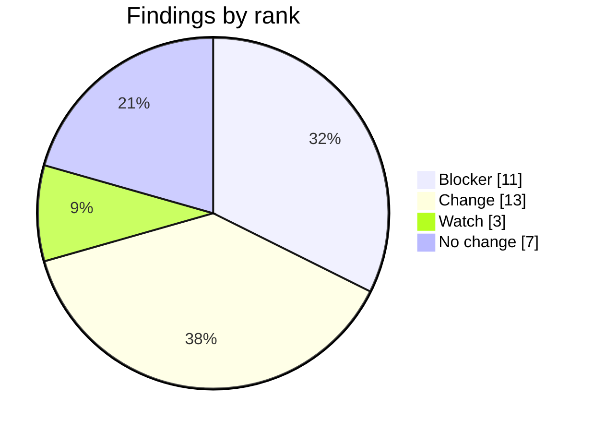
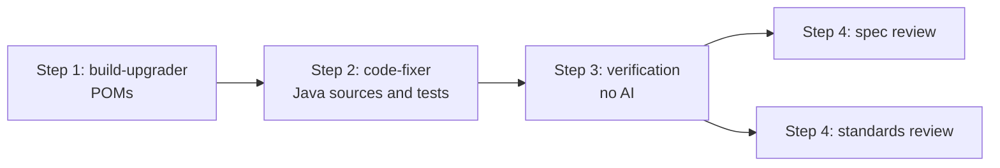

# Asset Manager Java Modernization Plan

## Request

- Issue: #16
- Outcome: Asset Manager builds and runs on Java 21 and Spring Boot 3.5.16, with `javax.*` EE imports moved to `jakarta.*`.
- Assessment: [assessment.md](assessment.md), approved by @lenvolk on 2026-10-19T23:07:03Z (gate 1), assessed commit `953286b19440`.

## Run Parameters

```yaml
issue: 16
project: asset-manager
source: { java: 8, spring-boot: "2.7.18" }
target: { java: 21, spring-boot: "3.5.16" }
maven-wrapper: "keep (3.9.9)"
```

## Assessment Summary

| Measure | Value |
|---|---|
| Code | 26 classes, 1207 lines (web 15 classes, worker 11) |
| Tests on JDK 8 baseline | 4 run, 0 failed, 1 error: `S3FileProcessingServiceTest.downloadOriginalCopiesFileFromS3` (Mockito cannot mock `ResponseInputStream`) |
| Test classes | web 0, worker 1 |
| `javax` imports to migrate | 9 in 5 files |
| JDK internal API use (jdeps) | 7 dependencies |
| Known advisories (OSV.dev) | 169 (17 critical, 64 high, 71 moderate, 17 low) |
| Findings | 34: 11 Blocker, 13 Change, 3 Watch, 7 No change |



## Scope

In scope:

- Java 8 to 21 and Spring Boot 2.7.18 to 3.5.16 in `asset-manager/` (modules `web`, `worker`).
- POM changes, `javax` to `jakarta` imports, Spring Framework 6 API changes.
- Reviewer decisions: no explicit `jakarta.servlet-api`; BOM manages PostgreSQL, Thymeleaf and Jackson; AWS SDK S3 moves to 2.57.0; Maven Wrapper stays; the baseline Mockito error is fixed only if it persists on JDK 21.

Out of scope:

- Azure service migration, containerization, deployment, CI/CD, observability, production rollout.
- Spring Boot 4.
- New tests for the `web` module.
- `javax.imageio.*`, which ships with the JDK and stays.

## Execution Plan



### Step 1 - modernize-build-upgrader

Findings: C-01, D-01, D-02, D-03, D-04, D-05, D-06, D-07, D-08, D-09, D-10, D-11, D-12, D-13, D-14, D-15, D-16, D-17, D-18, D-19, D-20.

Files it may change: `asset-manager/pom.xml`, `asset-manager/web/pom.xml`, `asset-manager/worker/pom.xml`. No Maven Wrapper change. No explicit `jakarta.servlet-api` dependency.

```diff
 asset-manager/pom.xml
-  spring-boot-starter-parent   2.7.18
+  spring-boot-starter-parent   3.5.16
-  java.version                 8
+  java.version                 21
 web/pom.xml, worker/pom.xml
-  explicit <version> on Boot starters, devtools, configuration-processor, lombok, postgresql, jackson-databind, thymeleaf
+  versions managed by the Spring Boot 3.5.16 BOM
-  aws-sdk.version              2.25.13
+  aws-sdk.version              2.57.0
```

Commit pattern: `build(D-01,D-02,C-01): ...`, `build(D-03,D-04,...): ...`.

Done when: both modules resolve dependencies on JDK 21 and the effective versions match the diff.

### Step 2 - modernize-code-fixer

Findings: C-03, C-04, C-05, C-06, C-07, C-09.

Files it may change:

- `web/.../config/WebMvcConfig.java`
- `web/.../model/ImageMetadata.java`
- `web/.../service/LocalFileStorageService.java`
- `worker/.../worker/model/ImageMetadata.java`
- `worker/.../worker/service/LocalFileProcessingService.java`
- `worker/src/test/.../S3FileProcessingServiceTest.java`, only if the Mockito error remains on JDK 21.

```diff
-class WebMvcConfig extends WebMvcConfigurerAdapter
+class WebMvcConfig implements WebMvcConfigurer
-class ...Interceptor extends HandlerInterceptorAdapter
+class ...Interceptor implements HandlerInterceptor
-import javax.servlet.http.*;     import javax.persistence.*;     import javax.annotation.PostConstruct;
+import jakarta.servlet.http.*;   import jakarta.persistence.*;   import jakarta.annotation.PostConstruct;
```

Commit pattern: `fix(C-03): ...`, `fix(C-04,C-06): ...`, `fix(C-09): ...`. `Paths.get` may stay or become `Path.of`.

Done when: both modules compile and tests pass on JDK 21 in a build and test loop, and test results are no worse than baseline. No-change findings stay untouched.

### Step 3 - verification

Deterministic, no AI:

- JDK 21 build and tests of both modules against the baseline.
- Version and namespace checks against Run Parameters.
- OSV.dev re-scan compared with the baseline of 169 advisories.

### Step 4 - review

- `modernize-conformance-reviewer` (spec): traces all findings to the diff.
- `modernize-standards-reviewer` (standards): checks repository rules.

Both run in parallel.

## Finding Coverage

| ID | Rank | Finding | Step | Agent | Verified by |
|---|---|---|---|---|---|
| C-03 | Blocker | WebMvcConfigurerAdapter and HandlerInterceptorAdapter removed in Spring 6 | Step 2 | modernize-code-fixer | verify-build |
| D-01 | Blocker | Spring Boot parent 2.7.18 to 3.5.16 | Step 1 | modernize-build-upgrader | verify-static |
| D-02 | Blocker | java.version 8 to 21 | Step 1 | modernize-build-upgrader | verify-static |
| D-03 | Blocker | Thymeleaf starter, 3 critical CVEs, BOM-managed | Step 1 | modernize-build-upgrader | verify-static |
| D-04 | Blocker | starter-web, BOM-managed (Tomcat 10.1.x) | Step 1 | modernize-build-upgrader | verify-static |
| D-07 | Blocker | devtools, BOM-managed | Step 1 | modernize-build-upgrader | verify-static |
| D-11 | Blocker | web starter-data-jpa, BOM-managed | Step 1 | modernize-build-upgrader | verify-static |
| D-12 | Blocker | web PostgreSQL 42.3.8, CVE-2024-1597, BOM-managed | Step 1 | modernize-build-upgrader | verify-static |
| D-18 | Blocker | worker jackson-databind 2.13.5, BOM-managed | Step 1 | modernize-build-upgrader | verify-static |
| D-19 | Blocker | worker starter-data-jpa, BOM-managed | Step 1 | modernize-build-upgrader | verify-static |
| D-20 | Blocker | worker PostgreSQL 42.3.8, CVE-2024-1597, BOM-managed | Step 1 | modernize-build-upgrader | verify-static |
| C-01 | Change | Parent POM Boot and Java baseline | Step 1 | modernize-build-upgrader | verify-static |
| C-04 | Change | web ImageMetadata javax.persistence to jakarta | Step 2 | modernize-code-fixer | verify-static |
| C-05 | Change | LocalFileStorageService PostConstruct to jakarta.annotation | Step 2 | modernize-code-fixer | verify-static |
| C-06 | Change | worker ImageMetadata javax.persistence to jakarta | Step 2 | modernize-code-fixer | verify-static |
| C-07 | Change | LocalFileProcessingService PostConstruct to jakarta.annotation | Step 2 | modernize-code-fixer | verify-static |
| D-05 | Change | web starter-amqp, BOM-managed | Step 1 | modernize-build-upgrader | verify-static |
| D-08 | Change | web configuration-processor, BOM-managed | Step 1 | modernize-build-upgrader | verify-static |
| D-09 | Change | web lombok, BOM-managed | Step 1 | modernize-build-upgrader | verify-static |
| D-10 | Change | web starter-test, BOM-managed | Step 1 | modernize-build-upgrader | verify-static |
| D-13 | Change | worker starter, BOM-managed | Step 1 | modernize-build-upgrader | verify-static |
| D-14 | Change | worker starter-amqp, BOM-managed | Step 1 | modernize-build-upgrader | verify-static |
| D-16 | Change | worker lombok, BOM-managed | Step 1 | modernize-build-upgrader | verify-static |
| D-17 | Change | worker starter-test, BOM-managed | Step 1 | modernize-build-upgrader | verify-static |
| C-09 | Watch | Baseline Mockito ResponseInputStream error | Step 2 | modernize-code-fixer | verify-build |
| D-06 | Watch | web aws-sdk.version 2.25.13 to 2.57.0 | Step 1 | modernize-build-upgrader | verify-static |
| D-15 | Watch | worker aws-sdk.version 2.25.13 to 2.57.0 | Step 1 | modernize-build-upgrader | verify-static |
| C-02 | No change | No explicit jakarta.servlet-api needed | none | none | verify-build |
| C-08 | No change | javax.imageio stays, it ships with the JDK | none | none | verify-static |
| C-10 | No change | Thymeleaf templates need no change | none | none | verify-build |
| C-11 | No change | web application.properties keys are Boot 3 compatible | none | none | verify-build |
| C-12 | No change | worker application.properties keys are Boot 3 compatible | none | none | verify-build |
| D-21 | No change | Maven Wrapper 3.9.9 kept | none | none | verify-static |
| D-22 | No change | spring-boot-maven-plugin inherited from parent | none | none | verify-static |

## Validation

- Capture the baseline first: 4 tests run, 0 failed, 1 error (`S3FileProcessingServiceTest.downloadOriginalCopiesFileFromS3`). Do not assume the baseline is green.
- Build both modules on JDK 21.
- Tests are no worse than baseline. The Mockito error is fixed if the Boot 3.5 test stack allows it, otherwise the reason is explained.
- Both jars package.
- No `javax.persistence|annotation|servlet|validation` imports remain. `javax.imageio` stays.
- Versions match Run Parameters: Java 21, Spring Boot 3.5.16, aws-sdk 2.57.0.
- OSV advisories after the upgrade are reported against the baseline of 169.

## Risks and Rollback

| Risk | Likelihood | Impact | Mitigation | Findings |
|---|---|---|---|---|
| `web` module has no tests, so behavior is unproven | High | Medium | Compile, package, and template and property review only; tests belong in a separate request | C-03, C-10, C-11 |
| Mockito error persists on JDK 21 | Medium | Low | Revise the mock only if the error remains | C-09 |
| AWS SDK 2.57.0 is not BOM-managed and may change APIs | Medium | Medium | Compile and run worker tests; fall back to 2.25.13 if it breaks | D-06, D-15 |
| Spring Framework 6 MVC changes alter interceptor behavior | Low | Medium | Keep method bodies unchanged | C-03 |
| Worker has one test class only | Medium | Medium | Review diff for import-only changes | C-06, C-07 |

Rollback: every stage can be re-run. Nothing reaches `main` until a human merges the Implementation pull request. Closing that pull request and deleting its branch undoes the run.

## Cost Estimate

Filled in by the pipeline.

## Approval Checklist

- [ ] Targets accepted: Java 21, Spring Boot 3.5.16, Maven Wrapper kept.
- [ ] Scope accepted, including no tests for `web`.
- [ ] Every Blocker is owned by a step.
- [ ] Risks accepted.
- [ ] Cost accepted.
