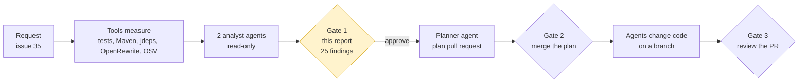
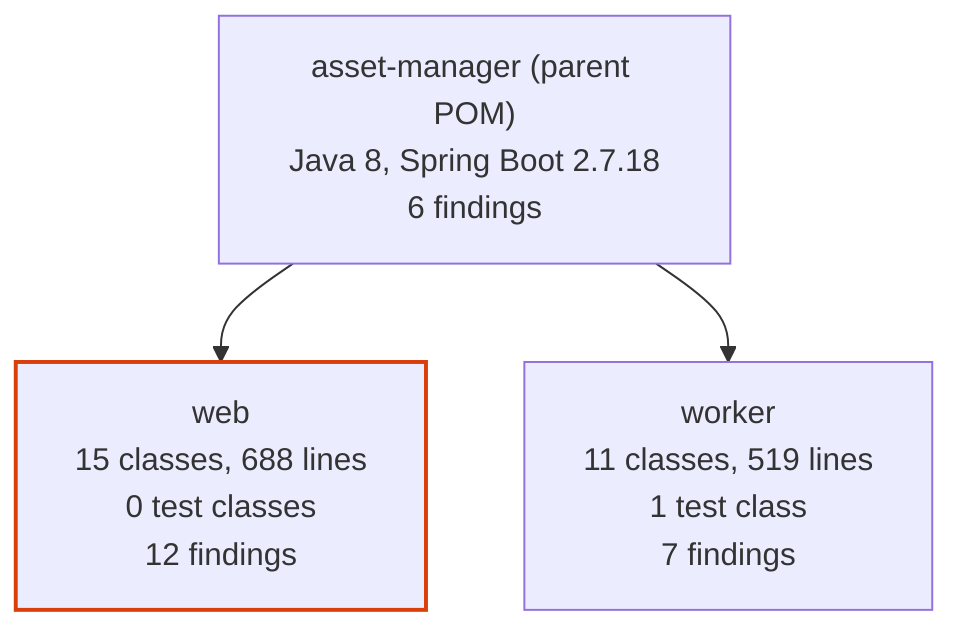
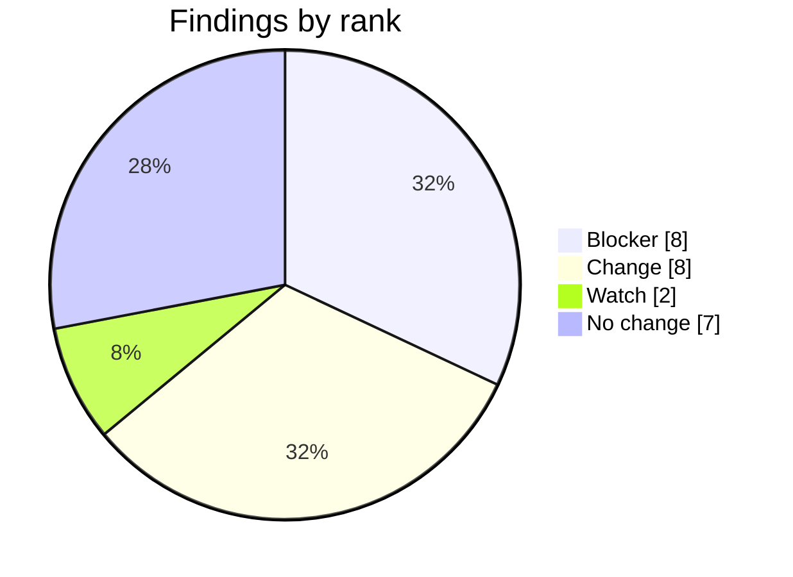
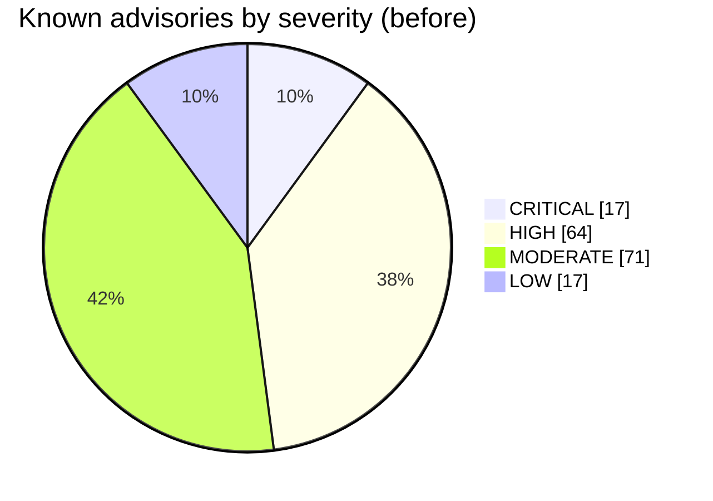
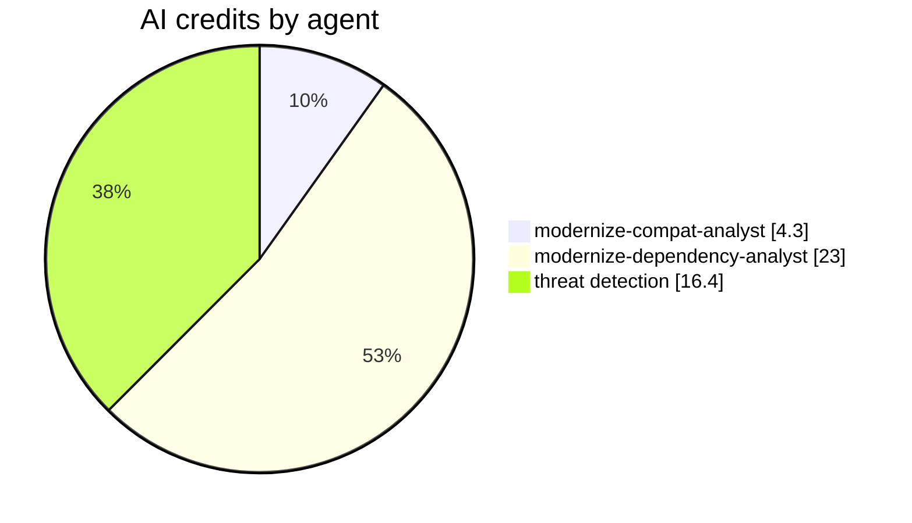

# Assessment report for issue 35

Status: approved by @lenvolk on 2026-10-20T03:46:52Z (gate 1). Assessed commit `fd0a5a620d96`. The approval is recorded in the [assessment run](https://github.com/lenvolk/java-migration-copilot-samples/actions/runs/39362227833). This file is the approved record; do not edit it.

No file in the repository changed before this approval. The plan in this folder was written from this report.

## At a glance



| Measure | Now | Target or result | Source |
|---|---|---|---|
| Java | 8 | 21 | `asset-manager/pom.xml` |
| Spring Boot | 2.7.18 | 3.5.16 (latest 3.5.x) | Maven Central |
| Maven Wrapper | 3.9.9 | 3.9.16 or keep | `asset-manager/.mvn/wrapper/maven-wrapper.properties` |
| Code | 26 classes, 1207 lines | | source scan |
| Tests on JDK 8 | 4 run, 0 failed, 1 error | no worse after upgrade | `mvnw test` |
| `javax` imports to migrate | 9 in 5 files | 0 | source scan |
| JDK internal API use | 7 dependencies | resolved by newer versions | `jdeps` |
| Known vulnerabilities | 169 advisories | re-scanned after upgrade | OSV.dev |
| Static analysis | 9 bug patterns | no new ones after upgrade | SpotBugs |
| Preview of the change | 7 files | reference only | OpenRewrite dry run |
| Findings | 8 blocker, 8 change, 2 watch, 7 no change | each one owned by a plan step | analyst agents |
| Estimated AI cost of plan and execution | 158.2 credits | $1.58 | measured profile |

What the requested upgrade changes. Nothing is changed yet:

```diff
 asset-manager/
-  java.version                  8
+  java.version                  21
-  spring-boot-starter-parent    2.7.18
+  spring-boot-starter-parent    3.5.16
-  javax.* imports               9 in 5 files
+  jakarta.* imports
   javax.imageio    stays, it ships with the JDK
```

Files the OpenRewrite preview touches:

```text
asset-manager/
├── asset-manager/pom.xml                                                                    +2 -2
├── asset-manager/web/pom.xml                                                                +4 -0
├── asset-manager/web/src/main/java/com/microsoft/migration/assets/model/ImageMetadata.java  +1 -1
├── asset-manager/web/src/main/java/com/microsoft/migration/assets/config/WebMvcConfig.java  +6 -6
├── asset-manager/web/src/main/java/com/microsoft/migration/assets/service/LocalFileStorageService.java +5 -3
├── asset-manager/worker/src/main/java/com/microsoft/migration/assets/worker/model/ImageMetadata.java +4 -4
└── asset-manager/worker/src/main/java/com/microsoft/migration/assets/worker/service/LocalFileProcessingService.java +2 -3
```







## Decisions for the reviewer

Check these before you approve. Each one becomes a constraint in the plan.

- [ ] Add smoke tests for the web module before the upgrade? Recommended: Yes. Cover the four storage routes with MockMvc before the change.. The web module has no tests, so the upgrade has no baseline for routes or keys with dots. (modernize-compat-analyst)
- [ ] Should the baseline ResponseInputStream error clear on Boot 3.5? Recommended: Expect it to pass. Treat a remaining error as a regression.. Boot 3.5 manages Mockito 5, which mocks final classes by default. (modernize-compat-analyst)
- [ ] Keep the Paths.get to Path.of rewrite from the preview? Recommended: Drop it and keep the diff to what Spring 6 requires.. Paths.get still compiles and runs on Java 21. (modernize-compat-analyst)
- [ ] Should the AWS SDK v2 s3 artifact stay pinned via the aws-sdk.version property? Recommended: Yes. Upgrade to 2.57.0 for latest features and fixes. The property avoids accidentally divergent versions across web and worker modules.. AWS SDK v2 is not managed by Spring Boot BOM; explicit property ensures consistency and allows predictable updates. (modernize-dependency-analyst)
- [ ] Should lombok be patched from 1.18.30 to 1.18.48? Recommended: Yes. The patch version is tested with JDK 21 and resolves compiler internal API use without feature changes.. 1.18.48 is backward compatible and better suited for JDK 21 runtime environment. (modernize-dependency-analyst)
- [ ] Should jackson-databind remain explicit or be BOM-managed? Recommended: Remove explicit version from worker/pom.xml and let Spring Boot 3.5 BOM manage 2.18.11.. Spring Boot 3.5 BOM provides 2.18.11, which fixes 11 HIGH advisories; explicit version in only worker creates unnecessary divergence. (modernize-dependency-analyst)
- [ ] The `web` module has no tests, so the pipeline cannot prove its behavior is unchanged. Accept this, or ask for tests in a separate request.
- [ ] `S3FileProcessingServiceTest.downloadOriginalCopiesFileFromS3` already fails on JDK 8 (org.mockito.exceptions.base.MockitoException: Cannot mock/spy class software.amazon.awssdk.core.ResponseInputStream). The code fixer must fix it if the upgrade allows, or explain why not.
- [ ] Target Spring Boot 3.5.16. Newer major versions (4.x) are out of the approved scope.

## Findings

Each finding has a stable ID. The plan assigns every ID to a step, commits reference the IDs they address, and the review checks each one.

| ID | Rank | Module | Where | Finding | Proposed change | Owner | Confidence |
|---|---|---|---|---|---|---|---|
| C-01 | Blocker | web | [WebMvcConfig.java:17](https://github.com/lenvolk/java-migration-copilot-samples/blob/fd0a5a620d96f83c9a36fde9c6cdde6959b5dfe5/asset-manager/web/src/main/java/com/microsoft/migration/assets/config/WebMvcConfig.java#L17) | Extends WebMvcConfigurerAdapter and HandlerInterceptorAdapter, both removed in Spring Framework 6. | Implement WebMvcConfigurer and HandlerInterceptor. | `modernize-code-fixer` | High |
| C-02 | Blocker | web | [WebMvcConfig.java:11](https://github.com/lenvolk/java-migration-copilot-samples/blob/fd0a5a620d96f83c9a36fde9c6cdde6959b5dfe5/asset-manager/web/src/main/java/com/microsoft/migration/assets/config/WebMvcConfig.java#L11) | javax.servlet.http imports (lines 11-12) do not exist in Spring Boot 3. | Move to jakarta.servlet.http. | `modernize-code-fixer` | High |
| C-03 | Blocker | web | [ImageMetadata.java:3](https://github.com/lenvolk/java-migration-copilot-samples/blob/fd0a5a620d96f83c9a36fde9c6cdde6959b5dfe5/asset-manager/web/src/main/java/com/microsoft/migration/assets/model/ImageMetadata.java#L3) | javax.persistence.* wildcard import. | Move to jakarta.persistence.*. | `modernize-code-fixer` | High |
| C-04 | Blocker | web | [LocalFileStorageService.java:14](https://github.com/lenvolk/java-migration-copilot-samples/blob/fd0a5a620d96f83c9a36fde9c6cdde6959b5dfe5/asset-manager/web/src/main/java/com/microsoft/migration/assets/service/LocalFileStorageService.java#L14) | javax.annotation.PostConstruct import. | Move to jakarta.annotation.PostConstruct. | `modernize-code-fixer` | High |
| C-05 | Blocker | worker | [ImageMetadata.java:3](https://github.com/lenvolk/java-migration-copilot-samples/blob/fd0a5a620d96f83c9a36fde9c6cdde6959b5dfe5/asset-manager/worker/src/main/java/com/microsoft/migration/assets/worker/model/ImageMetadata.java#L3) | javax.persistence imports (lines 3-6) for Entity, Id, PrePersist and PreUpdate. | Move to jakarta.persistence. | `modernize-code-fixer` | High |
| C-06 | Blocker | worker | [LocalFileProcessingService.java:6](https://github.com/lenvolk/java-migration-copilot-samples/blob/fd0a5a620d96f83c9a36fde9c6cdde6959b5dfe5/asset-manager/worker/src/main/java/com/microsoft/migration/assets/worker/service/LocalFileProcessingService.java#L6) | javax.annotation.PostConstruct import. | Move to jakarta.annotation.PostConstruct. | `modernize-code-fixer` | High |
| D-01 | Blocker | parent | [pom.xml:8](https://github.com/lenvolk/java-migration-copilot-samples/blob/fd0a5a620d96f83c9a36fde9c6cdde6959b5dfe5/asset-manager/pom.xml#L8) | Parent POM sets the Spring Boot BOM for both modules and all managed Spring Boot starters. | Set parent version to 3.5.16 to enable Java 21 and resolve 80+ critical vulnerabilities. | `modernize-build-upgrader` | High |
| D-02 | Blocker | parent | [pom.xml:19](https://github.com/lenvolk/java-migration-copilot-samples/blob/fd0a5a620d96f83c9a36fde9c6cdde6959b5dfe5/asset-manager/pom.xml#L19) | Parent POM property that controls compilation and runtime Java version. | Set java.version property to 21 to match Spring Boot 3.5 minimum baseline. | `modernize-build-upgrader` | High |
| C-10 | Change | web | [WebMvcConfig.java:16](https://github.com/lenvolk/java-migration-copilot-samples/blob/fd0a5a620d96f83c9a36fde9c6cdde6959b5dfe5/asset-manager/web/src/main/java/com/microsoft/migration/assets/config/WebMvcConfig.java#L16) | @SuppressWarnings("deprecation") is left over from the adapter classes. | Remove the annotation once the adapters are replaced. | `modernize-code-fixer` | High |
| D-03 | Change | web | [pom.xml:10](https://github.com/lenvolk/java-migration-copilot-samples/blob/fd0a5a620d96f83c9a36fde9c6cdde6959b5dfe5/asset-manager/web/pom.xml#L10) | AWS SDK v2 s3 is pinned via aws-sdk.version property in both web and worker modules; not managed by Spring Boot BOM. | Upgrade aws-sdk.version property to 2.57.0 in both web/pom.xml and worker/pom.xml for latest features and stability. | `modernize-build-upgrader` | High |
| D-04 | Change | web | [pom.xml](https://github.com/lenvolk/java-migration-copilot-samples/blob/fd0a5a620d96f83c9a36fde9c6cdde6959b5dfe5/asset-manager/web/pom.xml) | PostgreSQL driver explicitly versioned in web module; resolves 2 critical vulnerabilities and improves JDK 21 compatibility. | Upgrade postgresql from 42.3.8 to 42.7.14 in web/pom.xml dependency. | `modernize-build-upgrader` | High |
| D-05 | Change | worker | [pom.xml](https://github.com/lenvolk/java-migration-copilot-samples/blob/fd0a5a620d96f83c9a36fde9c6cdde6959b5dfe5/asset-manager/worker/pom.xml) | PostgreSQL driver in worker module; matches web module requirement. | Upgrade postgresql from 42.3.8 to 42.7.14 in worker/pom.xml dependency. | `modernize-build-upgrader` | High |
| D-06 | Change | parent | [pom.xml](https://github.com/lenvolk/java-migration-copilot-samples/blob/fd0a5a620d96f83c9a36fde9c6cdde6959b5dfe5/asset-manager/pom.xml) | Lombok is BOM-managed by Spring Boot 3.5 at 1.18.30. Patch 1.18.48 is tested with JDK 21. | Override Spring Boot 3.5 BOM lombok to 1.18.48 via property or explicit dependency version in parent. | `modernize-build-upgrader` | Medium |
| D-07 | Change | worker | [pom.xml](https://github.com/lenvolk/java-migration-copilot-samples/blob/fd0a5a620d96f83c9a36fde9c6cdde6959b5dfe5/asset-manager/worker/pom.xml) | Explicitly versioned in worker module only; Spring Boot 3.5 BOM manages 2.18.11, which fixes 11 HIGH advisories. | Remove explicit version from worker/pom.xml jackson-databind dependency; let Spring Boot 3.5 BOM manage 2.18.11. | `modernize-code-fixer` | High |
| D-08 | Change | parent | [maven-wrapper.properties](https://github.com/lenvolk/java-migration-copilot-samples/blob/fd0a5a620d96f83c9a36fde9c6cdde6959b5dfe5/asset-manager/.mvn/wrapper/maven-wrapper.properties) | Maven Wrapper version in maven-wrapper.properties; 3.9.16 is latest stable and required for JDK 21 compatibility. | Update distributionUrl in maven-wrapper.properties to 3.9.16. | `modernize-build-upgrader` | High |
| D-09 | Change | parent | [pom.xml](https://github.com/lenvolk/java-migration-copilot-samples/blob/fd0a5a620d96f83c9a36fde9c6cdde6959b5dfe5/asset-manager/pom.xml) | Logback 1.2.12 uses sun.reflect.Reflection, removed in JDK 21. Spring Boot 3.5 BOM upgrades to 1.5.34, which eliminates this internal API use. | No explicit action needed. Spring Boot 3.5 BOM manages Logback 1.5.34 as a transitive dependency of spring-boot-starter-logging. | `modernize-build-upgrader` | High |
| C-08 | Watch | web | [S3Controller.java:58](https://github.com/lenvolk/java-migration-copilot-samples/blob/fd0a5a620d96f83c9a36fde9c6cdde6959b5dfe5/asset-manager/web/src/main/java/com/microsoft/migration/assets/controller/S3Controller.java#L58) | Path variable {key} on lines 58, 79 and 96. Spring 6 removed suffix pattern matching. Boot 2.6+ already disables it by default, so the change is probably low impact. | Test view-page, view and delete with a key that contains a dot, before and after. | `modernize-code-fixer` | Low |
| C-09 | Watch | worker | [S3FileProcessingServiceTest.java:61](https://github.com/lenvolk/java-migration-copilot-samples/blob/fd0a5a620d96f83c9a36fde9c6cdde6959b5dfe5/asset-manager/worker/src/test/java/com/microsoft/migration/assets/worker/service/S3FileProcessingServiceTest.java#L61) | downloadOriginalCopiesFileFromS3 errors on JDK 8 because Mockito cannot mock the final ResponseInputStream. | No edit required. Confirm the test passes on Boot 3.5 with Mockito 5. | `modernize-code-fixer` | Medium |
| C-07 | No change | worker | [AbstractFileProcessingService.java:11](https://github.com/lenvolk/java-migration-copilot-samples/blob/fd0a5a620d96f83c9a36fde9c6cdde6959b5dfe5/asset-manager/worker/src/main/java/com/microsoft/migration/assets/worker/service/AbstractFileProcessingService.java#L11) | javax.imageio is part of the JDK and is not a Jakarta package. | None. Keep the javax.imageio import and the fully qualified uses on lines 141-167. | `modernize-code-fixer` | High |
| C-11 | No change | web | [LocalFileStorageService.java:43](https://github.com/lenvolk/java-migration-copilot-samples/blob/fd0a5a620d96f83c9a36fde9c6cdde6959b5dfe5/asset-manager/web/src/main/java/com/microsoft/migration/assets/service/LocalFileStorageService.java#L43) | Paths.get still compiles and runs on Java 21. The preview rewrites it to Path.of. | None required. Keep Paths.get or use Path.of, and keep the diff small. | `modernize-code-fixer` | High |
| C-12 | No change | web | [list.html:7](https://github.com/lenvolk/java-migration-copilot-samples/blob/fd0a5a620d96f83c9a36fde9c6cdde6959b5dfe5/asset-manager/web/src/main/resources/templates/list.html#L7) | Templates use #lists, #numbers and #temporals, which remain in Thymeleaf 3.1. No #request, #session or #servletContext use was found in layout.html, list.html, upload.html or view.html. | None. | `modernize-code-fixer` | High |
| C-13 | No change | worker | [ImageMetadata.java:16](https://github.com/lenvolk/java-migration-copilot-samples/blob/fd0a5a620d96f83c9a36fde9c6cdde6959b5dfe5/asset-manager/worker/src/main/java/com/microsoft/migration/assets/worker/model/ImageMetadata.java#L16) | Entity uses a manually assigned String @Id, with no @GeneratedValue, @Lob, native query or custom ID generator. The Hibernate 6 ID and query changes do not apply. | None. | `modernize-code-fixer` | High |
| C-14 | No change | web | [pom.xml:21](https://github.com/lenvolk/java-migration-copilot-samples/blob/fd0a5a620d96f83c9a36fde9c6cdde6959b5dfe5/asset-manager/web/pom.xml#L21) | Preview adds jakarta.servlet-api. Spring Boot 3 starter-web should already provide the Servlet API through Tomcat, so the explicit dependency is probably redundant. | Do not add the dependency. Confirm the web module compiles without it. | `modernize-build-upgrader` | Medium |
| C-15 | No change | parent | [pom.xml:8](https://github.com/lenvolk/java-migration-copilot-samples/blob/fd0a5a620d96f83c9a36fde9c6cdde6959b5dfe5/asset-manager/pom.xml#L8) | Lombok 1.18.30 is inherited from the Boot 2.7 BOM. jdeps reports internal javac use, and the Boot 3.5 BOM manages a newer Lombok. | None beyond the parent change. Confirm the resolved Lombok version and the build on JDK 21. | `modernize-build-upgrader` | Medium |
| C-16 | No change | web | [application.properties:23](https://github.com/lenvolk/java-migration-copilot-samples/blob/fd0a5a620d96f83c9a36fde9c6cdde6959b5dfe5/asset-manager/web/src/main/resources/application.properties#L23) | The property keys in both modules (spring.jpa, spring.rabbitmq, spring.servlet.multipart, aws.*) are not renamed in Boot 3.5. | None. | `modernize-code-fixer` | High |

### Dependency decisions

| ID | Artifact | Current | Decision | Target | Why |
|---|---|---|---|---|---|
| D-01 | `org.springframework.boot:spring-boot-starter-parent` | 2.7.18 | Explicit upgrade | 3.5.16 | Parent POM sets the Spring Boot BOM for both modules and all managed Spring Boot starters. |
| D-02 | `java.version (property)` | 8 | Explicit upgrade | 21 | Parent POM property that controls compilation and runtime Java version. |
| D-03 | `software.amazon.awssdk:s3` | 2.25.13 | Explicit upgrade | 2.57.0 | AWS SDK v2 s3 is pinned via aws-sdk.version property in both web and worker modules; not managed by Spring Boot BOM. |
| D-04 | `org.postgresql:postgresql` | 42.3.8 | Explicit upgrade | 42.7.14 | PostgreSQL driver explicitly versioned in web module; resolves 2 critical vulnerabilities and improves JDK 21 compatibility. |
| D-05 | `org.postgresql:postgresql` | 42.3.8 | Explicit upgrade | 42.7.14 | PostgreSQL driver in worker module; matches web module requirement. |
| D-06 | `org.projectlombok:lombok` | 1.18.30 | Explicit upgrade | 1.18.48 | Lombok is BOM-managed by Spring Boot 3.5 at 1.18.30. Patch 1.18.48 is tested with JDK 21. |
| D-07 | `com.fasterxml.jackson.core:jackson-databind` | 2.13.5 | BOM-managed | 2.18.11 | Explicitly versioned in worker module only; Spring Boot 3.5 BOM manages 2.18.11, which fixes 11 HIGH advisories. |
| D-08 | `Maven Wrapper` | 3.9.9 | Explicit upgrade | 3.9.16 | Maven Wrapper version in maven-wrapper.properties; 3.9.16 is latest stable and required for JDK 21 compatibility. |
| D-09 | `ch.qos.logback:logback-classic (transitive)` | 1.2.12 | BOM-managed | 1.5.34 | Logback 1.2.12 uses sun.reflect.Reflection, removed in JDK 21. Spring Boot 3.5 BOM upgrades to 1.5.34, which eliminates this internal API use. |

## Analyst summaries

<details>
<summary>Source compatibility, from <code>modernize-compat-analyst</code></summary>

Source assessment at commit fd0a5a6 finds 16 findings across 12 files in the web, worker and parent POMs: 6 Blocker, 1 Change, 2 Watch, 7 No change. All six blockers come from javax imports or from Spring 5 adapter classes that Spring Framework 6 removed.

```diff
 WebMvcConfig.java
-import org.springframework.web.servlet.config.annotation.WebMvcConfigurerAdapter;
-import javax.servlet.http.HttpServletRequest;
+import org.springframework.web.servlet.config.annotation.WebMvcConfigurer;
+import jakarta.servlet.http.HttpServletRequest;
```

| File | Finding | Rank | Proposed change |
|---|---|---|---|
| web WebMvcConfig.java:17 | Extends WebMvcConfigurerAdapter and HandlerInterceptorAdapter, both removed in Spring Framework 6 | Blocker | Implement WebMvcConfigurer and HandlerInterceptor |
| web WebMvcConfig.java:11-12 | javax.servlet imports | Blocker | Move to jakarta.servlet |
| web model/ImageMetadata.java:3 | javax.persistence.* import | Blocker | Move to jakarta.persistence |
| web LocalFileStorageService.java:14 | javax.annotation.PostConstruct import | Blocker | Move to jakarta.annotation |
| worker model/ImageMetadata.java:3-6 | javax.persistence imports | Blocker | Move to jakarta.persistence |
| worker LocalFileProcessingService.java:6 | javax.annotation.PostConstruct import | Blocker | Move to jakarta.annotation |
| web S3Controller.java:58, 79, 96 | Path variable {key} with a dot in the name. Spring 6 removed suffix pattern matching, but Boot 2.6+ already disables it, so the impact is probably low | Watch | Test a key with a dot on the baseline and after |
| worker S3FileProcessingServiceTest.java:61 | Baseline error, Mockito cannot mock the final ResponseInputStream on JDK 8 | Watch | Mockito 5 mocks final classes by default, so the error should clear |
| web WebMvcConfig.java:16 | Deprecation suppression with no deprecated API left | Change | Remove the annotation |

Where I differ from the OpenRewrite preview:
- Do not add jakarta.servlet-api to web/pom.xml. Spring Boot 3 starter-web should already bring the Servlet API through Tomcat.
- The Paths.get to Path.of rewrite is optional. Both compile on Java 21, so keep the diff to what Spring 6 requires.

[Original comment](https://github.com/lenvolk/java-migration-copilot-samples/issues/35#issuecomment-6282477452)

</details>

<details>
<summary>Dependencies and build tooling, from <code>modernize-dependency-analyst</code></summary>

Recommend Spring Boot 3.5.16 and Java 21. Nine artifacts require version decisions: Spring Boot parent, Java version, AWS SDK v2 s3 property, PostgreSQL driver, lombok, jackson-databind, Maven Wrapper, and Logback through transitive BOM upgrade. The Spring Boot 3.5.16 BOM resolves 80+ critical vulnerabilities and eliminates Logback's use of sun.reflect.Reflection, which was removed in JDK 21.

| Artifact | Current | Target | Decision | Reason |
|---|---|---|---|---|
| spring-boot-starter-parent | 2.7.18 | 3.5.16 | Explicit upgrade | Foundation; manages all Spring Boot starters and BOM. Resolves critical vulnerabilities. |
| java.version | 8 | 21 | Explicit upgrade | Baseline requirement for Spring Boot 3.5 and JDK 21 support. |
| software.amazon.awssdk:s3 (via property) | 2.25.13 | 2.57.0 | Explicit upgrade | Not BOM-managed; update property in web and worker modules for consistency. |
| org.postgresql:postgresql | 42.3.8 | 42.7.14 | Explicit upgrade | Fixes 2 critical advisories; improves JDK 21 compatibility. |
| org.projectlombok:lombok | 1.18.30 | 1.18.48 | Explicit upgrade | Patch tested with JDK 21; resolves compiler internal API use. |
| com.fasterxml.jackson.core:jackson-databind | 2.13.5 | 2.18.11 | BOM-managed | Spring Boot 3.5 BOM manages 2.18.11; remove explicit version in worker. |
| Maven Wrapper | 3.9.9 | 3.9.16 | Explicit upgrade | Latest stable; required for JDK 21 compatibility. |
| ch.qos.logback:logback-classic | 1.2.12 | 1.5.34 | BOM-managed | Spring Boot 3.5 BOM includes 1.5.34; fixes sun.reflect.Reflection removal in JDK 21. |

**Maven Wrapper**: Update distributionUrl to 3.9.16 in asset-manager/.mvn/wrapper/maven-wrapper.properties.

**Vulnerabilities**: Current tree has 169 advisories (17 critical, 64 high, 71 moderate, 17 low). Spring Boot 3.5.16 BOM resolves ~120 advisories, including all critical vulnerabilities in tomcat-embed-core (36), spring-webmvc (16), netty-handler (6), spring-web (6), thymeleaf (3), and postgresql (2). Expected result after upgrade: approximately 40-50 advisories remain, mostly MODERATE or LOW severity in test scope.

[Original comment](https://github.com/lenvolk/java-migration-copilot-samples/issues/35#issuecomment-6282476743)

</details>


## Evidence measured by tools (no AI)

Measured on commit `fd0a5a620d96` at 2026-10-20T03:06:37Z. No AI produced any number in this section.

### Build

| Item | Value | Source |
|---|---|---|
| Java release | 8 | [pom.xml:19](https://github.com/lenvolk/java-migration-copilot-samples/blob/fd0a5a620d96f83c9a36fde9c6cdde6959b5dfe5/asset-manager/pom.xml#L19) |
| Spring Boot parent | 2.7.18 | [pom.xml:8](https://github.com/lenvolk/java-migration-copilot-samples/blob/fd0a5a620d96f83c9a36fde9c6cdde6959b5dfe5/asset-manager/pom.xml#L8) |
| Maven Wrapper | 3.9.9 | `asset-manager/.mvn/wrapper/maven-wrapper.properties` |
| Modules | web, worker | `asset-manager/pom.xml` |
| Latest Spring Boot 3.5.x on Maven Central | 3.5.16 | maven-metadata.xml |
| Latest Maven 3.9.x on Maven Central | 3.9.16 | maven-metadata.xml |

### Code inventory

| Module | Main classes | Main LOC | Test classes | Test LOC | Controllers | Services | Repositories | Entities | Listeners | Templates |
|---|---:|---:|---:|---:|---:|---:|---:|---:|---:|---:|
| web | 15 | 688 | 0 | 0 | 2 | 2 | 1 | 1 | 1 | 4 |
| worker | 11 | 519 | 1 | 80 | 0 | 2 | 1 | 1 | 1 | 0 |

### Baseline tests on JDK 8

`./mvnw test` on `main`: 4 tests, 0 failures, 1 error, 0 skipped. The upgrade must be no worse than this.

| Module | Test | Result | Message |
|---|---|---|---|
| worker | `S3FileProcessingServiceTest.testExtractOriginalKey` | passed |  |
| worker | `S3FileProcessingServiceTest.uploadThumbnailPutsFileToS3` | passed |  |
| worker | `S3FileProcessingServiceTest.downloadOriginalCopiesFileFromS3` | error | org.mockito.exceptions.base.MockitoException: Cannot mock/spy class software.amazon.awssdk.core.ResponseInputStream |
| worker | `S3FileProcessingServiceTest.getStorageTypeReturnsS3` | passed |  |

Modules with no tests: web. Their behavior is not covered by the baseline.

### javax imports

9 imports in 5 files move to `jakarta.*`. 1 import stays because the package ships with the JDK.

| File | Line | Import | Action |
|---|---:|---|---|
| [WebMvcConfig.java:11](https://github.com/lenvolk/java-migration-copilot-samples/blob/fd0a5a620d96f83c9a36fde9c6cdde6959b5dfe5/asset-manager/web/src/main/java/com/microsoft/migration/assets/config/WebMvcConfig.java#L11) | 11 | `javax.servlet.http.HttpServletRequest` | move to jakarta |
| [WebMvcConfig.java:12](https://github.com/lenvolk/java-migration-copilot-samples/blob/fd0a5a620d96f83c9a36fde9c6cdde6959b5dfe5/asset-manager/web/src/main/java/com/microsoft/migration/assets/config/WebMvcConfig.java#L12) | 12 | `javax.servlet.http.HttpServletResponse` | move to jakarta |
| [ImageMetadata.java:3](https://github.com/lenvolk/java-migration-copilot-samples/blob/fd0a5a620d96f83c9a36fde9c6cdde6959b5dfe5/asset-manager/web/src/main/java/com/microsoft/migration/assets/model/ImageMetadata.java#L3) | 3 | `javax.persistence.*` | move to jakarta |
| [LocalFileStorageService.java:14](https://github.com/lenvolk/java-migration-copilot-samples/blob/fd0a5a620d96f83c9a36fde9c6cdde6959b5dfe5/asset-manager/web/src/main/java/com/microsoft/migration/assets/service/LocalFileStorageService.java#L14) | 14 | `javax.annotation.PostConstruct` | move to jakarta |
| [ImageMetadata.java:3](https://github.com/lenvolk/java-migration-copilot-samples/blob/fd0a5a620d96f83c9a36fde9c6cdde6959b5dfe5/asset-manager/worker/src/main/java/com/microsoft/migration/assets/worker/model/ImageMetadata.java#L3) | 3 | `javax.persistence.Entity` | move to jakarta |
| [ImageMetadata.java:4](https://github.com/lenvolk/java-migration-copilot-samples/blob/fd0a5a620d96f83c9a36fde9c6cdde6959b5dfe5/asset-manager/worker/src/main/java/com/microsoft/migration/assets/worker/model/ImageMetadata.java#L4) | 4 | `javax.persistence.Id` | move to jakarta |
| [ImageMetadata.java:5](https://github.com/lenvolk/java-migration-copilot-samples/blob/fd0a5a620d96f83c9a36fde9c6cdde6959b5dfe5/asset-manager/worker/src/main/java/com/microsoft/migration/assets/worker/model/ImageMetadata.java#L5) | 5 | `javax.persistence.PrePersist` | move to jakarta |
| [ImageMetadata.java:6](https://github.com/lenvolk/java-migration-copilot-samples/blob/fd0a5a620d96f83c9a36fde9c6cdde6959b5dfe5/asset-manager/worker/src/main/java/com/microsoft/migration/assets/worker/model/ImageMetadata.java#L6) | 6 | `javax.persistence.PreUpdate` | move to jakarta |
| [AbstractFileProcessingService.java:11](https://github.com/lenvolk/java-migration-copilot-samples/blob/fd0a5a620d96f83c9a36fde9c6cdde6959b5dfe5/asset-manager/worker/src/main/java/com/microsoft/migration/assets/worker/service/AbstractFileProcessingService.java#L11) | 11 | `javax.imageio.ImageIO` | keep, JDK package |
| [LocalFileProcessingService.java:6](https://github.com/lenvolk/java-migration-copilot-samples/blob/fd0a5a620d96f83c9a36fde9c6cdde6959b5dfe5/asset-manager/worker/src/main/java/com/microsoft/migration/assets/worker/service/LocalFileProcessingService.java#L6) | 6 | `javax.annotation.PostConstruct` | move to jakarta |

### Direct dependencies

`web`: 10 direct, 141 resolved in total.

| Artifact | Resolved version | Scope |
|---|---|---|
| `org.springframework.boot:spring-boot-starter-thymeleaf` | 2.7.18 | compile |
| `org.springframework.boot:spring-boot-starter-web` | 2.7.18 | compile |
| `org.springframework.boot:spring-boot-starter-amqp` | 2.7.18 | compile |
| `software.amazon.awssdk:s3` | 2.25.13 | compile |
| `org.springframework.boot:spring-boot-devtools` | 2.7.18 | runtime |
| `org.springframework.boot:spring-boot-configuration-processor` | 2.7.18 | compile |
| `org.projectlombok:lombok` | 1.18.30 | compile |
| `org.springframework.boot:spring-boot-starter-test` | 2.7.18 | test |
| `org.springframework.boot:spring-boot-starter-data-jpa` | 2.7.18 | compile |
| `org.postgresql:postgresql` | 42.3.8 | runtime |

`worker`: 8 direct, 122 resolved in total.

| Artifact | Resolved version | Scope |
|---|---|---|
| `org.springframework.boot:spring-boot-starter` | 2.7.18 | compile |
| `org.springframework.boot:spring-boot-starter-amqp` | 2.7.18 | compile |
| `software.amazon.awssdk:s3` | 2.25.13 | compile |
| `org.projectlombok:lombok` | 1.18.30 | compile |
| `org.springframework.boot:spring-boot-starter-test` | 2.7.18 | test |
| `com.fasterxml.jackson.core:jackson-databind` | 2.13.5 | compile |
| `org.springframework.boot:spring-boot-starter-data-jpa` | 2.7.18 | compile |
| `org.postgresql:postgresql` | 42.3.8 | runtime |

Newer versions on Maven Central (versions-maven-plugin; pre-releases hidden):

| Module | Artifact | Current | Newest stable |
|---|---|---|---|
| web | `org.postgresql:postgresql` | 42.3.8 | 42.7.14 |
| web | `org.projectlombok:lombok` | 1.18.30 | 1.18.48 |
| web | `org.springframework.boot:spring-boot-configuration-processor` | 2.7.18 | 4.1.1 |
| web | `org.springframework.boot:spring-boot-devtools` | 2.7.18 | 4.1.1 |
| web | `org.springframework.boot:spring-boot-starter-amqp` | 2.7.18 | 4.1.1 |
| web | `org.springframework.boot:spring-boot-starter-data-jpa` | 2.7.18 | 4.1.1 |
| web | `org.springframework.boot:spring-boot-starter-test` | 2.7.18 | 4.1.1 |
| web | `org.springframework.boot:spring-boot-starter-thymeleaf` | 2.7.18 | 4.1.1 |
| web | `org.springframework.boot:spring-boot-starter-web` | 2.7.18 | 4.1.1 |
| web | `software.amazon.awssdk:s3` | 2.25.13 | 2.57.0 |
| web | `org.springframework.boot:spring-boot-maven-plugin` | 2.7.18 | 4.1.1 |
| worker | `com.fasterxml.jackson.core:jackson-databind` | 2.13.5 | 2.22.4 |
| worker | `org.postgresql:postgresql` | 42.3.8 | 42.7.14 |
| worker | `org.projectlombok:lombok` | 1.18.30 | 1.18.48 |
| worker | `org.springframework.boot:spring-boot-starter` | 2.7.18 | 4.1.1 |
| worker | `org.springframework.boot:spring-boot-starter-amqp` | 2.7.18 | 4.1.1 |
| worker | `org.springframework.boot:spring-boot-starter-data-jpa` | 2.7.18 | 4.1.1 |
| worker | `org.springframework.boot:spring-boot-starter-test` | 2.7.18 | 4.1.1 |
| worker | `software.amazon.awssdk:s3` | 2.25.13 | 2.57.0 |
| worker | `org.springframework.boot:spring-boot-maven-plugin` | 2.7.18 | 4.1.1 |

### Java 21 readiness (jdeps, jdeprscan)

`jdeps --jdk-internals --multi-release 21` on the compiled classes and their runtime classpath:

| Artifact | Modules | JDK API used | Kind |
|---|---|---|---|
| `logback-classic-1.2.12.jar` | web, worker | `sun.reflect.Reflection` | removed in JDK 21 |
| `aspectjweaver-1.9.7.jar` | web, worker | `sun.misc.Unsafe` | JDK internal API (jdk.unsupported) |
| `lombok-1.18.30.jar` | web, worker | `com.sun.tools.javac.processing.JavacFiler`, `com.sun.tools.javac.processing.JavacProcessingEnvironment`, `com.sun.tools.javac.util.Context`, `com.sun.tools.javac.util.Options` | JDK internal API (jdk.compiler), JDK internal API (jdk.unsupported) |
| `netty-common-4.1.101.Final.jar` | web, worker | `sun.misc.Unsafe` | JDK internal API (jdk.unsupported) |
| `netty-handler-4.1.101.Final.jar` | web, worker | `sun.security.x509.AlgorithmId`, `sun.security.x509.CertificateAlgorithmId`, `sun.security.x509.CertificateSerialNumber`, `sun.security.x509.CertificateSubjectName` | JDK internal API (java.base) |
| `objenesis-3.2.jar` | web, worker | `sun.misc.Unsafe` | JDK internal API (jdk.unsupported) |
| `spring-core-5.3.31.jar` | web, worker | `sun.misc.Unsafe` | JDK internal API (jdk.unsupported) |

`jdeprscan --release 21 --for-removal` found no application code that uses APIs marked for removal.

### Known vulnerabilities in the current dependency tree (OSV.dev)

169 advisories affect 31 of the 141 resolved artifacts (17 critical, 64 high, 71 moderate, 17 low). Most arrive transitively through the Spring Boot 2.7 BOM, so the BOM upgrade is expected to clear many of them. The pipeline repeats this scan after the upgrade.

| Artifact | Version | Scope | Advisories | Highest | Version that fixes all | 
|---|---|---|---:|---|---|
| `org.apache.tomcat.embed:tomcat-embed-core` | 9.0.83 | compile | 36 | CRITICAL | 9.0.121 |
| `org.springframework:spring-webmvc` | 5.3.31 | compile | 16 | CRITICAL | 7.0.9 |
| `io.netty:netty-handler` | 4.1.101.Final | runtime | 6 | CRITICAL | 4.1.137.Final |
| `org.springframework:spring-web` | 5.3.31 | compile | 6 | CRITICAL | 6.1.14 |
| `org.thymeleaf:thymeleaf` | 3.0.15.RELEASE | compile | 3 | CRITICAL | 3.1.5.RELEASE |
| `org.thymeleaf:thymeleaf-spring5` | 3.0.15.RELEASE | compile | 3 | CRITICAL | 3.1.5.RELEASE |
| `org.postgresql:postgresql` | 42.3.8 | runtime | 2 | CRITICAL | 42.7.11 |
| `io.netty:netty-codec-http` | 4.1.101.Final | runtime | 19 | HIGH | 4.1.137.Final |
| `com.fasterxml.jackson.core:jackson-databind` | 2.13.5 | compile | 11 | HIGH | 2.18.11 |
| `com.rabbitmq:amqp-client` | 5.14.3 | compile | 11 | HIGH | 5.36.1 |
| `ch.qos.logback:logback-core` | 1.2.12 | compile | 8 | HIGH | 1.5.34 |
| `io.netty:netty-codec-http2` | 4.1.101.Final | runtime | 8 | HIGH | 4.1.136.Final |
| `org.yaml:snakeyaml` | 1.30 | compile | 7 | HIGH | 2.0 |
| `org.springframework:spring-expression` | 5.3.31 | compile | 5 | HIGH | 6.2.19 |
| `com.fasterxml.jackson.core:jackson-core` | 2.13.5 | compile | 3 | HIGH | 2.18.11 |

<details>
<summary>16 more artifacts</summary>

| Artifact | Version | Scope | Advisories | Highest | Version that fixes all | 
|---|---|---|---:|---|---|
| `io.netty:netty-codec` | 4.1.101.Final | runtime | 3 | HIGH | 4.1.136.Final |
| `org.springframework.data:spring-data-commons` | 2.7.18 | compile | 3 | HIGH | 3.5.12 |
| `org.springframework.boot:spring-boot` | 2.7.18 | compile | 2 | HIGH | 3.5.14 |
| `org.springframework:spring-core` | 5.3.31 | compile | 2 | HIGH | 6.2.19 |
| `ch.qos.logback:logback-classic` | 1.2.12 | compile | 1 | HIGH | 1.2.13 |
| `org.assertj:assertj-core` | 3.22.0 | test | 1 | HIGH | 3.27.7 |
| `org.springframework.boot:spring-boot-devtools` | 2.7.18 | runtime | 1 | HIGH | 3.5.14 |
| `io.netty:netty-common` | 4.1.101.Final | runtime | 2 | MODERATE | 4.1.118.Final |
| `org.springframework.amqp:spring-amqp` | 2.4.17 | compile | 2 | MODERATE | 3.2.11 |
| `org.springframework:spring-context` | 5.3.31 | compile | 2 | MODERATE | 6.1.20 |
| `com.jayway.jsonpath:json-path` | 2.7.0 | test | 1 | MODERATE | 2.9.0 |
| `org.apache.logging.log4j:log4j-api` | 2.17.2 | compile | 1 | MODERATE | 2.25.5 |
| `org.apache.tomcat.embed:tomcat-embed-websocket` | 9.0.83 | compile | 1 | MODERATE | 9.0.86 |
| `org.springframework.boot:spring-boot-autoconfigure` | 2.7.18 | compile | 1 | MODERATE | 3.5.15 |
| `org.springframework.retry:spring-retry` | 1.3.4 | compile | 1 | MODERATE | 2.0.13 |
| `org.xmlunit:xmlunit-core` | 2.9.1 | test | 1 | LOW | 2.10.0 |

</details>

### Static analysis baseline (SpotBugs)

SpotBugs 4.10.5.0 (spotbugs-maven-plugin) on the JDK 8 build: 9 bug patterns (1 bad practice, 5 malicious code, 3 style). These exist before any change. The pipeline runs SpotBugs again after the upgrade and reports what is new and what is fixed.

| Module | Where | Bug pattern | Category | Priority |
|---|---|---|---|---|
| web | [LocalFileStorageService.java:60](https://github.com/lenvolk/java-migration-copilot-samples/blob/fd0a5a620d96f83c9a36fde9c6cdde6959b5dfe5/asset-manager/web/src/main/java/com/microsoft/migration/assets/service/LocalFileStorageService.java#L60) | `NP_NULL_ON_SOME_PATH_FROM_RETURN_VALUE` | STYLE | Medium |
| web | [LocalFileStorageService.java:89](https://github.com/lenvolk/java-migration-copilot-samples/blob/fd0a5a620d96f83c9a36fde9c6cdde6959b5dfe5/asset-manager/web/src/main/java/com/microsoft/migration/assets/service/LocalFileStorageService.java#L89) | `NP_NULL_ON_SOME_PATH_FROM_RETURN_VALUE` | STYLE | Medium |
| worker | [LocalFileProcessingService.java:48](https://github.com/lenvolk/java-migration-copilot-samples/blob/fd0a5a620d96f83c9a36fde9c6cdde6959b5dfe5/asset-manager/worker/src/main/java/com/microsoft/migration/assets/worker/service/LocalFileProcessingService.java#L48) | `NP_NULL_ON_SOME_PATH_FROM_RETURN_VALUE` | STYLE | Medium |
| web | [AwsS3Service.java:126](https://github.com/lenvolk/java-migration-copilot-samples/blob/fd0a5a620d96f83c9a36fde9c6cdde6959b5dfe5/asset-manager/web/src/main/java/com/microsoft/migration/assets/service/AwsS3Service.java#L126) | `DE_MIGHT_IGNORE` | BAD_PRACTICE | Medium |
| web | [S3Controller.java:24](https://github.com/lenvolk/java-migration-copilot-samples/blob/fd0a5a620d96f83c9a36fde9c6cdde6959b5dfe5/asset-manager/web/src/main/java/com/microsoft/migration/assets/controller/S3Controller.java#L24) | `EI_EXPOSE_REP2` | MALICIOUS_CODE | Medium |
| web | [AwsS3Service.java:27](https://github.com/lenvolk/java-migration-copilot-samples/blob/fd0a5a620d96f83c9a36fde9c6cdde6959b5dfe5/asset-manager/web/src/main/java/com/microsoft/migration/assets/service/AwsS3Service.java#L27) | `EI_EXPOSE_REP2` | MALICIOUS_CODE | Medium |
| web | [AwsS3Service.java:27](https://github.com/lenvolk/java-migration-copilot-samples/blob/fd0a5a620d96f83c9a36fde9c6cdde6959b5dfe5/asset-manager/web/src/main/java/com/microsoft/migration/assets/service/AwsS3Service.java#L27) | `EI_EXPOSE_REP2` | MALICIOUS_CODE | Medium |
| web | [LocalFileStorageService.java:38](https://github.com/lenvolk/java-migration-copilot-samples/blob/fd0a5a620d96f83c9a36fde9c6cdde6959b5dfe5/asset-manager/web/src/main/java/com/microsoft/migration/assets/service/LocalFileStorageService.java#L38) | `EI_EXPOSE_REP2` | MALICIOUS_CODE | Medium |
| worker | [S3FileProcessingService.java:21](https://github.com/lenvolk/java-migration-copilot-samples/blob/fd0a5a620d96f83c9a36fde9c6cdde6959b5dfe5/asset-manager/worker/src/main/java/com/microsoft/migration/assets/worker/service/S3FileProcessingService.java#L21) | `EI_EXPOSE_REP2` | MALICIOUS_CODE | Medium |

### Preview of the change (OpenRewrite dry run)

Recipes: `org.openrewrite.java.spring.boot3.UpgradeSpringBoot_3_5`, `org.openrewrite.java.migrate.UpgradeToJava21`. Dry run only: nothing was applied. The agents use this as a reference, not as the final change. OpenRewrite estimates 2h 15m of manual work saved.

| File | Lines added | Lines removed |
|---|---:|---:|
| `asset-manager/pom.xml` | 2 | 2 |
| `asset-manager/web/pom.xml` | 4 | 0 |
| `asset-manager/web/src/main/java/com/microsoft/migration/assets/model/ImageMetadata.java` | 1 | 1 |
| `asset-manager/web/src/main/java/com/microsoft/migration/assets/config/WebMvcConfig.java` | 6 | 6 |
| `asset-manager/web/src/main/java/com/microsoft/migration/assets/service/LocalFileStorageService.java` | 5 | 3 |
| `asset-manager/worker/src/main/java/com/microsoft/migration/assets/worker/model/ImageMetadata.java` | 4 | 4 |
| `asset-manager/worker/src/main/java/com/microsoft/migration/assets/worker/service/LocalFileProcessingService.java` | 2 | 3 |

<details>
<summary>Full preview diff</summary>

```diff
diff --git a/asset-manager/pom.xml b/asset-manager/pom.xml
index 33450fb..2c88ead 100644
--- a/asset-manager/pom.xml
+++ b/asset-manager/pom.xml
@@ -6,7 +6,7 @@ org.openrewrite.config.CompositeRecipe
     <parent>
         <groupId>org.springframework.boot</groupId>
         <artifactId>spring-boot-starter-parent</artifactId>
-        <version>2.7.18</version>
+        <version>3.5.16</version>
         <relativePath/> <!-- lookup parent from repository -->
     </parent>
     
@@ -16,7 +16,7 @@
     <packaging>pom</packaging>
     
     <properties>
-        <java.version>8</java.version>
+        <java.version>21</java.version>
     </properties>
 
     <modules>

diff --git a/asset-manager/web/pom.xml b/asset-manager/web/pom.xml
index 59fcccd..b9295b7 100644
--- a/asset-manager/web/pom.xml
+++ b/asset-manager/web/pom.xml
@@ -19,6 +19,10 @@ org.openrewrite.config.CompositeRecipe
 
     <dependencies>
         <dependency>
+            <groupId>jakarta.servlet</groupId>
+            <artifactId>jakarta.servlet-api</artifactId>
+        </dependency>
+        <dependency>
             <groupId>org.springframework.boot</groupId>
             <artifactId>spring-boot-starter-thymeleaf</artifactId>
         </dependency>

diff --git a/asset-manager/web/src/main/java/com/microsoft/migration/assets/model/ImageMetadata.java b/asset-manager/web/src/main/java/com/microsoft/migration/assets/model/ImageMetadata.java
index 97ae548..f6fe5be 100644
--- a/asset-manager/web/src/main/java/com/microsoft/migration/assets/model/ImageMetadata.java
+++ b/asset-manager/web/src/main/java/com/microsoft/migration/assets/model/ImageMetadata.java
@@ -1,6 +1,6 @@ org.openrewrite.config.CompositeRecipe
 package com.microsoft.migration.assets.model;
 
-import javax.persistence.*;
+import jakarta.persistence.*;
 import lombok.Data;
 import lombok.NoArgsConstructor;
 

diff --git a/asset-manager/web/src/main/java/com/microsoft/migration/assets/config/WebMvcConfig.java b/asset-manager/web/src/main/java/com/microsoft/migration/assets/config/WebMvcConfig.java
index af668e1..d12ee46 100644
--- a/asset-manager/web/src/main/java/com/microsoft/migration/assets/config/WebMvcConfig.java
+++ b/asset-manager/web/src/main/java/com/microsoft/migration/assets/config/WebMvcConfig.java
@@ -3,18 +3,18 @@ org.openrewrite.config.CompositeRecipe
 import com.microsoft.migration.assets.constants.StorageConstants;
 import org.springframework.context.annotation.Configuration;
 import org.springframework.http.CacheControl;
+import org.springframework.web.servlet.HandlerInterceptor;
 import org.springframework.web.servlet.config.annotation.InterceptorRegistry;
 import org.springframework.web.servlet.config.annotation.ResourceHandlerRegistry;
-import org.springframework.web.servlet.config.annotation.WebMvcConfigurerAdapter;
-import org.springframework.web.servlet.handler.HandlerInterceptorAdapter;
+import org.springframework.web.servlet.config.annotation.WebMvcConfigurer;
 
-import javax.servlet.http.HttpServletRequest;
-import javax.servlet.http.HttpServletResponse;
+import jakarta.servlet.http.HttpServletRequest;
+import jakarta.servlet.http.HttpServletResponse;
 import java.util.concurrent.TimeUnit;
 
 @Configuration
 @SuppressWarnings("deprecation")
-public class WebMvcConfig extends WebMvcConfigurerAdapter {
+public class WebMvcConfig implements WebMvcConfigurer {
 
     /**
      * Resource handlers with caching for static content.
@@ -46,7 +46,7 @@
      * Custom interceptor using HandlerInterceptorAdapter.
      * This interceptor logs file operations for monitoring and debugging purposes.
      */
-    private static class FileOperationLoggingInterceptor extends HandlerInterceptorAdapter {
+    private static class FileOperationLoggingInterceptor implements HandlerInterceptor {
         
         @Override
         public boolean preHandle(HttpServletRequest request, HttpServletResponse response, Object handler) {

diff --git a/asset-manager/web/src/main/java/com/microsoft/migration/assets/service/LocalFileStorageService.java b/asset-manager/web/src/main/java/com/microsoft/migration/assets/service/LocalFileStorageService.java
index 9b33232..69b57ff 100644
--- a/asset-manager/web/src/main/java/com/microsoft/migration/assets/service/LocalFileStorageService.java
+++ b/asset-manager/web/src/main/java/com/microsoft/migration/assets/service/LocalFileStorageService.java
@@ -11,9 +11,11 @@ org.openrewrite.config.CompositeRecipe
 import org.springframework.util.StringUtils;
 import org.springframework.web.multipart.MultipartFile;
 
-import javax.annotation.PostConstruct;
+import jakarta.annotation.PostConstruct;
 import java.io.*;
-import java.nio.file.*;
+import java.nio.file.Files;
+import java.nio.file.Path;
+import java.nio.file.StandardCopyOption;
 import java.nio.file.attribute.BasicFileAttributes;
 import java.util.ArrayList;
 import java.util.List;
@@ -40,7 +42,7 @@
     
     @PostConstruct
     public void init() throws IOException {
-        rootLocation = Paths.get(storageDirectory).toAbsolutePath().normalize();
+        rootLocation = Path.of(storageDirectory).toAbsolutePath().normalize();
         logger.info("Local storage directory: {}", rootLocation);
         
         // Create directory if it doesn't exist

diff --git a/asset-manager/worker/src/main/java/com/microsoft/migration/assets/worker/model/ImageMetadata.java b/asset-manager/worker/src/main/java/com/microsoft/migration/assets/worker/model/ImageMetadata.java
index f21a51d..74f192a 100644
--- a/asset-manager/worker/src/main/java/com/microsoft/migration/assets/worker/model/ImageMetadata.java
+++ b/asset-manager/worker/src/main/java/com/microsoft/migration/assets/worker/model/ImageMetadata.java
@@ -1,9 +1,9 @@ org.openrewrite.config.CompositeRecipe
 package com.microsoft.migration.assets.worker.model;
 
-import javax.persistence.Entity;
-import javax.persistence.Id;
-import javax.persistence.PrePersist;
-import javax.persistence.PreUpdate;
+import jakarta.persistence.Entity;
+import jakarta.persistence.Id;
+import jakarta.persistence.PrePersist;
+import jakarta.persistence.PreUpdate;
 import lombok.Data;
 import lombok.NoArgsConstructor;
 

diff --git a/asset-manager/worker/src/main/java/com/microsoft/migration/assets/worker/service/LocalFileProcessingService.java b/asset-manager/worker/src/main/java/com/microsoft/migration/assets/worker/service/LocalFileProcessingService.java
index 1a06e40..97f8c5c 100644
--- a/asset-manager/worker/src/main/java/com/microsoft/migration/assets/worker/service/LocalFileProcessingService.java
+++ b/asset-manager/worker/src/main/java/com/microsoft/migration/assets/worker/service/LocalFileProcessingService.java
@@ -3,10 +3,9 @@ org.openrewrite.config.CompositeRecipe
 import org.springframework.beans.factory.annotation.Value;
 import org.springframework.context.annotation.Profile;
 import org.springframework.stereotype.Service;
-import javax.annotation.PostConstruct;
+import jakarta.annotation.PostConstruct;
 import java.nio.file.Files;
 import java.nio.file.Path;
-import java.nio.file.Paths;
 import java.nio.file.StandardCopyOption;
 import org.slf4j.Logger;
 import org.slf4j.LoggerFactory;
@@ -24,7 +23,7 @@
     
     @PostConstruct
     public void init() throws Exception {
-        rootLocation = Paths.get(storageDirectory).toAbsolutePath().normalize();
+        rootLocation = Path.of(storageDirectory).toAbsolutePath().normalize();
         logger.info("Local storage directory: {}", rootLocation);
         
         if (!Files.exists(rootLocation)) {
```

</details>


## After you approve

| Step | Who | Changes | Human gate |
|---|---|---|---|
| Plan | `modernize-planner` agent | Opens a pull request with `plan.md`, this report and the evidence. No code. | Gate 2: merge the plan |
| Build upgrade | `modernize-build-upgrader` agent | POM files and Maven Wrapper only | |
| Code fixes | `modernize-code-fixer` agent | Java sources and tests, in a build and test loop | |
| Verify | Actions jobs, no AI | JDK 21 build and tests against this baseline, version and namespace checks, OSV re-scan | |
| Review | `modernize-conformance-reviewer` (spec) and `modernize-standards-reviewer` (standards), in parallel | Comments only | |
| Result | Draft Implementation pull request | Branch `modernize/issue-35`, never `main` | Gate 3: review the PR |

### Estimated AI cost of the next stages

| Stage | Agent | Model | Requests | Input | Output | Cache read | Cache write | AI credits (range) | USD (range) |
|---|---|---|---:|---:|---:|---:|---:|---|---|
| Plan | `modernize-planner` | `claude-sonnet-5.5` | ~12 | 6.3K | 9.3K | 489.9K | 62.7K | 31.1 (21.8 to 56.0) | $0.31 ($0.22 to $0.56) |
| Execution | `modernize-build-upgrader` | `claude-haiku-5.5` | ~11 | 6.4K | 6.5K | 406.4K | 46.4K | 1.4 (1.0 to 2.5) | $0.01 ($0.01 to $0.02) |
| Execution | `modernize-code-fixer` | `claude-sonnet-5.5` | ~13 | 6.5K | 4.1K | 475.2K | 44.4K | 21.2 (14.8 to 63.6) | $0.21 ($0.15 to $0.64) |
| Execution | `modernize-conformance-reviewer` | `claude-sonnet-5.5` | ~10 | 5.4K | 6.0K | 389.2K | 53.8K | 24.5 (17.1 to 44.0) | $0.24 ($0.17 to $0.44) |
| Execution | `modernize-standards-reviewer` | `claude-sonnet-5` | ~11 | 6.4K | 5.1K | 408.0K | 51.1K | 27.4 (19.1 to 49.2) | $0.27 ($0.19 to $0.49) |
| All | threat detection after each agent (5 runs, same model as the agent) | | ~10 | | | | | 52.7 | $0.53 |
| **Total** | | | | | | | | **158.2 (126.6 to 268.1)** | **$1.58 ($1.27 to $2.68)** |

Estimate from token counts measured on a full real run of this pipeline (2026-10-19). Prices: [GitHub Copilot models and pricing](https://docs.github.com/en/copilot/reference/copilot-billing/models-and-pricing), read 2026-10-19. 1 AI credit = $0.01. Credits count against the Copilot plan of the `COPILOT_GITHUB_TOKEN` owner; usage beyond the plan's included credits is billed. Deterministic jobs (tests, Maven, OpenRewrite, OSV) use GitHub Actions minutes and no AI credits.

### AI cost so far (this assessment run)

| Agent | Model used | Requests | Input | Output | Cache read | Cache write | AI credits | USD |
|---|---|---:|---:|---:|---:|---:|---:|---:|
| `modernize-compat-analyst` | `claude-haiku-5.5` | 14 | 6.4K | 49.0K | 803.1K | 80.5K | 4.3 | $0.04 |
| `modernize-dependency-analyst` | `claude-haiku-4.5` | 20 | 7.3K | 14.2K | 739.4K | 62.2K | 23.0 | $0.23 |
| threat detection (2 runs) | `claude-haiku-4.5, claude-haiku-5.5` | 17 | | | | | 16.4 | $0.16 |
| **Total** | | | | | | | **43.7** | **$0.44** |



Recorded by gh-aw for every model request (`token_usage.jsonl` in the `*-usage` artifacts of this run). 1 AI credit = $0.01.
