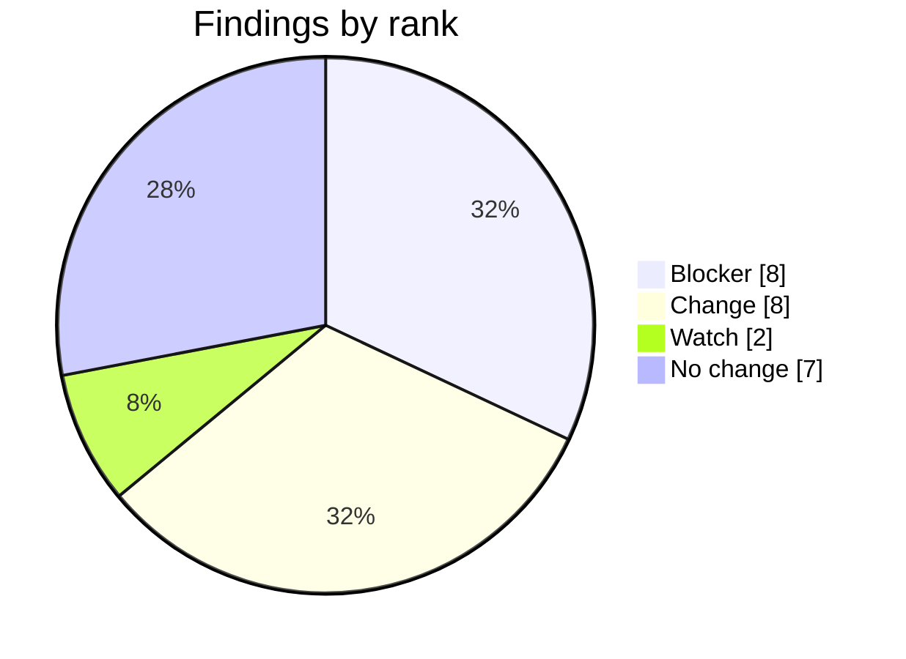
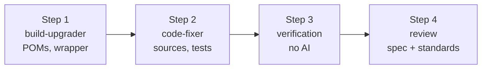
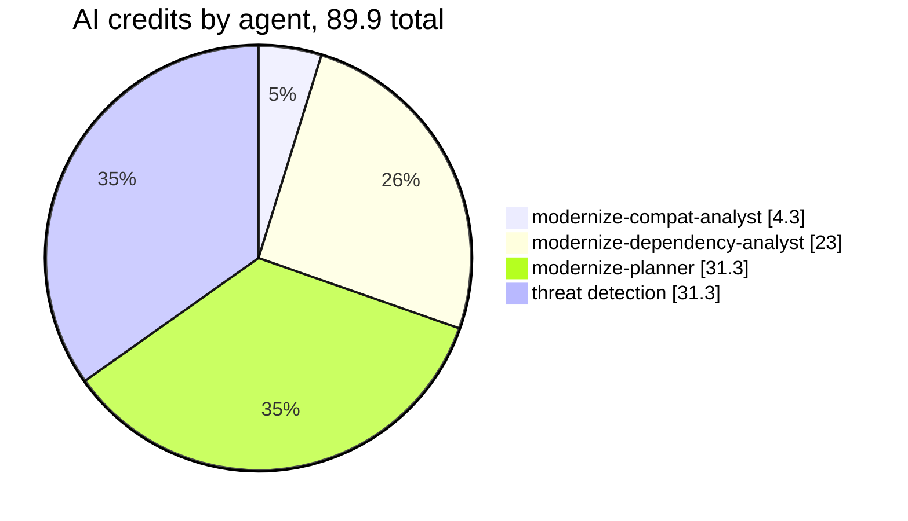

# Asset Manager Java Modernization Plan

## Request

- Issue: #35. Business outcome: run Asset Manager on Java 21 and Spring Boot 3.5.16 with no behavior change.
- Approved assessment: [assessment.md](assessment.md), approved by @lenvolk on 2026-10-20T03:46:52Z (gate 1), assessed commit `fd0a5a620d96`.

## Run Parameters

```yaml
issue: 35
project: asset-manager
source: { java: 8, spring-boot: "2.7.18" }
target: { java: 21, spring-boot: "3.5.16" }
maven-wrapper: "3.9.16"
```

## Assessment Summary

| Measure | Value |
|---|---|
| Code | 26 classes, 1207 lines (web 15 classes, worker 11) |
| Tests at baseline (JDK 8) | 4 run, 0 failures, 1 error: `S3FileProcessingServiceTest.downloadOriginalCopiesFileFromS3` (Mockito cannot mock `ResponseInputStream`) |
| Modules without tests | web |
| `javax` imports to migrate | 9 in 5 files |
| jdeps artifacts using JDK internal API | 7 |
| Known advisories (OSV.dev) | 169 (17 critical, 64 high, 71 moderate, 17 low) |
| SpotBugs baseline | 9 bug patterns |
| Findings | 25: 8 Blocker, 8 Change, 2 Watch, 7 No change |



The assessment has no `## Reviewer notes at gate 1` section, so there are no binding notes. The open "Decisions for the reviewer" were unchecked; the plan follows each recommendation:

- Web smoke tests: followed. Step 2 adds MockMvc tests for the storage routes (C-08).
- Baseline Mockito error: followed. Expected to pass on Boot 3.5; a remaining error is a regression (C-09).
- `Paths.get` to `Path.of`: followed by dropping it (C-11 stays unchanged).
- `aws-sdk.version` property stays, set to 2.57.0 in both modules (D-03).
- Lombok 1.18.48 override (D-06) and jackson-databind BOM-managed (D-07): followed.
- D-07 is a POM edit, so it moves from `modernize-code-fixer` (assessment owner) to `modernize-build-upgrader`, which owns POM files.

## Scope

In scope:

- Java 8 to 21 and Spring Boot 2.7.18 to 3.5.16 for modules `web` and `worker`.
- `javax` to `jakarta` namespace migration, removed Spring APIs, dependency versions, Maven Wrapper.
- A small MockMvc smoke test set for `web`, because it has no tests.

Out of scope: Azure service migration, containerization, deployment, CI/CD, observability, production rollout, Spring Boot 4.

## Execution Plan



### Step 1 - modernize-build-upgrader

Owns: D-01, D-02, D-03, D-04, D-05, D-06, D-07, D-08, D-09.

Files it may change: `asset-manager/pom.xml`, `asset-manager/web/pom.xml`, `asset-manager/worker/pom.xml`, `asset-manager/.mvn/wrapper/maven-wrapper.properties`.

```diff
 # asset-manager/pom.xml
-<version>2.7.18</version>            (spring-boot-starter-parent)
+<version>3.5.16</version>
-<java.version>8</java.version>
+<java.version>21</java.version>
+<lombok.version>1.18.48</lombok.version>
 # web/pom.xml and worker/pom.xml
-<aws-sdk.version>2.25.13</aws-sdk.version>
+<aws-sdk.version>2.57.0</aws-sdk.version>
 # postgresql in web and worker: pin to 42.7.14 (42.3.8 resolved today through the Boot 2.7 BOM; neither pom sets a version, so add an explicit one)
 # worker/pom.xml: jackson-databind has no version; BOM manages 2.18.11 (was 2.13.5 in the dependency tree)
 # .mvn/wrapper/maven-wrapper.properties
-apache-maven/3.9.9/apache-maven-3.9.9-bin.zip
+apache-maven/3.9.16/apache-maven-3.9.16-bin.zip
```

Notes: D-09 needs no edit; Logback 1.5.34 arrives through the BOM and the step confirms it. The step must not add `jakarta.servlet-api` (see C-14). The code will not compile until Step 2 migrates imports; that is expected.

Commit pattern: `build(D-01,D-02): ...`, `build(D-03,D-04,D-05): ...`, `build(D-06,D-07,D-08,D-09): ...`

Done when: both POMs resolve on JDK 21, resolved versions match the diff, and only the four files above changed.

### Step 2 - modernize-code-fixer

Owns: C-01, C-02, C-03, C-04, C-05, C-06, C-08, C-09, C-10.

Files it may change: Java sources and tests under `asset-manager/web/src` and `asset-manager/worker/src`. No POM edits.

```diff
 // web WebMvcConfig.java
-@SuppressWarnings("deprecation")
-class WebMvcConfig extends WebMvcConfigurerAdapter
+class WebMvcConfig implements WebMvcConfigurer
-class ...Interceptor extends HandlerInterceptorAdapter
+class ...Interceptor implements HandlerInterceptor
-import javax.servlet.http.*;
+import jakarta.servlet.http.*;
 // web and worker ImageMetadata.java
-import javax.persistence.*;
+import jakarta.persistence.*;
 // web LocalFileStorageService.java, worker LocalFileProcessingService.java
-import javax.annotation.PostConstruct;
+import jakarta.annotation.PostConstruct;
```

Also: add MockMvc tests in `web/src/test` for view-page, view and delete with a key containing a dot, run before and after the change if possible (C-08). Confirm `downloadOriginalCopiesFileFromS3` passes on Mockito 5 (C-09); if it still errors, fix it or explain why not. Keep `javax.imageio` untouched.

Commit pattern: `fix(C-01,C-02,C-10): ...`, `fix(C-03,C-04,C-05,C-06): ...`, `test(C-08,C-09): ...`

Done when: both modules build and tests pass on JDK 21 with no remaining `javax.persistence|annotation|servlet|validation` imports.

### Step 3 - verification

Deterministic, no AI:

- JDK 21 build and tests of both modules against the JDK 8 baseline.
- Version and namespace checks against Run Parameters.
- Both jars package.
- OSV.dev re-scan compared with the baseline.

### Step 4 - review

`modernize-conformance-reviewer` (spec) and `modernize-standards-reviewer` (standards) run in parallel and comment on all findings. Output: draft Implementation pull request.

## Finding Coverage

| ID | Rank | Finding | Step | Agent | Verified by |
|---|---|---|---|---|---|
| C-01 | Blocker | WebMvcConfigurerAdapter and HandlerInterceptorAdapter removed | Step 2 | modernize-code-fixer | verify-build |
| C-02 | Blocker | javax.servlet.http to jakarta in WebMvcConfig | Step 2 | modernize-code-fixer | verify-static |
| C-03 | Blocker | javax.persistence in web ImageMetadata | Step 2 | modernize-code-fixer | verify-static |
| C-04 | Blocker | javax.annotation.PostConstruct in web LocalFileStorageService | Step 2 | modernize-code-fixer | verify-static |
| C-05 | Blocker | javax.persistence in worker ImageMetadata | Step 2 | modernize-code-fixer | verify-static |
| C-06 | Blocker | javax.annotation.PostConstruct in worker LocalFileProcessingService | Step 2 | modernize-code-fixer | verify-static |
| D-01 | Blocker | Spring Boot parent 2.7.18 to 3.5.16 | Step 1 | modernize-build-upgrader | verify-static |
| D-02 | Blocker | java.version 8 to 21 | Step 1 | modernize-build-upgrader | verify-static |
| C-10 | Change | Remove leftover @SuppressWarnings("deprecation") | Step 2 | modernize-code-fixer | Spec review |
| D-03 | Change | AWS SDK s3 2.25.13 to 2.57.0 | Step 1 | modernize-build-upgrader | verify-static |
| D-04 | Change | PostgreSQL 42.3.8 to 42.7.14 in web | Step 1 | modernize-build-upgrader | verify-static |
| D-05 | Change | PostgreSQL 42.3.8 to 42.7.14 in worker | Step 1 | modernize-build-upgrader | verify-static |
| D-06 | Change | Lombok override to 1.18.48 | Step 1 | modernize-build-upgrader | verify-static |
| D-07 | Change | jackson-databind explicit 2.13.5 removed, BOM 2.18.11 | Step 1 | modernize-build-upgrader | verify-static |
| D-08 | Change | Maven Wrapper 3.9.9 to 3.9.16 | Step 1 | modernize-build-upgrader | verify-static |
| D-09 | Change | Logback 1.2.12 to 1.5.34 via BOM, no edit | Step 1 | modernize-build-upgrader | verify-build |
| C-08 | Watch | Path variable {key} with dots after suffix matching removal | Step 2 | modernize-code-fixer | verify-build |
| C-09 | Watch | Baseline Mockito error on ResponseInputStream | Step 2 | modernize-code-fixer | verify-build |
| C-07 | No change | javax.imageio stays, it ships with the JDK | none | none | verify-static |
| C-11 | No change | Paths.get stays | none | none | Spec review |
| C-12 | No change | Thymeleaf templates stay compatible | none | none | verify-build |
| C-13 | No change | Hibernate 6 ID and query changes do not apply | none | none | verify-build |
| C-14 | No change | Do not add jakarta.servlet-api | none | none | Spec review |
| C-15 | No change | Lombok inherited, confirm resolved version | none | none | verify-build |
| C-16 | No change | Property keys unchanged in Boot 3.5 | none | none | verify-build |

## Validation

1. Capture the baseline first: JDK 8, `./mvnw test`, 4 tests, 0 failures, 1 error (`S3FileProcessingServiceTest.downloadOriginalCopiesFileFromS3`). Do not assume the baseline is green.
2. Build both modules on JDK 21.
3. Tests no worse than baseline (at most 1 error, no new failures; new web tests must pass).
4. Both jars package.
5. No remaining `javax.persistence|annotation|servlet|validation` imports; `javax.imageio` stays.
6. Resolved versions match Run Parameters.
7. OSV advisories after the upgrade reported against the 169 baseline.

## Risks and Rollback

| Risk | Likelihood | Impact | Mitigation | Findings |
|---|---|---|---|---|
| Web module has no tests, so behavior is not proven unchanged | High | Medium | Add MockMvc smoke tests for storage routes | C-08 |
| Keys with dots resolve differently in Spring 6 | Low | Medium | Test view-page, view, delete with a dotted key | C-08 |
| Baseline Mockito error remains on Boot 3.5 | Medium | Low | Fix test or explain; treat as regression if not at baseline | C-09 |
| AWS SDK 2.57.0 is a large jump from 2.25.13 | Medium | Medium | Build and worker tests; review S3 API use | D-03 |
| Worker has only 1 test class, so coverage is thin | Medium | Medium | Manual review in Step 4 | C-05, C-06 |

Rollback: every stage can be re-run. Nothing reaches `main` until a human merges the Implementation pull request. Closing that pull request and deleting its branch undoes the run.

## Cost Estimate


Filled in by the pipeline from measured token counts, not by the planner agent.

Estimated cost of the execution stage, which starts when this pull request is merged:

| Stage | Agent | Model | Requests | Input | Output | Cache read | Cache write | AI credits (range) | USD (range) |
|---|---|---|---:|---:|---:|---:|---:|---|---|
| Execution | `modernize-build-upgrader` | `claude-haiku-5.5` | ~11 | 6.4K | 6.5K | 406.4K | 46.4K | 1.4 (1.0 to 2.5) | $0.01 ($0.01 to $0.02) |
| Execution | `modernize-code-fixer` | `claude-sonnet-5.5` | ~13 | 6.5K | 4.1K | 475.2K | 44.4K | 21.2 (14.8 to 63.6) | $0.21 ($0.15 to $0.64) |
| Execution | `modernize-conformance-reviewer` | `claude-sonnet-5.5` | ~10 | 5.4K | 6.0K | 389.2K | 53.8K | 24.5 (17.1 to 44.0) | $0.24 ($0.17 to $0.44) |
| Execution | `modernize-standards-reviewer` | `claude-sonnet-5` | ~11 | 6.4K | 5.1K | 408.0K | 51.1K | 27.4 (19.1 to 49.2) | $0.27 ($0.19 to $0.49) |
| All | threat detection after each agent (4 runs, same model as the agent) | | ~8 | | | | | 37.9 | $0.38 |
| **Total** | | | | | | | | **112.3 (90.0 to 197.3)** | **$1.12 ($0.90 to $1.97)** |

Estimate from token counts measured on a full real run of this pipeline (2026-10-19). Prices: [GitHub Copilot models and pricing](https://docs.github.com/en/copilot/reference/copilot-billing/models-and-pricing), read 2026-10-19. 1 AI credit = $0.01. Credits count against the Copilot plan of the `COPILOT_GITHUB_TOKEN` owner; usage beyond the plan's included credits is billed. Deterministic jobs (tests, Maven, OpenRewrite, OSV) use GitHub Actions minutes and no AI credits.

AI credits already used by the assessment and plan (recorded by gh-aw in this run):

| Agent | Model used | Requests | Input | Output | Cache read | Cache write | AI credits | USD |
|---|---|---:|---:|---:|---:|---:|---:|---:|
| `modernize-compat-analyst` | `claude-haiku-5.5` | 14 | 6.4K | 49.0K | 803.1K | 80.5K | 4.3 | $0.04 |
| `modernize-dependency-analyst` | `claude-haiku-4.5` | 20 | 7.3K | 14.2K | 739.4K | 62.2K | 23.0 | $0.23 |
| `modernize-planner` | `claude-sonnet-5.5` | 14 | 6.5K | 9.7K | 572.7K | 58.5K | 31.3 | $0.31 |
| threat detection (3 runs) | `claude-haiku-4.5, claude-haiku-5.5, claude-sonnet-5.5` | 19 | | | | | 31.3 | $0.31 |
| **Total** | | | | | | | **89.9** | **$0.90** |



_Slices show the share of the total; the legend shows the credits._

Recorded by gh-aw for every model request (`token_usage.jsonl` in the `*-usage` artifacts of this run). 1 AI credit = $0.01.

## Approval Checklist

- [ ] Targets are Java 21 and Spring Boot 3.5.16, Maven Wrapper 3.9.16
- [ ] Scope and out-of-scope list are acceptable
- [ ] Every Blocker (C-01 to C-06, D-01, D-02) is owned by a step
- [ ] Risks accepted, including untested web module
- [ ] Cost estimate accepted
