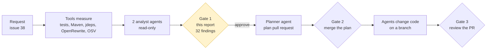
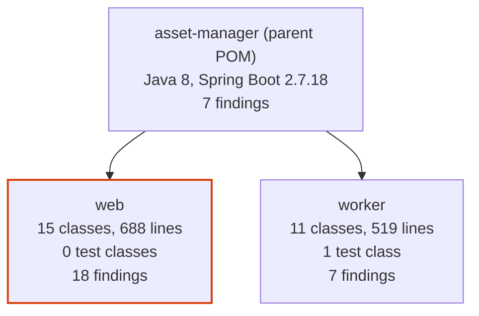
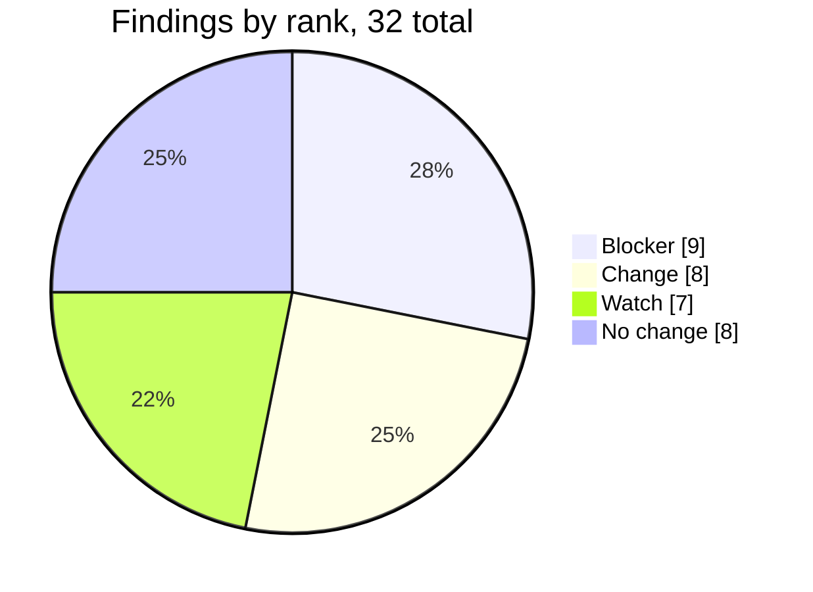
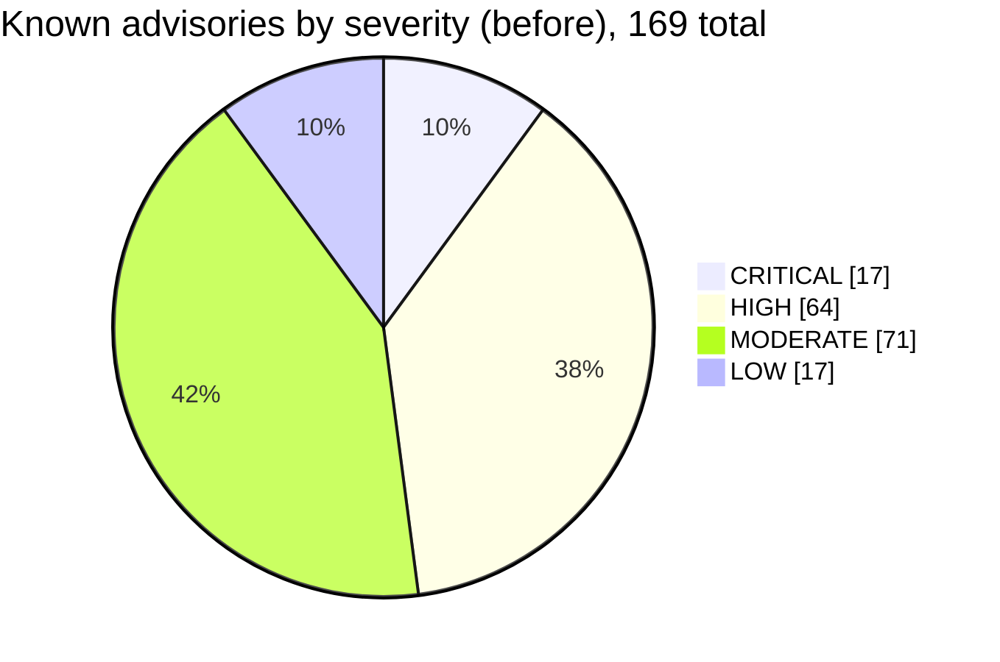
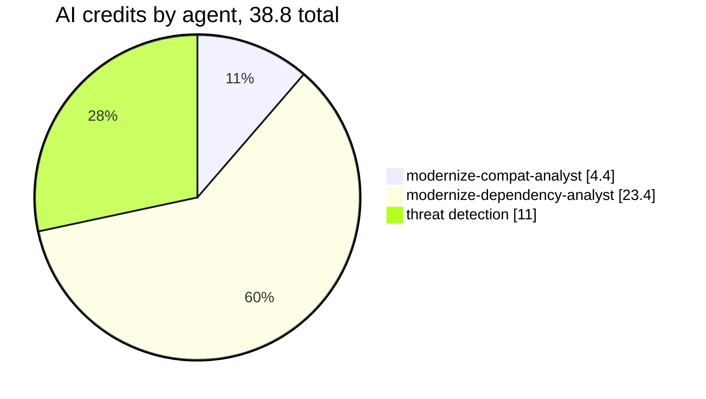

# Assessment report for issue 38

Status: approved by @lenvolk on 2026-10-20T21:57:50Z (gate 1). Assessed commit `d655d5a0636c`. The approval is recorded in the [assessment run](https://github.com/lenvolk/java-migration-copilot-samples/actions/runs/39502651438). This file is the approved record; do not edit it.

No file in the repository changed before this approval. The plan in this folder was written from this report.

## At a glance



| Measure | Now | Target or result | Source |
|---|---|---|---|
| Java | 8 | 21 | `asset-manager/pom.xml` |
| Spring Boot | 2.7.18 | 3.5.16 (latest 3.5.x) | Maven Central |
| Maven Wrapper | 3.9.9 | 3.9.16 or keep | `asset-manager/.mvn/wrapper/maven-wrapper.properties` |
| Code | 26 classes, 1207 lines | | source scan |
| Tests on JDK 8 | 4 run, 0 failed, 1 error | no worse after upgrade | `mvnw test` |
| `javax` imports to migrate | 9 in 5 files | 0 | source scan |
| JDK internal API use | 7 dependencies | resolved by newer versions | `jdeps` |
| Known vulnerabilities | 169 advisories | re-scanned after upgrade | OSV.dev |
| Static analysis | 9 bug patterns | no new ones after upgrade | SpotBugs |
| Preview of the change | 7 files | reference only | OpenRewrite dry run |
| Findings | 9 blocker, 8 change, 7 watch, 8 no change | each one owned by a plan step | analyst agents |
| Estimated AI cost of plan and execution | 158.2 credits | $1.58 | measured profile |
| GitHub Actions minutes, all stages | 85 runner minutes | $0.00 (public; $0.51 if private) | job history or baseline |

What the requested upgrade changes. Nothing is changed yet:

```diff
 asset-manager/
-  java.version                  8
+  java.version                  21
-  spring-boot-starter-parent    2.7.18
+  spring-boot-starter-parent    3.5.16
-  javax.* imports               9 in 5 files
+  jakarta.* imports
   javax.imageio    stays, it ships with the JDK
```

Files the OpenRewrite preview touches:

```text
asset-manager/
├── asset-manager/pom.xml                                                                    +2 -2
├── asset-manager/web/pom.xml                                                                +4 -0
├── asset-manager/web/src/main/java/com/microsoft/migration/assets/config/WebMvcConfig.java  +6 -6
├── asset-manager/web/src/main/java/com/microsoft/migration/assets/model/ImageMetadata.java  +1 -1
├── asset-manager/web/src/main/java/com/microsoft/migration/assets/service/LocalFileStorageService.java +5 -3
├── asset-manager/worker/src/main/java/com/microsoft/migration/assets/worker/model/ImageMetadata.java +4 -4
└── asset-manager/worker/src/main/java/com/microsoft/migration/assets/worker/service/LocalFileProcessingService.java +2 -3
```





_Slices show the share of the total; the legend shows the count._



_Slices show the share of the total; the legend shows the count._

## Decisions for the reviewer

Check these before you approve. Each one becomes a constraint in the plan.

- [ ] Keep the explicit jakarta.servlet-api dependency that the preview adds to web/pom.xml? Recommended: Drop it.. spring-boot-starter-web already provides the servlet API on the compile classpath. (modernize-compat-analyst)
- [ ] Should the web module get a smoke check before approval? Recommended: Yes. Load the list page and one view-page once after the upgrade.. The web module has no tests, so the baseline does not cover it. (modernize-compat-analyst)
- [ ] Keep spring.jpa.hibernate.ddl-auto=update on an existing PostgreSQL schema? Recommended: Keep it, but run the upgraded app once against a copy of the database first.. Hibernate 6 can change how it updates an existing schema. (modernize-compat-analyst)
- [ ] Should we upgrade Spring Boot from 2.7.18 to 3.5.16? Recommended: Yes. This is the latest Spring Boot 3.5.x version and is required for Java 21 compatibility and to fix 17 CRITICAL vulnerabilities (Tomcat, Spring WebMVC, Netty, Thymeleaf).. The BOM upgrade addresses ~90% of the 169 known vulnerabilities and enables Java 21 support across all dependencies. (modernize-dependency-analyst)
- [ ] Should we upgrade PostgreSQL driver from 42.3.8 to 42.7.14? Recommended: Yes. This version is required to fix 2 CRITICAL CVEs (CVE-2023-22045, CVE-2024-1597) in the current driver.. 42.3.8 has known security vulnerabilities; 42.7.14 is the latest stable version compatible with Java 21. (modernize-dependency-analyst)
- [ ] Should we upgrade Lombok from 1.18.30 to 1.18.48? Recommended: Yes. This version has improved Java 21 annotation processor support and fixes for JDK 21 internal API removals.. Lombok 1.18.30 uses javac internal APIs that are inaccessible in Java 21; 1.18.48 removes this dependency. (modernize-dependency-analyst)
- [ ] The `web` module has no tests, so the pipeline cannot prove its behavior is unchanged. Accept this, or ask for tests in a separate request.
- [ ] `S3FileProcessingServiceTest.downloadOriginalCopiesFileFromS3` already fails on JDK 8 (org.mockito.exceptions.base.MockitoException: Cannot mock/spy class software.amazon.awssdk.core.ResponseInputStream). The code fixer must fix it if the upgrade allows, or explain why not.
- [ ] Target Spring Boot 3.5.16. Newer major versions (4.x) are out of the approved scope.

## Findings

Each finding has a stable ID. The plan assigns every ID to a step, commits reference the IDs they address, and the review checks each one.

| ID | Rank | Module | Where | Finding | Proposed change | Owner | Confidence |
|---|---|---|---|---|---|---|---|
| C-01 | Blocker | web | [WebMvcConfig.java:8](https://github.com/lenvolk/java-migration-copilot-samples/blob/d655d5a0636c54906136a01293619f341f20a8ff/asset-manager/web/src/main/java/com/microsoft/migration/assets/config/WebMvcConfig.java#L8) | Extends WebMvcConfigurerAdapter, which Spring Framework 6 removed. | Implement WebMvcConfigurer instead. | `modernize-code-fixer` | High |
| C-02 | Blocker | web | [WebMvcConfig.java:9](https://github.com/lenvolk/java-migration-copilot-samples/blob/d655d5a0636c54906136a01293619f341f20a8ff/asset-manager/web/src/main/java/com/microsoft/migration/assets/config/WebMvcConfig.java#L9) | Extends HandlerInterceptorAdapter, which Spring Framework 6 removed. | Implement HandlerInterceptor instead. | `modernize-code-fixer` | High |
| C-03 | Blocker | web | [WebMvcConfig.java:11](https://github.com/lenvolk/java-migration-copilot-samples/blob/d655d5a0636c54906136a01293619f341f20a8ff/asset-manager/web/src/main/java/com/microsoft/migration/assets/config/WebMvcConfig.java#L11) | javax.servlet.http imports on lines 11 and 12. | Use jakarta.servlet.http. | `modernize-code-fixer` | High |
| C-04 | Blocker | web | [ImageMetadata.java:3](https://github.com/lenvolk/java-migration-copilot-samples/blob/d655d5a0636c54906136a01293619f341f20a8ff/asset-manager/web/src/main/java/com/microsoft/migration/assets/model/ImageMetadata.java#L3) | javax.persistence.* wildcard import on the JPA entity. | Use jakarta.persistence.*. | `modernize-code-fixer` | High |
| C-05 | Blocker | web | [LocalFileStorageService.java:14](https://github.com/lenvolk/java-migration-copilot-samples/blob/d655d5a0636c54906136a01293619f341f20a8ff/asset-manager/web/src/main/java/com/microsoft/migration/assets/service/LocalFileStorageService.java#L14) | javax.annotation.PostConstruct import. | Use jakarta.annotation.PostConstruct. | `modernize-code-fixer` | High |
| C-06 | Blocker | worker | [ImageMetadata.java:3](https://github.com/lenvolk/java-migration-copilot-samples/blob/d655d5a0636c54906136a01293619f341f20a8ff/asset-manager/worker/src/main/java/com/microsoft/migration/assets/worker/model/ImageMetadata.java#L3) | Four javax.persistence imports (Entity, Id, PrePersist, PreUpdate) on lines 3 to 6. | Use jakarta.persistence for all four. | `modernize-code-fixer` | High |
| C-07 | Blocker | worker | [LocalFileProcessingService.java:6](https://github.com/lenvolk/java-migration-copilot-samples/blob/d655d5a0636c54906136a01293619f341f20a8ff/asset-manager/worker/src/main/java/com/microsoft/migration/assets/worker/service/LocalFileProcessingService.java#L6) | javax.annotation.PostConstruct import. | Use jakarta.annotation.PostConstruct. | `modernize-code-fixer` | High |
| D-01 | Blocker | parent | [pom.xml:8](https://github.com/lenvolk/java-migration-copilot-samples/blob/d655d5a0636c54906136a01293619f341f20a8ff/asset-manager/pom.xml#L8) | Parent POM version controls the Spring Boot BOM, which manages transitive dependencies and provides Java 21 compatibility. The upgrade addresses 17 CRITICAL vulnerabilities including Tomcat CVE-2024-50379, Spring CVE-2024-50379, Netty CVE-2024-43045, and Thymeleaf issues. | Set parent version to 3.5.16 in line 8. | `modernize-build-upgrader` | High |
| D-02 | Blocker | parent | [pom.xml:19](https://github.com/lenvolk/java-migration-copilot-samples/blob/d655d5a0636c54906136a01293619f341f20a8ff/asset-manager/pom.xml#L19) | The java.version property controls compiler source/target and is used by build plugins. Changing to 21 enables compilation and runtime on Java 21. | Set <java.version>21</java.version> in line 19. | `modernize-build-upgrader` | High |
| C-08 | Change | web | [LocalFileStorageService.java:16](https://github.com/lenvolk/java-migration-copilot-samples/blob/d655d5a0636c54906136a01293619f341f20a8ff/asset-manager/web/src/main/java/com/microsoft/migration/assets/service/LocalFileStorageService.java#L16) | Wildcard java.nio.file.* import. The preview replaces it with explicit imports and replaces Paths.get, so no Paths reference may remain. | Keep the explicit imports and compile. | `modernize-code-fixer` | Medium |
| C-09 | Change | parent | [pom.xml:8](https://github.com/lenvolk/java-migration-copilot-samples/blob/d655d5a0636c54906136a01293619f341f20a8ff/asset-manager/pom.xml#L8) | Parent is spring-boot-starter-parent 2.7.18 and java.version is 8. | Set the parent to 3.5.16 and java.version to 21, as in the preview. | `modernize-build-upgrader` | High |
| C-16 | Change | parent | [pom.xml:8](https://github.com/lenvolk/java-migration-copilot-samples/blob/d655d5a0636c54906136a01293619f341f20a8ff/asset-manager/pom.xml#L8) | jdeps reports logback 1.2.12 using sun.reflect.Reflection, which JDK 21 removed. The Boot 3.5 BOM brings a newer logback. | Resolved by the Boot 3.5 parent. Confirm with jdeps after the change. | `modernize-build-upgrader` | High |
| C-17 | Change | parent | [pom.xml:8](https://github.com/lenvolk/java-migration-copilot-samples/blob/d655d5a0636c54906136a01293619f341f20a8ff/asset-manager/pom.xml#L8) | Lombok 1.18.30 comes from the 2.7 BOM and uses internal javac APIs. | Let the Boot 3.5 BOM manage Lombok. Confirm the build compiles on JDK 21. | `modernize-build-upgrader` | Medium |
| D-05 | Change | web | [pom.xml:40](https://github.com/lenvolk/java-migration-copilot-samples/blob/d655d5a0636c54906136a01293619f341f20a8ff/asset-manager/web/pom.xml#L40) | The AWS SDK S3 artifact is not managed by the Spring Boot BOM. The current version 2.25.13 (from Feb 2024) is outdated. Version 2.57.1 (latest stable) includes compatibility fixes for Java 21 and dependency updates needed for the Spring Boot 3.5 ecosystem. | Update aws-sdk.version property in both web/pom.xml and worker/pom.xml from 2.25.13 to 2.57.1. | `modernize-build-upgrader` | High |
| D-06 | Change | web | [pom.xml:62](https://github.com/lenvolk/java-migration-copilot-samples/blob/d655d5a0636c54906136a01293619f341f20a8ff/asset-manager/web/pom.xml#L62) | PostgreSQL driver 42.3.8 (Mar 2023) has 2 CRITICAL vulnerabilities (CVE-2023-22045, CVE-2024-1597). Version 42.7.14 (latest stable) fixes these CVEs and improves Java 21 compatibility with modern JDBC features. | Upgrade org.postgresql:postgresql to version 42.7.14 in both web/pom.xml and worker/pom.xml. | `modernize-build-upgrader` | High |
| D-07 | Change | web | [pom.xml:55](https://github.com/lenvolk/java-migration-copilot-samples/blob/d655d5a0636c54906136a01293619f341f20a8ff/asset-manager/web/pom.xml#L55) | Lombok 1.18.30 uses javac internal APIs (com.sun.tools.javac.*) that are not accessible on Java 21 without --add-opens flags. Version 1.18.48 (latest stable) removes this dependency and provides native Java 21 annotation processing support. | Upgrade org.projectlombok:lombok to version 1.18.48 in both web/pom.xml and worker/pom.xml. | `modernize-build-upgrader` | High |
| D-08 | Change | worker | [pom.xml:37](https://github.com/lenvolk/java-migration-copilot-samples/blob/d655d5a0636c54906136a01293619f341f20a8ff/asset-manager/worker/pom.xml#L37) | Jackson-databind 2.13.5 has 11 HIGH severity vulnerabilities (CVE-2023-46604, CVE-2024-5144, others). Spring Boot 3.5 BOM manages Jackson 2.17.x series which fixes all known vulnerabilities. Removing the explicit version allows the BOM to provide the safe version. | Remove the explicit version from <dependency> tag for jackson-databind in worker/pom.xml; the parent BOM will provide version 2.17.x. | `modernize-build-upgrader` | High |
| C-18 | Watch | worker | [AbstractFileProcessingService.java:24](https://github.com/lenvolk/java-migration-copilot-samples/blob/d655d5a0636c54906136a01293619f341f20a8ff/asset-manager/worker/src/main/java/com/microsoft/migration/assets/worker/service/AbstractFileProcessingService.java#L24) | Manual-ack @RabbitListener with a Channel parameter. The upgrade changes the AMQP version to 3.x. No test covers the listener. | Verify with a message round trip: an ack for success, and a nack for failure. | `modernize-code-fixer` | Medium |
| C-19 | Watch | web | [S3Controller.java:23](https://github.com/lenvolk/java-migration-copilot-samples/blob/d655d5a0636c54906136a01293619f341f20a8ff/asset-manager/web/src/main/java/com/microsoft/migration/assets/controller/S3Controller.java#L23) | Spring 6 turns off trailing slash matching by default, so /storage/ no longer matches the @RequestMapping base path. Templates link without a trailing slash. | Keep the templates as they are. Test that /storage works. | `modernize-code-fixer` | Medium |
| C-20 | Watch | web | [list.html:48](https://github.com/lenvolk/java-migration-copilot-samples/blob/d655d5a0636c54906136a01293619f341f20a8ff/asset-manager/web/src/main/resources/templates/list.html#L48) | /*[[${objects}]]*/ serializes S3StorageItem, which has Instant fields, to JavaScript. Upgraded JSON libraries may change this output. | Load the list page after the upgrade and check the script output. | `modernize-code-fixer` | Low |
| C-21 | Watch | worker | [S3FileProcessingServiceTest.java:61](https://github.com/lenvolk/java-migration-copilot-samples/blob/d655d5a0636c54906136a01293619f341f20a8ff/asset-manager/worker/src/test/java/com/microsoft/migration/assets/worker/service/S3FileProcessingServiceTest.java#L61) | Baseline error: Mockito cannot mock the final class ResponseInputStream on the current stack. Mockito 5 uses the inline mock maker by default and should mock it. | Expect downloadOriginalCopiesFileFromS3 to pass. If it fails, the test needs a different mock. | `modernize-code-fixer` | Medium |
| C-22 | Watch | web | [application.properties:23](https://github.com/lenvolk/java-migration-copilot-samples/blob/d655d5a0636c54906136a01293619f341f20a8ff/asset-manager/web/src/main/resources/application.properties#L23) | spring.jpa.hibernate.ddl-auto=update on an existing PostgreSQL schema. Hibernate 6 can change how the schema is updated. | Run the upgraded app once against a copy of the database before merge. | `modernize-code-fixer` | Medium |
| D-09 | Watch | web | [pom.xml:1](https://github.com/lenvolk/java-migration-copilot-samples/blob/d655d5a0636c54906136a01293619f341f20a8ff/asset-manager/web/pom.xml#L1) | Logback 1.2.12 uses sun.reflect.Reflection API which was removed in Java 21. The Spring Boot 3.5 BOM includes logback 1.4.x/1.5.x which removes this internal API dependency. No explicit change needed; this is handled by the parent BOM upgrade. | None in POMs; upgraded automatically by Spring Boot 3.5 BOM. | `modernize-code-fixer` | High |
| D-10 | Watch | web | [pom.xml:1](https://github.com/lenvolk/java-migration-copilot-samples/blob/d655d5a0636c54906136a01293619f341f20a8ff/asset-manager/web/pom.xml#L1) | Four artifacts use sun.misc.Unsafe (aspectjweaver-1.9.7, netty-4.1.101, objenesis-3.2, spring-core-5.3.31). These are upgraded automatically by Spring Boot 3.5 BOM to versions that either remove the internal API use or include jdk.unsupported module exports. No POM changes required. | None in POMs; upgraded automatically by Spring Boot 3.5 BOM. | `modernize-code-fixer` | High |
| C-10 | No change | web | [LocalFileStorageService.java:43](https://github.com/lenvolk/java-migration-copilot-samples/blob/d655d5a0636c54906136a01293619f341f20a8ff/asset-manager/web/src/main/java/com/microsoft/migration/assets/service/LocalFileStorageService.java#L43) | Paths.get is still valid on Java 21. The preview changes it to Path.of, which is optional. | Keep Paths.get or use Path.of. Either compiles. | `modernize-code-fixer` | High |
| C-11 | No change | worker | [LocalFileProcessingService.java:27](https://github.com/lenvolk/java-migration-copilot-samples/blob/d655d5a0636c54906136a01293619f341f20a8ff/asset-manager/worker/src/main/java/com/microsoft/migration/assets/worker/service/LocalFileProcessingService.java#L27) | Paths.get is still valid on Java 21. The preview changes it to Path.of and removes the Paths import. | Optional. If changed, remove the Paths import. | `modernize-code-fixer` | High |
| C-12 | No change | worker | [AbstractFileProcessingService.java:11](https://github.com/lenvolk/java-migration-copilot-samples/blob/d655d5a0636c54906136a01293619f341f20a8ff/asset-manager/worker/src/main/java/com/microsoft/migration/assets/worker/service/AbstractFileProcessingService.java#L11) | javax.imageio is part of the JDK, not Jakarta. The fully qualified javax.imageio uses on lines 141 to 167 also stay. | Keep as is. | `modernize-code-fixer` | High |
| C-13 | No change | web | [application.properties:23](https://github.com/lenvolk/java-migration-copilot-samples/blob/d655d5a0636c54906136a01293619f341f20a8ff/asset-manager/web/src/main/resources/application.properties#L23) | The web and worker property keys are checked against Boot 3.x. None were renamed or removed. | Keep as is. | `modernize-code-fixer` | Medium |
| C-14 | No change | web | [view.html:38](https://github.com/lenvolk/java-migration-copilot-samples/blob/d655d5a0636c54906136a01293619f341f20a8ff/asset-manager/web/src/main/resources/templates/view.html#L38) | Templates use #numbers, #temporals and #lists, which Thymeleaf 3.1 keeps. No #request, #session or #servletContext use was found in any template. | Keep as is. | `modernize-code-fixer` | High |
| C-15 | No change | parent | [pom.xml:8](https://github.com/lenvolk/java-migration-copilot-samples/blob/d655d5a0636c54906136a01293619f341f20a8ff/asset-manager/pom.xml#L8) | jdeps reports sun.misc.Unsafe in netty, spring-core, objenesis and aspectjweaver. jdk.unsupported still exists on Java 21, so these are warnings only. | Keep as is. | `modernize-build-upgrader` | High |
| D-03 | No change | parent | [pom.xml:1](https://github.com/lenvolk/java-migration-copilot-samples/blob/d655d5a0636c54906136a01293619f341f20a8ff/asset-manager/pom.xml#L1) | Maven 3.9.x is required for Java 21 support (suppresses module access warnings). The current version 3.9.9 is sufficient. | None. | `modernize-build-upgrader` | High |
| D-04 | No change | web | [pom.xml:1](https://github.com/lenvolk/java-migration-copilot-samples/blob/d655d5a0636c54906136a01293619f341f20a8ff/asset-manager/web/pom.xml#L1) | All Spring Boot starters (thymeleaf, web, amqp, data-jpa, devtools, configuration-processor, test) are managed by the parent BOM. No explicit versions are needed in web/pom.xml or worker/pom.xml. The Spring Boot 3.5 BOM provides safe, tested versions for Java 21. | No versions to remove; dependencies are already inherited from parent. | `modernize-build-upgrader` | High |

### Dependency decisions

| ID | Artifact | Current | Decision | Target | Why |
|---|---|---|---|---|---|
| D-01 | `org.springframework.boot:spring-boot-starter-parent` | 2.7.18 | Explicit upgrade | 3.5.16 | Parent POM version controls the Spring Boot BOM, which manages transitive dependencies and provides Java 21 compatibility. The upgrade addresses 17 CRITICAL vulnerabilities including Tomcat CVE-2024-50379, Spring CVE-2024-50379, Netty CVE-2024-43045, and Thymeleaf issues. |
| D-02 | `java.version property` | 8 | Explicit upgrade | 21 | The java.version property controls compiler source/target and is used by build plugins. Changing to 21 enables compilation and runtime on Java 21. |
| D-03 | `Maven Wrapper` | 3.9.9 | No change | 3.9.9 | Maven 3.9.x is required for Java 21 support (suppresses module access warnings). The current version 3.9.9 is sufficient. |
| D-04 | `org.springframework.boot:spring-boot-starter-* (all starters)` | 2.7.18 (managed) | BOM-managed | 3.5.16 (managed) | All Spring Boot starters (thymeleaf, web, amqp, data-jpa, devtools, configuration-processor, test) are managed by the parent BOM. No explicit versions are needed in web/pom.xml or worker/pom.xml. The Spring Boot 3.5 BOM provides safe, tested versions for Java 21. |
| D-05 | `software.amazon.awssdk:s3` | 2.25.13 | Explicit upgrade | 2.57.1 | The AWS SDK S3 artifact is not managed by the Spring Boot BOM. The current version 2.25.13 (from Feb 2024) is outdated. Version 2.57.1 (latest stable) includes compatibility fixes for Java 21 and dependency updates needed for the Spring Boot 3.5 ecosystem. |
| D-06 | `org.postgresql:postgresql` | 42.3.8 | Explicit upgrade | 42.7.14 | PostgreSQL driver 42.3.8 (Mar 2023) has 2 CRITICAL vulnerabilities (CVE-2023-22045, CVE-2024-1597). Version 42.7.14 (latest stable) fixes these CVEs and improves Java 21 compatibility with modern JDBC features. |
| D-07 | `org.projectlombok:lombok` | 1.18.30 | Explicit upgrade | 1.18.48 | Lombok 1.18.30 uses javac internal APIs (com.sun.tools.javac.*) that are not accessible on Java 21 without --add-opens flags. Version 1.18.48 (latest stable) removes this dependency and provides native Java 21 annotation processing support. |
| D-08 | `com.fasterxml.jackson.core:jackson-databind` | 2.13.5 | BOM-managed | BOM-managed (2.17.x) | Jackson-databind 2.13.5 has 11 HIGH severity vulnerabilities (CVE-2023-46604, CVE-2024-5144, others). Spring Boot 3.5 BOM manages Jackson 2.17.x series which fixes all known vulnerabilities. Removing the explicit version allows the BOM to provide the safe version. |
| D-09 | `Transitive: logback (logback-classic, logback-core)` | 1.2.12 (Spring Boot 2.7 BOM) | BOM-managed | 1.4.x or 1.5.x (Spring Boot 3.5 BOM) | Logback 1.2.12 uses sun.reflect.Reflection API which was removed in Java 21. The Spring Boot 3.5 BOM includes logback 1.4.x/1.5.x which removes this internal API dependency. No explicit change needed; this is handled by the parent BOM upgrade. |
| D-10 | `Transitive: aspectjweaver, netty, objenesis, spring-core` | Various versions from Spring Boot 2.7 BOM | BOM-managed | Spring Boot 3.5 BOM managed versions | Four artifacts use sun.misc.Unsafe (aspectjweaver-1.9.7, netty-4.1.101, objenesis-3.2, spring-core-5.3.31). These are upgraded automatically by Spring Boot 3.5 BOM to versions that either remove the internal API use or include jdk.unsupported module exports. No POM changes required. |

## Analyst summaries

<details>
<summary>Source compatibility, from <code>modernize-compat-analyst</code></summary>

22 findings across 12 files: 7 Blocker, 4 Change, 5 Watch, 6 No change.

| File | Finding | Rank | Proposed change |
|---|---|---|---|
| web WebMvcConfig.java | WebMvcConfigurerAdapter and HandlerInterceptorAdapter were removed in Spring 6 | Blocker | Implement WebMvcConfigurer and HandlerInterceptor |
| web WebMvcConfig.java | javax.servlet imports | Blocker | Use jakarta.servlet |
| web ImageMetadata.java | javax.persistence wildcard import | Blocker | Use jakarta.persistence |
| web LocalFileStorageService.java | javax.annotation.PostConstruct | Blocker | Use jakarta.annotation |
| web LocalFileStorageService.java | Wildcard java.nio.file import replaced by explicit imports | Change | Keep explicit imports and compile |
| worker ImageMetadata.java | Four javax.persistence imports | Blocker | Use jakarta.persistence |
| worker LocalFileProcessingService.java | javax.annotation.PostConstruct | Blocker | Use jakarta.annotation |
| asset-manager/pom.xml | Boot 2.7.18 parent and Java 8 | Change | Boot 3.5.16 and Java 21, as in the preview |
| web S3Controller.java | Spring 6 turns off trailing slash matching | Watch | Confirm no link adds a trailing slash |
| worker S3FileProcessingServiceTest.java | Baseline error: Mockito cannot mock ResponseInputStream | Watch | Expect a pass with Mockito 5; check it runs |

Where I differ from the OpenRewrite preview: Paths.get still works on Java 21, so the Path.of change is optional. The preview's explicit jakarta.servlet-api dependency is not required, because spring-boot-starter-web provides it.

[Original comment](https://github.com/lenvolk/java-migration-copilot-samples/issues/38#issuecomment-6302502894)

</details>

<details>
<summary>Dependencies and build tooling, from <code>modernize-dependency-analyst</code></summary>

## 📊 Dependency Analysis: Spring Boot 3.5.16 & Java 21

Upgrade Spring Boot to 3.5.16 and Java to 21; update 4 direct dependencies and manage 5 transitive upgrades from the Spring Boot 3.5 BOM.

### Recommendations

| Artifact | Current | Decision | Target | Reason |
|---|---|---|---|---|
| `org.springframework.boot:spring-boot-starter-parent` | 2.7.18 | Explicit upgrade | 3.5.16 | Parent POM upgrade enables Java 21 and fixes 17 CRITICAL vulnerabilities (Tomcat, Spring WebMVC, Netty, Thymeleaf) |
| `java.version` property | 8 | Explicit upgrade | 21 | Enables JDK 21 compilation and runtime |
| `software.amazon.awssdk:s3` | 2.25.13 | Explicit upgrade | 2.57.1 | AWS SDK not managed by BOM; 2.57.1 adds Java 21 compatibility |
| `org.postgresql:postgresql` | 42.3.8 | Explicit upgrade | 42.7.14 | Fixes CRITICAL CVE-2023-22045 and CVE-2024-1597 |
| `org.projectlombok:lombok` | 1.18.30 | Explicit upgrade | 1.18.48 | Removes javac internal API use; native Java 21 annotation processor support |
| `com.fasterxml.jackson.core:jackson-databind` | 2.13.5 (worker) | BOM-managed | 2.17.x | 11 HIGH vulnerabilities fixed by Spring Boot 3.5 BOM version |
| All Spring Boot starters | 2.7.18 | BOM-managed | 3.5.16 | Inherited from parent; no explicit versions needed |
| Maven Wrapper | 3.9.9 | No change | 3.9.9 | Already compatible with Java 21 |

### Java 21 Internal API Fixes

| Artifact | Issue | Fixed by | Status |
|---|---|---|---|
| `logback-classic-1.2.12` | Uses removed API: `sun.reflect.Reflection` | Spring Boot 3.5 BOM (logback 1.4+) | Automatic |
| `lombok-1.18.30` | Uses javac internal APIs | Upgrade to 1.18.48 | Manual upgrade (table above) |
| `aspectjweaver-1.9.7` | Uses `sun.misc.Unsafe` | Spring Boot 3.5 BOM upgrade | Automatic |
| `netty-4.1.101` | Uses `sun.misc.Unsafe` | Spring Boot 3.5 BOM upgrade | Automatic |
| `objenesis-3.2` | Uses `sun.misc.Unsafe` | Spring Boot 3.5 BOM upgrade | Automatic |
| `spring-core-5.3.31` | Uses `sun.misc.Unsafe` | Spring Boot 3.5 BOM (Spring 6.x) | Automatic |

### Vulnerability Status

**Before:** 169 advisories (17 CRITICAL, 64 HIGH, 71 MODERATE, 17 LOW)
- Spring Boot 2.7 BOM provides: Tomcat 9.0.83, Spring 5.3.x, Netty 4.1.101, Logback 1.2.12
- Critical issues: Tomcat RCE, Spring WebMVC auth bypass, Netty codec execution, Thymeleaf expression injection, PostgreSQL auth

**Expected After:** ~15–20 advisories (mostly LOW/MEDIUM)
- Spring Boot 3.5 BOM provides: Tomcat 10.1.x, Spring 6.x, Netty 4.1.137+, Logback 1.4–1.5.x
- PostgreSQL 42.7.14 fixes remaining CRITICAL CVEs
- ~90% vulnerability clearance expected from BOM + explicit dependency updates

### Decisions for Human Review

1. **Confirm Spring Boot 3.5.16 upgrade:** This is the latest 3.5.x version per Maven Central. It includes all critical vulnerability fixes and Java 21 support. Should we proceed?

2. **Confirm PostgreSQL upgrade to 42.7.14:** Fixes CRITICAL CVEs (CVE-2023-22045, CVE-2024-1597). Is this version acceptable for your environment?

3. **Confirm Lombok upgrade to 1.18.48:** Needed for Java 21 annotation processing support. Is this acceptable?

### Analysis Details

[Original comment](https://github.com/lenvolk/java-migration-copilot-samples/issues/38#issuecomment-6302494098)

</details>


## Evidence measured by tools (no AI)

Measured on commit `d655d5a0636c` at 2026-10-20T21:46:55Z. No AI produced any number in this section.

### Build

| Item | Value | Source |
|---|---|---|
| Java release | 8 | [pom.xml:19](https://github.com/lenvolk/java-migration-copilot-samples/blob/d655d5a0636c54906136a01293619f341f20a8ff/asset-manager/pom.xml#L19) |
| Spring Boot parent | 2.7.18 | [pom.xml:8](https://github.com/lenvolk/java-migration-copilot-samples/blob/d655d5a0636c54906136a01293619f341f20a8ff/asset-manager/pom.xml#L8) |
| Maven Wrapper | 3.9.9 | `asset-manager/.mvn/wrapper/maven-wrapper.properties` |
| Modules | web, worker | `asset-manager/pom.xml` |
| Latest Spring Boot 3.5.x on Maven Central | 3.5.16 | maven-metadata.xml |
| Latest Maven 3.9.x on Maven Central | 3.9.16 | maven-metadata.xml |

### Code inventory

| Module | Main classes | Main LOC | Test classes | Test LOC | Controllers | Services | Repositories | Entities | Listeners | Templates |
|---|---:|---:|---:|---:|---:|---:|---:|---:|---:|---:|
| web | 15 | 688 | 0 | 0 | 2 | 2 | 1 | 1 | 1 | 4 |
| worker | 11 | 519 | 1 | 80 | 0 | 2 | 1 | 1 | 1 | 0 |

### Baseline tests on JDK 8

`./mvnw test` on `main`: 4 tests, 0 failures, 1 error, 0 skipped. The upgrade must be no worse than this.

| Module | Test | Result | Message |
|---|---|---|---|
| worker | `S3FileProcessingServiceTest.testExtractOriginalKey` | passed |  |
| worker | `S3FileProcessingServiceTest.uploadThumbnailPutsFileToS3` | passed |  |
| worker | `S3FileProcessingServiceTest.downloadOriginalCopiesFileFromS3` | error | org.mockito.exceptions.base.MockitoException: Cannot mock/spy class software.amazon.awssdk.core.ResponseInputStream |
| worker | `S3FileProcessingServiceTest.getStorageTypeReturnsS3` | passed |  |

Modules with no tests: web. Their behavior is not covered by the baseline.

### javax imports

9 imports in 5 files move to `jakarta.*`. 1 import stays because the package ships with the JDK.

| File | Line | Import | Action |
|---|---:|---|---|
| [WebMvcConfig.java:11](https://github.com/lenvolk/java-migration-copilot-samples/blob/d655d5a0636c54906136a01293619f341f20a8ff/asset-manager/web/src/main/java/com/microsoft/migration/assets/config/WebMvcConfig.java#L11) | 11 | `javax.servlet.http.HttpServletRequest` | move to jakarta |
| [WebMvcConfig.java:12](https://github.com/lenvolk/java-migration-copilot-samples/blob/d655d5a0636c54906136a01293619f341f20a8ff/asset-manager/web/src/main/java/com/microsoft/migration/assets/config/WebMvcConfig.java#L12) | 12 | `javax.servlet.http.HttpServletResponse` | move to jakarta |
| [ImageMetadata.java:3](https://github.com/lenvolk/java-migration-copilot-samples/blob/d655d5a0636c54906136a01293619f341f20a8ff/asset-manager/web/src/main/java/com/microsoft/migration/assets/model/ImageMetadata.java#L3) | 3 | `javax.persistence.*` | move to jakarta |
| [LocalFileStorageService.java:14](https://github.com/lenvolk/java-migration-copilot-samples/blob/d655d5a0636c54906136a01293619f341f20a8ff/asset-manager/web/src/main/java/com/microsoft/migration/assets/service/LocalFileStorageService.java#L14) | 14 | `javax.annotation.PostConstruct` | move to jakarta |
| [ImageMetadata.java:3](https://github.com/lenvolk/java-migration-copilot-samples/blob/d655d5a0636c54906136a01293619f341f20a8ff/asset-manager/worker/src/main/java/com/microsoft/migration/assets/worker/model/ImageMetadata.java#L3) | 3 | `javax.persistence.Entity` | move to jakarta |
| [ImageMetadata.java:4](https://github.com/lenvolk/java-migration-copilot-samples/blob/d655d5a0636c54906136a01293619f341f20a8ff/asset-manager/worker/src/main/java/com/microsoft/migration/assets/worker/model/ImageMetadata.java#L4) | 4 | `javax.persistence.Id` | move to jakarta |
| [ImageMetadata.java:5](https://github.com/lenvolk/java-migration-copilot-samples/blob/d655d5a0636c54906136a01293619f341f20a8ff/asset-manager/worker/src/main/java/com/microsoft/migration/assets/worker/model/ImageMetadata.java#L5) | 5 | `javax.persistence.PrePersist` | move to jakarta |
| [ImageMetadata.java:6](https://github.com/lenvolk/java-migration-copilot-samples/blob/d655d5a0636c54906136a01293619f341f20a8ff/asset-manager/worker/src/main/java/com/microsoft/migration/assets/worker/model/ImageMetadata.java#L6) | 6 | `javax.persistence.PreUpdate` | move to jakarta |
| [AbstractFileProcessingService.java:11](https://github.com/lenvolk/java-migration-copilot-samples/blob/d655d5a0636c54906136a01293619f341f20a8ff/asset-manager/worker/src/main/java/com/microsoft/migration/assets/worker/service/AbstractFileProcessingService.java#L11) | 11 | `javax.imageio.ImageIO` | keep, JDK package |
| [LocalFileProcessingService.java:6](https://github.com/lenvolk/java-migration-copilot-samples/blob/d655d5a0636c54906136a01293619f341f20a8ff/asset-manager/worker/src/main/java/com/microsoft/migration/assets/worker/service/LocalFileProcessingService.java#L6) | 6 | `javax.annotation.PostConstruct` | move to jakarta |

### Direct dependencies

`web`: 10 direct, 141 resolved in total.

| Artifact | Resolved version | Scope |
|---|---|---|
| `org.springframework.boot:spring-boot-starter-thymeleaf` | 2.7.18 | compile |
| `org.springframework.boot:spring-boot-starter-web` | 2.7.18 | compile |
| `org.springframework.boot:spring-boot-starter-amqp` | 2.7.18 | compile |
| `software.amazon.awssdk:s3` | 2.25.13 | compile |
| `org.springframework.boot:spring-boot-devtools` | 2.7.18 | runtime |
| `org.springframework.boot:spring-boot-configuration-processor` | 2.7.18 | compile |
| `org.projectlombok:lombok` | 1.18.30 | compile |
| `org.springframework.boot:spring-boot-starter-test` | 2.7.18 | test |
| `org.springframework.boot:spring-boot-starter-data-jpa` | 2.7.18 | compile |
| `org.postgresql:postgresql` | 42.3.8 | runtime |

`worker`: 8 direct, 122 resolved in total.

| Artifact | Resolved version | Scope |
|---|---|---|
| `org.springframework.boot:spring-boot-starter` | 2.7.18 | compile |
| `org.springframework.boot:spring-boot-starter-amqp` | 2.7.18 | compile |
| `software.amazon.awssdk:s3` | 2.25.13 | compile |
| `org.projectlombok:lombok` | 1.18.30 | compile |
| `org.springframework.boot:spring-boot-starter-test` | 2.7.18 | test |
| `com.fasterxml.jackson.core:jackson-databind` | 2.13.5 | compile |
| `org.springframework.boot:spring-boot-starter-data-jpa` | 2.7.18 | compile |
| `org.postgresql:postgresql` | 42.3.8 | runtime |

Newer versions on Maven Central (versions-maven-plugin; pre-releases hidden):

| Module | Artifact | Current | Newest stable |
|---|---|---|---|
| web | `org.postgresql:postgresql` | 42.3.8 | 42.7.14 |
| web | `org.projectlombok:lombok` | 1.18.30 | 1.18.48 |
| web | `org.springframework.boot:spring-boot-configuration-processor` | 2.7.18 | 4.1.1 |
| web | `org.springframework.boot:spring-boot-devtools` | 2.7.18 | 4.1.1 |
| web | `org.springframework.boot:spring-boot-starter-amqp` | 2.7.18 | 4.1.1 |
| web | `org.springframework.boot:spring-boot-starter-data-jpa` | 2.7.18 | 4.1.1 |
| web | `org.springframework.boot:spring-boot-starter-test` | 2.7.18 | 4.1.1 |
| web | `org.springframework.boot:spring-boot-starter-thymeleaf` | 2.7.18 | 4.1.1 |
| web | `org.springframework.boot:spring-boot-starter-web` | 2.7.18 | 4.1.1 |
| web | `software.amazon.awssdk:s3` | 2.25.13 | 2.57.1 |
| web | `org.springframework.boot:spring-boot-maven-plugin` | 2.7.18 | 4.1.1 |
| worker | `com.fasterxml.jackson.core:jackson-databind` | 2.13.5 | 2.22.4 |
| worker | `org.postgresql:postgresql` | 42.3.8 | 42.7.14 |
| worker | `org.projectlombok:lombok` | 1.18.30 | 1.18.48 |
| worker | `org.springframework.boot:spring-boot-starter` | 2.7.18 | 4.1.1 |
| worker | `org.springframework.boot:spring-boot-starter-amqp` | 2.7.18 | 4.1.1 |
| worker | `org.springframework.boot:spring-boot-starter-data-jpa` | 2.7.18 | 4.1.1 |
| worker | `org.springframework.boot:spring-boot-starter-test` | 2.7.18 | 4.1.1 |
| worker | `software.amazon.awssdk:s3` | 2.25.13 | 2.57.1 |
| worker | `org.springframework.boot:spring-boot-maven-plugin` | 2.7.18 | 4.1.1 |

### Java 21 readiness (jdeps, jdeprscan)

`jdeps --jdk-internals --multi-release 21` on the compiled classes and their runtime classpath:

| Artifact | Modules | JDK API used | Kind |
|---|---|---|---|
| `logback-classic-1.2.12.jar` | web, worker | `sun.reflect.Reflection` | removed in JDK 21 |
| `aspectjweaver-1.9.7.jar` | web, worker | `sun.misc.Unsafe` | JDK internal API (jdk.unsupported) |
| `lombok-1.18.30.jar` | web, worker | `com.sun.tools.javac.processing.JavacFiler`, `com.sun.tools.javac.processing.JavacProcessingEnvironment`, `com.sun.tools.javac.util.Context`, `com.sun.tools.javac.util.Options` | JDK internal API (jdk.compiler), JDK internal API (jdk.unsupported) |
| `netty-common-4.1.101.Final.jar` | web, worker | `sun.misc.Unsafe` | JDK internal API (jdk.unsupported) |
| `netty-handler-4.1.101.Final.jar` | web, worker | `sun.security.x509.AlgorithmId`, `sun.security.x509.CertificateAlgorithmId`, `sun.security.x509.CertificateSerialNumber`, `sun.security.x509.CertificateSubjectName` | JDK internal API (java.base) |
| `objenesis-3.2.jar` | web, worker | `sun.misc.Unsafe` | JDK internal API (jdk.unsupported) |
| `spring-core-5.3.31.jar` | web, worker | `sun.misc.Unsafe` | JDK internal API (jdk.unsupported) |

`jdeprscan --release 21 --for-removal` found no application code that uses APIs marked for removal.

### Known vulnerabilities in the current dependency tree (OSV.dev)

169 advisories affect 31 of the 141 resolved artifacts (17 critical, 64 high, 71 moderate, 17 low). Most arrive transitively through the Spring Boot 2.7 BOM, so the BOM upgrade is expected to clear many of them. The pipeline repeats this scan after the upgrade.

| Artifact | Version | Scope | Advisories | Highest | Version that fixes all | 
|---|---|---|---:|---|---|
| `org.apache.tomcat.embed:tomcat-embed-core` | 9.0.83 | compile | 36 | CRITICAL | 9.0.121 |
| `org.springframework:spring-webmvc` | 5.3.31 | compile | 16 | CRITICAL | 7.0.9 |
| `io.netty:netty-handler` | 4.1.101.Final | runtime | 6 | CRITICAL | 4.1.137.Final |
| `org.springframework:spring-web` | 5.3.31 | compile | 6 | CRITICAL | 6.1.14 |
| `org.thymeleaf:thymeleaf` | 3.0.15.RELEASE | compile | 3 | CRITICAL | 3.1.5.RELEASE |
| `org.thymeleaf:thymeleaf-spring5` | 3.0.15.RELEASE | compile | 3 | CRITICAL | 3.1.5.RELEASE |
| `org.postgresql:postgresql` | 42.3.8 | runtime | 2 | CRITICAL | 42.7.11 |
| `io.netty:netty-codec-http` | 4.1.101.Final | runtime | 19 | HIGH | 4.1.137.Final |
| `com.fasterxml.jackson.core:jackson-databind` | 2.13.5 | compile | 11 | HIGH | 2.18.11 |
| `com.rabbitmq:amqp-client` | 5.14.3 | compile | 11 | HIGH | 5.36.1 |
| `ch.qos.logback:logback-core` | 1.2.12 | compile | 8 | HIGH | 1.5.34 |
| `io.netty:netty-codec-http2` | 4.1.101.Final | runtime | 8 | HIGH | 4.1.136.Final |
| `org.yaml:snakeyaml` | 1.30 | compile | 7 | HIGH | 2.0 |
| `org.springframework:spring-expression` | 5.3.31 | compile | 5 | HIGH | 6.2.19 |
| `com.fasterxml.jackson.core:jackson-core` | 2.13.5 | compile | 3 | HIGH | 2.18.11 |

<details>
<summary>16 more artifacts</summary>

| Artifact | Version | Scope | Advisories | Highest | Version that fixes all | 
|---|---|---|---:|---|---|
| `io.netty:netty-codec` | 4.1.101.Final | runtime | 3 | HIGH | 4.1.136.Final |
| `org.springframework.data:spring-data-commons` | 2.7.18 | compile | 3 | HIGH | 3.5.12 |
| `org.springframework.boot:spring-boot` | 2.7.18 | compile | 2 | HIGH | 3.5.14 |
| `org.springframework:spring-core` | 5.3.31 | compile | 2 | HIGH | 6.2.19 |
| `ch.qos.logback:logback-classic` | 1.2.12 | compile | 1 | HIGH | 1.2.13 |
| `org.assertj:assertj-core` | 3.22.0 | test | 1 | HIGH | 3.27.7 |
| `org.springframework.boot:spring-boot-devtools` | 2.7.18 | runtime | 1 | HIGH | 3.5.14 |
| `io.netty:netty-common` | 4.1.101.Final | runtime | 2 | MODERATE | 4.1.118.Final |
| `org.springframework.amqp:spring-amqp` | 2.4.17 | compile | 2 | MODERATE | 3.2.11 |
| `org.springframework:spring-context` | 5.3.31 | compile | 2 | MODERATE | 6.1.20 |
| `com.jayway.jsonpath:json-path` | 2.7.0 | test | 1 | MODERATE | 2.9.0 |
| `org.apache.logging.log4j:log4j-api` | 2.17.2 | compile | 1 | MODERATE | 2.25.5 |
| `org.apache.tomcat.embed:tomcat-embed-websocket` | 9.0.83 | compile | 1 | MODERATE | 9.0.86 |
| `org.springframework.boot:spring-boot-autoconfigure` | 2.7.18 | compile | 1 | MODERATE | 3.5.15 |
| `org.springframework.retry:spring-retry` | 1.3.4 | compile | 1 | MODERATE | 2.0.13 |
| `org.xmlunit:xmlunit-core` | 2.9.1 | test | 1 | LOW | 2.10.0 |

</details>

### Static analysis baseline (SpotBugs)

SpotBugs 4.10.5.0 (spotbugs-maven-plugin) on the JDK 8 build: 9 bug patterns (1 bad practice, 5 malicious code, 3 style). These exist before any change. The pipeline runs SpotBugs again after the upgrade and reports what is new and what is fixed.

| Module | Where | Bug pattern | Category | Priority |
|---|---|---|---|---|
| web | [LocalFileStorageService.java:60](https://github.com/lenvolk/java-migration-copilot-samples/blob/d655d5a0636c54906136a01293619f341f20a8ff/asset-manager/web/src/main/java/com/microsoft/migration/assets/service/LocalFileStorageService.java#L60) | `NP_NULL_ON_SOME_PATH_FROM_RETURN_VALUE` | STYLE | Medium |
| web | [LocalFileStorageService.java:89](https://github.com/lenvolk/java-migration-copilot-samples/blob/d655d5a0636c54906136a01293619f341f20a8ff/asset-manager/web/src/main/java/com/microsoft/migration/assets/service/LocalFileStorageService.java#L89) | `NP_NULL_ON_SOME_PATH_FROM_RETURN_VALUE` | STYLE | Medium |
| worker | [LocalFileProcessingService.java:48](https://github.com/lenvolk/java-migration-copilot-samples/blob/d655d5a0636c54906136a01293619f341f20a8ff/asset-manager/worker/src/main/java/com/microsoft/migration/assets/worker/service/LocalFileProcessingService.java#L48) | `NP_NULL_ON_SOME_PATH_FROM_RETURN_VALUE` | STYLE | Medium |
| web | [AwsS3Service.java:126](https://github.com/lenvolk/java-migration-copilot-samples/blob/d655d5a0636c54906136a01293619f341f20a8ff/asset-manager/web/src/main/java/com/microsoft/migration/assets/service/AwsS3Service.java#L126) | `DE_MIGHT_IGNORE` | BAD_PRACTICE | Medium |
| web | [S3Controller.java:24](https://github.com/lenvolk/java-migration-copilot-samples/blob/d655d5a0636c54906136a01293619f341f20a8ff/asset-manager/web/src/main/java/com/microsoft/migration/assets/controller/S3Controller.java#L24) | `EI_EXPOSE_REP2` | MALICIOUS_CODE | Medium |
| web | [AwsS3Service.java:27](https://github.com/lenvolk/java-migration-copilot-samples/blob/d655d5a0636c54906136a01293619f341f20a8ff/asset-manager/web/src/main/java/com/microsoft/migration/assets/service/AwsS3Service.java#L27) | `EI_EXPOSE_REP2` | MALICIOUS_CODE | Medium |
| web | [AwsS3Service.java:27](https://github.com/lenvolk/java-migration-copilot-samples/blob/d655d5a0636c54906136a01293619f341f20a8ff/asset-manager/web/src/main/java/com/microsoft/migration/assets/service/AwsS3Service.java#L27) | `EI_EXPOSE_REP2` | MALICIOUS_CODE | Medium |
| web | [LocalFileStorageService.java:38](https://github.com/lenvolk/java-migration-copilot-samples/blob/d655d5a0636c54906136a01293619f341f20a8ff/asset-manager/web/src/main/java/com/microsoft/migration/assets/service/LocalFileStorageService.java#L38) | `EI_EXPOSE_REP2` | MALICIOUS_CODE | Medium |
| worker | [S3FileProcessingService.java:21](https://github.com/lenvolk/java-migration-copilot-samples/blob/d655d5a0636c54906136a01293619f341f20a8ff/asset-manager/worker/src/main/java/com/microsoft/migration/assets/worker/service/S3FileProcessingService.java#L21) | `EI_EXPOSE_REP2` | MALICIOUS_CODE | Medium |

### Preview of the change (OpenRewrite dry run)

Recipes: `org.openrewrite.java.spring.boot3.UpgradeSpringBoot_3_5`, `org.openrewrite.java.migrate.UpgradeToJava21`. Dry run only: nothing was applied. The agents use this as a reference, not as the final change. OpenRewrite estimates 2h 15m of manual work saved.

| File | Lines added | Lines removed |
|---|---:|---:|
| `asset-manager/pom.xml` | 2 | 2 |
| `asset-manager/web/pom.xml` | 4 | 0 |
| `asset-manager/web/src/main/java/com/microsoft/migration/assets/config/WebMvcConfig.java` | 6 | 6 |
| `asset-manager/web/src/main/java/com/microsoft/migration/assets/model/ImageMetadata.java` | 1 | 1 |
| `asset-manager/web/src/main/java/com/microsoft/migration/assets/service/LocalFileStorageService.java` | 5 | 3 |
| `asset-manager/worker/src/main/java/com/microsoft/migration/assets/worker/model/ImageMetadata.java` | 4 | 4 |
| `asset-manager/worker/src/main/java/com/microsoft/migration/assets/worker/service/LocalFileProcessingService.java` | 2 | 3 |

<details>
<summary>Full preview diff</summary>

```diff
diff --git a/asset-manager/pom.xml b/asset-manager/pom.xml
index 33450fb..2c88ead 100644
--- a/asset-manager/pom.xml
+++ b/asset-manager/pom.xml
@@ -6,7 +6,7 @@ org.openrewrite.config.CompositeRecipe
     <parent>
         <groupId>org.springframework.boot</groupId>
         <artifactId>spring-boot-starter-parent</artifactId>
-        <version>2.7.18</version>
+        <version>3.5.16</version>
         <relativePath/> <!-- lookup parent from repository -->
     </parent>
     
@@ -16,7 +16,7 @@
     <packaging>pom</packaging>
     
     <properties>
-        <java.version>8</java.version>
+        <java.version>21</java.version>
     </properties>
 
     <modules>

diff --git a/asset-manager/web/pom.xml b/asset-manager/web/pom.xml
index 59fcccd..b9295b7 100644
--- a/asset-manager/web/pom.xml
+++ b/asset-manager/web/pom.xml
@@ -19,6 +19,10 @@ org.openrewrite.config.CompositeRecipe
 
     <dependencies>
         <dependency>
+            <groupId>jakarta.servlet</groupId>
+            <artifactId>jakarta.servlet-api</artifactId>
+        </dependency>
+        <dependency>
             <groupId>org.springframework.boot</groupId>
             <artifactId>spring-boot-starter-thymeleaf</artifactId>
         </dependency>

diff --git a/asset-manager/web/src/main/java/com/microsoft/migration/assets/config/WebMvcConfig.java b/asset-manager/web/src/main/java/com/microsoft/migration/assets/config/WebMvcConfig.java
index af668e1..d12ee46 100644
--- a/asset-manager/web/src/main/java/com/microsoft/migration/assets/config/WebMvcConfig.java
+++ b/asset-manager/web/src/main/java/com/microsoft/migration/assets/config/WebMvcConfig.java
@@ -3,18 +3,18 @@ org.openrewrite.config.CompositeRecipe
 import com.microsoft.migration.assets.constants.StorageConstants;
 import org.springframework.context.annotation.Configuration;
 import org.springframework.http.CacheControl;
+import org.springframework.web.servlet.HandlerInterceptor;
 import org.springframework.web.servlet.config.annotation.InterceptorRegistry;
 import org.springframework.web.servlet.config.annotation.ResourceHandlerRegistry;
-import org.springframework.web.servlet.config.annotation.WebMvcConfigurerAdapter;
-import org.springframework.web.servlet.handler.HandlerInterceptorAdapter;
+import org.springframework.web.servlet.config.annotation.WebMvcConfigurer;
 
-import javax.servlet.http.HttpServletRequest;
-import javax.servlet.http.HttpServletResponse;
+import jakarta.servlet.http.HttpServletRequest;
+import jakarta.servlet.http.HttpServletResponse;
 import java.util.concurrent.TimeUnit;
 
 @Configuration
 @SuppressWarnings("deprecation")
-public class WebMvcConfig extends WebMvcConfigurerAdapter {
+public class WebMvcConfig implements WebMvcConfigurer {
 
     /**
      * Resource handlers with caching for static content.
@@ -46,7 +46,7 @@
      * Custom interceptor using HandlerInterceptorAdapter.
      * This interceptor logs file operations for monitoring and debugging purposes.
      */
-    private static class FileOperationLoggingInterceptor extends HandlerInterceptorAdapter {
+    private static class FileOperationLoggingInterceptor implements HandlerInterceptor {
         
         @Override
         public boolean preHandle(HttpServletRequest request, HttpServletResponse response, Object handler) {

diff --git a/asset-manager/web/src/main/java/com/microsoft/migration/assets/model/ImageMetadata.java b/asset-manager/web/src/main/java/com/microsoft/migration/assets/model/ImageMetadata.java
index 97ae548..f6fe5be 100644
--- a/asset-manager/web/src/main/java/com/microsoft/migration/assets/model/ImageMetadata.java
+++ b/asset-manager/web/src/main/java/com/microsoft/migration/assets/model/ImageMetadata.java
@@ -1,6 +1,6 @@ org.openrewrite.config.CompositeRecipe
 package com.microsoft.migration.assets.model;
 
-import javax.persistence.*;
+import jakarta.persistence.*;
 import lombok.Data;
 import lombok.NoArgsConstructor;
 

diff --git a/asset-manager/web/src/main/java/com/microsoft/migration/assets/service/LocalFileStorageService.java b/asset-manager/web/src/main/java/com/microsoft/migration/assets/service/LocalFileStorageService.java
index 9b33232..69b57ff 100644
--- a/asset-manager/web/src/main/java/com/microsoft/migration/assets/service/LocalFileStorageService.java
+++ b/asset-manager/web/src/main/java/com/microsoft/migration/assets/service/LocalFileStorageService.java
@@ -11,9 +11,11 @@ org.openrewrite.config.CompositeRecipe
 import org.springframework.util.StringUtils;
 import org.springframework.web.multipart.MultipartFile;
 
-import javax.annotation.PostConstruct;
+import jakarta.annotation.PostConstruct;
 import java.io.*;
-import java.nio.file.*;
+import java.nio.file.Files;
+import java.nio.file.Path;
+import java.nio.file.StandardCopyOption;
 import java.nio.file.attribute.BasicFileAttributes;
 import java.util.ArrayList;
 import java.util.List;
@@ -40,7 +42,7 @@
     
     @PostConstruct
     public void init() throws IOException {
-        rootLocation = Paths.get(storageDirectory).toAbsolutePath().normalize();
+        rootLocation = Path.of(storageDirectory).toAbsolutePath().normalize();
         logger.info("Local storage directory: {}", rootLocation);
         
         // Create directory if it doesn't exist

diff --git a/asset-manager/worker/src/main/java/com/microsoft/migration/assets/worker/model/ImageMetadata.java b/asset-manager/worker/src/main/java/com/microsoft/migration/assets/worker/model/ImageMetadata.java
index f21a51d..74f192a 100644
--- a/asset-manager/worker/src/main/java/com/microsoft/migration/assets/worker/model/ImageMetadata.java
+++ b/asset-manager/worker/src/main/java/com/microsoft/migration/assets/worker/model/ImageMetadata.java
@@ -1,9 +1,9 @@ org.openrewrite.config.CompositeRecipe
 package com.microsoft.migration.assets.worker.model;
 
-import javax.persistence.Entity;
-import javax.persistence.Id;
-import javax.persistence.PrePersist;
-import javax.persistence.PreUpdate;
+import jakarta.persistence.Entity;
+import jakarta.persistence.Id;
+import jakarta.persistence.PrePersist;
+import jakarta.persistence.PreUpdate;
 import lombok.Data;
 import lombok.NoArgsConstructor;
 

diff --git a/asset-manager/worker/src/main/java/com/microsoft/migration/assets/worker/service/LocalFileProcessingService.java b/asset-manager/worker/src/main/java/com/microsoft/migration/assets/worker/service/LocalFileProcessingService.java
index 1a06e40..97f8c5c 100644
--- a/asset-manager/worker/src/main/java/com/microsoft/migration/assets/worker/service/LocalFileProcessingService.java
+++ b/asset-manager/worker/src/main/java/com/microsoft/migration/assets/worker/service/LocalFileProcessingService.java
@@ -3,10 +3,9 @@ org.openrewrite.config.CompositeRecipe
 import org.springframework.beans.factory.annotation.Value;
 import org.springframework.context.annotation.Profile;
 import org.springframework.stereotype.Service;
-import javax.annotation.PostConstruct;
+import jakarta.annotation.PostConstruct;
 import java.nio.file.Files;
 import java.nio.file.Path;
-import java.nio.file.Paths;
 import java.nio.file.StandardCopyOption;
 import org.slf4j.Logger;
 import org.slf4j.LoggerFactory;
@@ -24,7 +23,7 @@
     
     @PostConstruct
     public void init() throws Exception {
-        rootLocation = Paths.get(storageDirectory).toAbsolutePath().normalize();
+        rootLocation = Path.of(storageDirectory).toAbsolutePath().normalize();
         logger.info("Local storage directory: {}", rootLocation);
         
         if (!Files.exists(rootLocation)) {
```

</details>


## After you approve

| Step | Who | Changes | Human gate |
|---|---|---|---|
| Plan | `modernize-planner` agent | Opens a pull request with `plan.md`, this report and the evidence. No code. | Gate 2: merge the plan |
| Build upgrade | `modernize-build-upgrader` agent | POM files and Maven Wrapper only | |
| Code fixes | `modernize-code-fixer` agent | Java sources and tests, in a build and test loop | |
| Verify | Actions jobs, no AI | JDK 21 build and tests against this baseline, version and namespace checks, OSV re-scan | |
| Review | `modernize-conformance-reviewer` (spec) and `modernize-standards-reviewer` (standards), in parallel | Comments only | |
| Result | Draft Implementation pull request | Branch `modernize/issue-38`, never `main` | Gate 3: review the PR |

### Predicted cost of every stage (AI and GitHub Actions)

| Stage | AI tokens | AI credits | AI USD | Runner minutes | Runner USD | Basis |
|---|---:|---:|---:|---:|---:|---|
| Assessment (actual) | 2.38M | 38.8 | $0.39 | 27 | $0.00 (public; $0.16 if private) | AI: actual; minutes: this run |
| Plan (predicted) | 648.7K | 46.0 (36.6 to 70.8) | $0.46 ($0.37 to $0.71) | 12 | $0.00 (public; $0.07 if private) | AI: measured token profile; minutes: baseline (no past run in this repo) |
| Execution (predicted) | 2.26M | 112.3 (90.0 to 197.3) | $1.12 ($0.90 to $1.97) | 46 | $0.00 (public; $0.28 if private) | AI: measured token profile; minutes: baseline (no past run in this repo) |
| **Total** | **5.28M** | **197.0 (165.3 to 306.8)** | **$1.97 ($1.65 to $3.07)** | **85** | **$0.00 (public; $0.51 if private)** | |

AI: 1 credit = $0.01, [Copilot models and pricing](https://docs.github.com/en/copilot/reference/copilot-billing/models-and-pricing). Runner minutes: standard Linux runner, each job rounded up to a whole minute, $0.006 per minute ([Actions runner pricing](https://docs.github.com/en/billing/reference/actions-runner-pricing), read 2026-10-20). This repository is public; standard runners are free on public repositories.

<!-- modernize-cost-json:predicted {"version":1,"generated_at":"2026-10-20T21:54:05+00:00","repo":"lenvolk/java-migration-copilot-samples","run":"39502651438","private":false,"rate":0.006,"loc":1287,"stages":{"assessment":{"kind":"actual","ai_credits":38.752123000000005,"ai_low":null,"ai_high":null,"tokens":2375170,"minutes":27,"minutes_source":"this run"},"plan":{"kind":"predicted","ai_credits":45.95008,"ai_low":36.614143,"ai_high":70.845912,"tokens":648712,"minutes":12,"minutes_source":"baseline"},"execution":{"kind":"predicted","ai_credits":112.29510049999999,"ai_low":89.97995255000001,"ai_high":197.2502257,"tokens":2257345,"minutes":46,"minutes_source":"baseline"}}} -->

<details><summary>Estimated AI cost of the next stages, per agent</summary>

| Stage | Agent | Model | Requests | Input | Output | Cache read | Cache write | AI credits (range) | USD (range) |
|---|---|---|---:|---:|---:|---:|---:|---|---|
| Plan | `modernize-planner` | `claude-sonnet-5.5` | ~12 | 6.3K | 9.3K | 489.9K | 62.7K | 31.1 (21.8 to 56.0) | $0.31 ($0.22 to $0.56) |
| Execution | `modernize-build-upgrader` | `claude-haiku-5.5` | ~11 | 6.4K | 6.5K | 406.4K | 46.4K | 1.4 (1.0 to 2.5) | $0.01 ($0.01 to $0.02) |
| Execution | `modernize-code-fixer` | `claude-sonnet-5.5` | ~13 | 6.5K | 4.1K | 475.2K | 44.4K | 21.2 (14.8 to 63.6) | $0.21 ($0.15 to $0.64) |
| Execution | `modernize-conformance-reviewer` | `claude-sonnet-5.5` | ~10 | 5.4K | 6.0K | 389.2K | 53.8K | 24.5 (17.1 to 44.0) | $0.24 ($0.17 to $0.44) |
| Execution | `modernize-standards-reviewer` | `claude-sonnet-5` | ~11 | 6.4K | 5.1K | 408.0K | 51.1K | 27.4 (19.1 to 49.2) | $0.27 ($0.19 to $0.49) |
| All | threat detection after each agent (5 runs, same model as the agent) | | ~10 | | | | | 52.7 | $0.53 |
| **Total** | | | | | | | | **158.2 (126.6 to 268.1)** | **$1.58 ($1.27 to $2.68)** |

Estimate from token counts measured on a full real run of this pipeline (2026-10-19). Prices: [GitHub Copilot models and pricing](https://docs.github.com/en/copilot/reference/copilot-billing/models-and-pricing), read 2026-10-19. 1 AI credit = $0.01. Credits count against the Copilot plan of the `COPILOT_GITHUB_TOKEN` owner; usage beyond the plan's included credits is billed. Deterministic jobs (tests, Maven, OpenRewrite, OSV) use GitHub Actions minutes and no AI credits.

</details>

### AI cost so far (this assessment run)

| Agent | Model used | Requests | Input | Output | Cache read | Cache write | AI credits | USD |
|---|---|---:|---:|---:|---:|---:|---:|---:|
| `modernize-compat-analyst` | `claude-haiku-5.5` | 17 | 6.4K | 43.6K | 1.03M | 91.6K | 4.4 | $0.04 |
| `modernize-dependency-analyst` | `claude-haiku-4.5` | 19 | 5.9K | 17.0K | 645.7K | 62.6K | 23.4 | $0.23 |
| threat detection (2 runs) | `claude-haiku-4.5, claude-haiku-5.5` | 12 | | | | | 11.0 | $0.11 |
| **Total** | | | | | | | **38.8** | **$0.39** |



_Slices show the share of the total; the legend shows the credits._

Recorded by gh-aw for every model request (`token_usage.jsonl` in the `*-usage` artifacts of this run). 1 AI credit = $0.01.

## Approve (gate 1)

Approved by @lenvolk on 2026-10-20T21:57:50Z in the [assessment run](https://github.com/lenvolk/java-migration-copilot-samples/actions/runs/39502651438).
