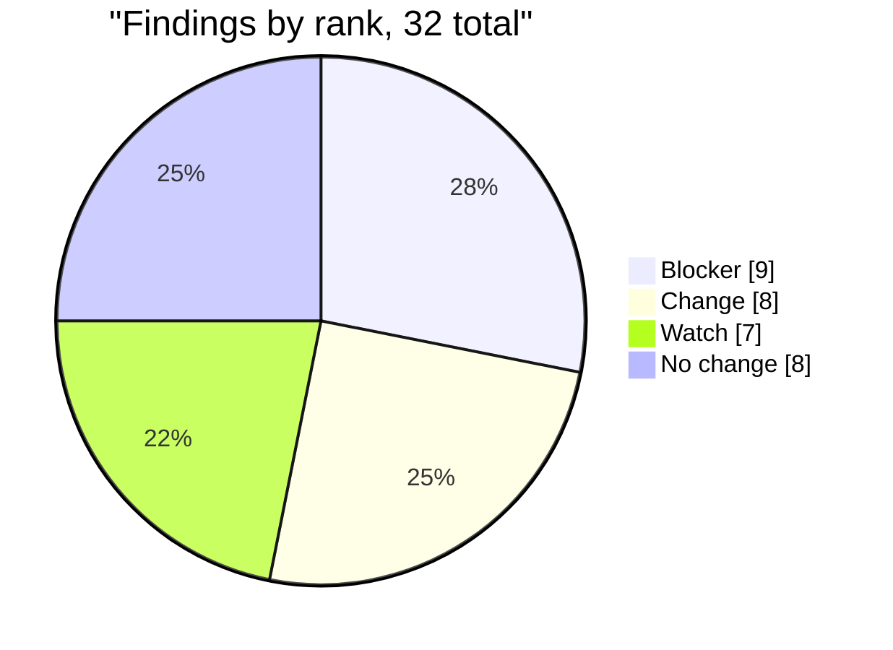
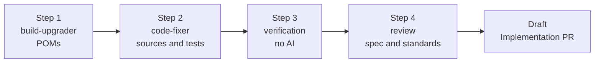
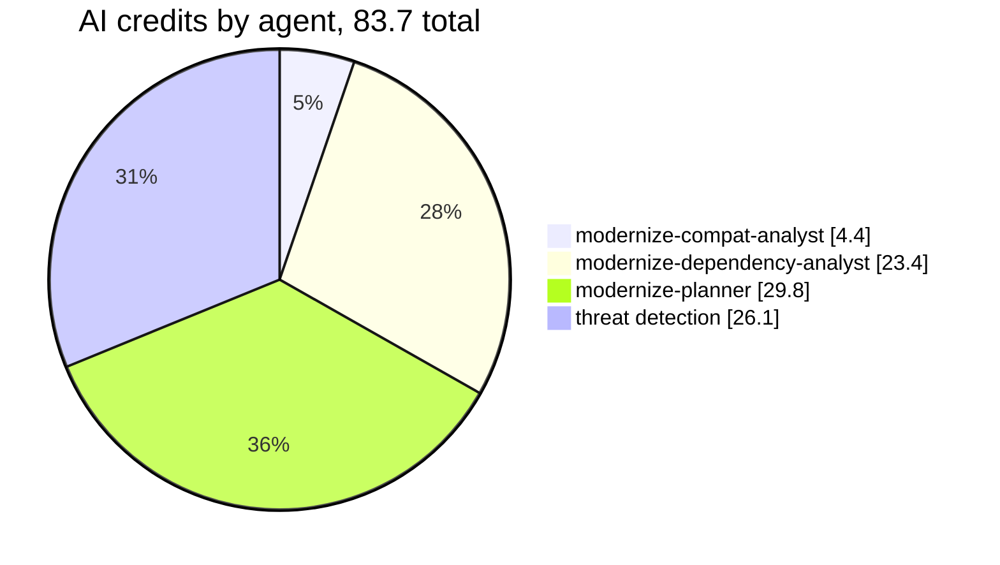

# Asset Manager Java Modernization Plan

## Request

- Issue: #38
- Business outcome: run Asset Manager on Java 21 and Spring Boot 3.5.16, with no `javax` namespace left that belongs to Jakarta EE, and with the known dependency advisories re-scanned.
- Assessment: [assessment.md](assessment.md), assessed commit `d655d5a0636c`.
- Assessment approved by @lenvolk on 2026-10-20T21:57:50Z (gate 1).

## Run Parameters

```yaml
issue: 38
project: asset-manager
source: { java: 8, spring-boot: "2.7.18" }
target: { java: 21, spring-boot: "3.5.16" }
maven-wrapper: "keep (3.9.9)"
```

## Assessment Summary

| Measure | Value |
|---|---|
| Code | 26 classes, 1207 lines (web 15 classes / 688 lines / 0 test classes; worker 11 classes / 519 lines / 1 test class) |
| Tests at baseline (JDK 8) | 4 run, 0 failed, 1 error: `S3FileProcessingServiceTest.downloadOriginalCopiesFileFromS3` (Mockito cannot mock `ResponseInputStream`) |
| `javax` imports to migrate | 9 in 5 files |
| JDK internal API use (jdeps) | 7 dependencies |
| Known advisories (OSV.dev) | 169 (17 critical, 64 high, 71 moderate, 17 low) |
| Findings | 32: 9 Blocker, 8 Change, 7 Watch, 8 No change |



The assessment has no `## Reviewer notes at gate 1` section. Its "Decisions for the reviewer" checklist is applied as follows:

- Drop the explicit `jakarta.servlet-api` dependency the OpenRewrite preview adds to `web/pom.xml`; `spring-boot-starter-web` provides it.
- Run a smoke check on `web` (list page and one view page) because it has no tests.
- Keep `ddl-auto=update`, run once against a copy of the database before merge (human task, see Risks).
- Fix the baseline Mockito error if the upgrade allows, otherwise explain why not.
- Spring Boot 4.x stays out of scope.

## Scope

In scope:

- Java 8 to 21 and Spring Boot 2.7.18 to 3.5.16 for modules `web` and `worker`.
- `javax` to `jakarta` for Jakarta EE packages, removed Spring MVC adapters, and the dependency versions in the findings.

Out of scope: Azure service migration, containerization, deployment, CI/CD, observability, production rollout, Spring Boot 4, new tests for `web`. `javax.imageio.*` stays, it ships with the JDK.

## Execution Plan



### Step 1 - modernize-build-upgrader

Owns: D-01, D-02, C-09, C-16, C-17, D-05, D-06, D-07, D-08.

Files it may change: `asset-manager/pom.xml`, `asset-manager/web/pom.xml`, `asset-manager/worker/pom.xml`. The Maven Wrapper stays at 3.9.9. Do not add `jakarta.servlet-api`.

```diff
 asset-manager/pom.xml
-  spring-boot-starter-parent  2.7.18
+  spring-boot-starter-parent  3.5.16
-  <java.version>8</java.version>
+  <java.version>21</java.version>
 web/pom.xml and worker/pom.xml
-  aws-sdk.version       2.25.13
+  aws-sdk.version       2.57.1
-  org.postgresql:postgresql  42.3.8
+  org.postgresql:postgresql  42.7.14
-  org.projectlombok:lombok   1.18.30
+  org.projectlombok:lombok   1.18.48
 worker/pom.xml
-  jackson-databind explicit version 2.13.5
+  (version removed, managed by the Boot BOM)
```

Commit messages: `build(D-01,D-02,C-09): ...`, `build(D-05,D-06,D-07,C-17): ...`, `build(D-08,C-16): ...`.

Done when: both POMs resolve on JDK 21, the versions above are in place, and the dependency tree shows the BOM-managed logback and Jackson.

### Step 2 - modernize-code-fixer

Owns: C-01, C-02, C-03, C-04, C-05, C-06, C-07, C-08, C-18, C-19, C-20, C-21, C-22, D-09, D-10.

Files it may change: Java sources and tests under `asset-manager/web/src` and `asset-manager/worker/src`, and `web/src/main/resources` only if a smoke check proves a need. No POM changes.

```diff
 web/.../config/WebMvcConfig.java
-class WebMvcConfig extends WebMvcConfigurerAdapter
+class WebMvcConfig implements WebMvcConfigurer
-class ...Interceptor extends HandlerInterceptorAdapter
+class ...Interceptor implements HandlerInterceptor
-import javax.servlet.http.*
+import jakarta.servlet.http.*
 web/.../model/ImageMetadata.java, worker/.../model/ImageMetadata.java
-import javax.persistence.*
+import jakarta.persistence.*
 LocalFileStorageService.java, LocalFileProcessingService.java
-import javax.annotation.PostConstruct
+import jakarta.annotation.PostConstruct
```

Watch items (C-18 to C-22, D-09, D-10) need no source change unless a check fails. The fixer records the result of each: the RabbitMQ ack and nack path, `/storage` without a trailing slash, the list page script output, the baseline Mockito test, the `ddl-auto` setting, and the jdeps re-run. If the Mockito test still fails, it explains why in the commit body.

Commit messages: `fix(C-01,C-02,C-03): ...`, `fix(C-04,C-05,C-08): ...`, `fix(C-06,C-07): ...`, `fix(C-21): ...`.

Done when: both modules compile and test on JDK 21, tests are no worse than baseline, and no Jakarta EE `javax` import remains.

### Step 3 - verification

Deterministic checks, no AI:

- Baseline captured first, then a JDK 21 build and test run of both modules.
- Version checks against Run Parameters and a namespace grep.
- jdeps re-run and OSV.dev re-scan, reported against the baseline.

### Step 4 - review

`modernize-conformance-reviewer` (spec) and `modernize-standards-reviewer` (standards) run in parallel on all findings and the diff. They write the findings into the draft Implementation pull request.

## Finding Coverage

| ID | Rank | Finding | Step | Agent | Verified by |
|---|---|---|---|---|---|
| C-01 | Blocker | WebMvcConfigurerAdapter removed | Step 2 | modernize-code-fixer | verify-build |
| C-02 | Blocker | HandlerInterceptorAdapter removed | Step 2 | modernize-code-fixer | verify-build |
| C-03 | Blocker | javax.servlet.http imports in WebMvcConfig | Step 2 | modernize-code-fixer | verify-static |
| C-04 | Blocker | javax.persistence in web ImageMetadata | Step 2 | modernize-code-fixer | verify-static |
| C-05 | Blocker | javax.annotation.PostConstruct in LocalFileStorageService | Step 2 | modernize-code-fixer | verify-static |
| C-06 | Blocker | javax.persistence in worker ImageMetadata | Step 2 | modernize-code-fixer | verify-static |
| C-07 | Blocker | javax.annotation.PostConstruct in LocalFileProcessingService | Step 2 | modernize-code-fixer | verify-static |
| D-01 | Blocker | Spring Boot parent 2.7.18 to 3.5.16 | Step 1 | modernize-build-upgrader | verify-static |
| D-02 | Blocker | java.version 8 to 21 | Step 1 | modernize-build-upgrader | verify-static |
| C-08 | Change | Wildcard java.nio.file import made explicit | Step 2 | modernize-code-fixer | verify-build |
| C-09 | Change | Parent 3.5.16 and java.version 21 | Step 1 | modernize-build-upgrader | verify-static |
| C-16 | Change | logback 1.2.12 uses removed internal API | Step 1 | modernize-build-upgrader | verify-build |
| C-17 | Change | Lombok from the 2.7 BOM uses javac internals | Step 1 | modernize-build-upgrader | verify-build |
| D-05 | Change | AWS SDK S3 2.25.13 to 2.57.1 | Step 1 | modernize-build-upgrader | verify-static |
| D-06 | Change | PostgreSQL driver 42.3.8 to 42.7.14 | Step 1 | modernize-build-upgrader | verify-static |
| D-07 | Change | Lombok 1.18.30 to 1.18.48 | Step 1 | modernize-build-upgrader | verify-static |
| D-08 | Change | jackson-databind explicit 2.13.5 removed | Step 1 | modernize-build-upgrader | verify-static |
| C-18 | Watch | Manual-ack RabbitListener after AMQP 3.x | Step 2 | modernize-code-fixer | Spec review |
| C-19 | Watch | Trailing slash matching off in Spring 6 | Step 2 | modernize-code-fixer | Spec review |
| C-20 | Watch | list.html serializes Instant fields to script | Step 2 | modernize-code-fixer | Spec review |
| C-21 | Watch | Baseline Mockito error on ResponseInputStream | Step 2 | modernize-code-fixer | verify-build |
| C-22 | Watch | ddl-auto=update with Hibernate 6 | Step 2 | modernize-code-fixer | Spec review |
| D-09 | Watch | logback upgraded by the BOM | Step 2 | modernize-code-fixer | verify-build |
| D-10 | Watch | sun.misc.Unsafe users upgraded by the BOM | Step 2 | modernize-code-fixer | verify-build |
| C-10 | No change | Paths.get stays valid | none | none | verify-static |
| C-11 | No change | Paths.get stays valid in worker | none | none | verify-static |
| C-12 | No change | javax.imageio ships with the JDK | none | none | verify-static |
| C-13 | No change | Property keys unchanged in Boot 3.x | none | none | verify-static |
| C-14 | No change | Thymeleaf expression objects kept in 3.1 | none | none | verify-static |
| C-15 | No change | sun.misc.Unsafe warnings only | none | none | verify-static |
| D-03 | No change | Maven Wrapper 3.9.9 is sufficient | none | none | verify-static |
| D-04 | No change | Starters are BOM-managed | none | none | verify-static |

## Validation

- Capture the baseline first: 4 tests run, 0 failed, 1 error (`S3FileProcessingServiceTest.downloadOriginalCopiesFileFromS3`). Never assume it is green.
- Build both modules on JDK 21; tests no worse than baseline; both jars package.
- No `javax.persistence|annotation|servlet|validation` imports remain; `javax.imageio` stays.
- Versions match the Run Parameters (Boot 3.5.16, Java 21, Maven Wrapper 3.9.9).
- OSV advisories after the upgrade are reported against the baseline of 169.
- Smoke check of `web` (list page, one view page, `/storage`) is recorded, since `web` has no tests.

## Risks and Rollback

| Risk | Likelihood | Impact | Mitigation | Findings |
|---|---|---|---|---|
| `web` has no tests, so behavior is not proven | High | Medium | Smoke check of list and view pages; human review of the PR | C-19, C-20 |
| Hibernate 6 changes schema update behavior | Medium | High | Run once against a copy of the database before merge (human) | C-22 |
| RabbitMQ manual ack path changes under AMQP 3.x | Medium | Medium | Verify an ack and a nack round trip | C-18 |
| Baseline Mockito test still fails | Medium | Low | Fixer fixes or explains in the commit | C-21 |
| BOM-managed logback and Unsafe users not as expected | Low | Medium | jdeps re-run in verification | D-09, D-10 |
| `worker` has one test class only | Medium | Medium | Build and test on JDK 21, human review | C-06, C-07 |

Rollback: every stage can be re-run. Nothing reaches `main` until a human merges the Implementation pull request. Closing that pull request and deleting its branch undoes the run.

## Cost Estimate


Filled in by the pipeline from measured token counts, not by the planner agent.

Predicted cost, made at gate 1. The execution stage starts when this pull request is merged:

Predicted at gate 1 for every stage:

| Stage | AI tokens | AI credits | AI USD | Runner minutes | Runner USD | Basis |
|---|---:|---:|---:|---:|---:|---|
| Assessment (actual) | 2.38M | 38.8 | $0.39 | 27 | $0.00 (public; $0.16 if private) | AI: actual; minutes: this run |
| Plan (predicted) | 648.7K | 46.0 (36.6 to 70.8) | $0.46 ($0.37 to $0.71) | 12 | $0.00 (public; $0.07 if private) | AI: measured token profile; minutes: baseline (no past run in this repo) |
| Execution (predicted) | 2.26M | 112.3 (90.0 to 197.3) | $1.12 ($0.90 to $1.97) | 46 | $0.00 (public; $0.28 if private) | AI: measured token profile; minutes: baseline (no past run in this repo) |
| **Total** | **5.28M** | **197.0 (165.3 to 306.8)** | **$1.97 ($1.65 to $3.07)** | **85** | **$0.00 (public; $0.51 if private)** | |

AI: 1 credit = $0.01, [Copilot models and pricing](https://docs.github.com/en/copilot/reference/copilot-billing/models-and-pricing). Runner minutes: standard Linux runner, each job rounded up to a whole minute, $0.006 per minute ([Actions runner pricing](https://docs.github.com/en/billing/reference/actions-runner-pricing), read 2026-10-20). This repository is public; standard runners are free on public repositories.

<!-- modernize-cost-json:predicted {"version":1,"generated_at":"2026-10-20T21:54:05+00:00","repo":"lenvolk/java-migration-copilot-samples","run":"39502651438","private":false,"rate":0.006,"loc":1287,"stages":{"assessment":{"kind":"actual","ai_credits":38.752123000000005,"ai_low":null,"ai_high":null,"tokens":2375170,"minutes":27,"minutes_source":"this run"},"plan":{"kind":"predicted","ai_credits":45.95008,"ai_low":36.614143,"ai_high":70.845912,"tokens":648712,"minutes":12,"minutes_source":"baseline"},"execution":{"kind":"predicted","ai_credits":112.29510049999999,"ai_low":89.97995255000001,"ai_high":197.2502257,"tokens":2257345,"minutes":46,"minutes_source":"baseline"}}} -->

Execution stage, per agent:

| Stage | Agent | Model | Requests | Input | Output | Cache read | Cache write | AI credits (range) | USD (range) |
|---|---|---|---:|---:|---:|---:|---:|---|---|
| Execution | `modernize-build-upgrader` | `claude-haiku-5.5` | ~11 | 6.4K | 6.5K | 406.4K | 46.4K | 1.4 (1.0 to 2.5) | $0.01 ($0.01 to $0.02) |
| Execution | `modernize-code-fixer` | `claude-sonnet-5.5` | ~13 | 6.5K | 4.1K | 475.2K | 44.4K | 21.2 (14.8 to 63.6) | $0.21 ($0.15 to $0.64) |
| Execution | `modernize-conformance-reviewer` | `claude-sonnet-5.5` | ~10 | 5.4K | 6.0K | 389.2K | 53.8K | 24.5 (17.1 to 44.0) | $0.24 ($0.17 to $0.44) |
| Execution | `modernize-standards-reviewer` | `claude-sonnet-5` | ~11 | 6.4K | 5.1K | 408.0K | 51.1K | 27.4 (19.1 to 49.2) | $0.27 ($0.19 to $0.49) |
| All | threat detection after each agent (4 runs, same model as the agent) | | ~8 | | | | | 37.9 | $0.38 |
| **Total** | | | | | | | | **112.3 (90.0 to 197.3)** | **$1.12 ($0.90 to $1.97)** |

Estimate from token counts measured on a full real run of this pipeline (2026-10-19). Prices: [GitHub Copilot models and pricing](https://docs.github.com/en/copilot/reference/copilot-billing/models-and-pricing), read 2026-10-19. 1 AI credit = $0.01. Credits count against the Copilot plan of the `COPILOT_GITHUB_TOKEN` owner; usage beyond the plan's included credits is billed. Deterministic jobs (tests, Maven, OpenRewrite, OSV) use GitHub Actions minutes and no AI credits.

AI credits already used by the assessment and plan (recorded by gh-aw in this run):

| Agent | Model used | Requests | Input | Output | Cache read | Cache write | AI credits | USD |
|---|---|---:|---:|---:|---:|---:|---:|---:|
| `modernize-compat-analyst` | `claude-haiku-5.5` | 17 | 6.4K | 43.6K | 1.03M | 91.6K | 4.4 | $0.04 |
| `modernize-dependency-analyst` | `claude-haiku-4.5` | 19 | 5.9K | 17.0K | 645.7K | 62.6K | 23.4 | $0.23 |
| `modernize-planner` | `claude-sonnet-5.5` | 11 | 6.7K | 9.1K | 438.2K | 60.2K | 29.8 | $0.30 |
| threat detection (3 runs) | `claude-haiku-4.5, claude-haiku-5.5, claude-sonnet-5.5` | 14 | | | | | 26.1 | $0.26 |
| **Total** | | | | | | | **83.7** | **$0.84** |



_Slices show the share of the total; the legend shows the credits._

Recorded by gh-aw for every model request (`token_usage.jsonl` in the `*-usage` artifacts of this run). 1 AI credit = $0.01.

## Approval Checklist

- [ ] Targets are right: Java 21, Spring Boot 3.5.16, Maven Wrapper kept at 3.9.9.
- [ ] Scope is right, and out-of-scope items are accepted.
- [ ] Every Blocker (C-01 to C-07, D-01, D-02) is owned by a step.
- [ ] Risks are accepted, including no tests for `web`.
- [ ] Cost estimate is accepted.
